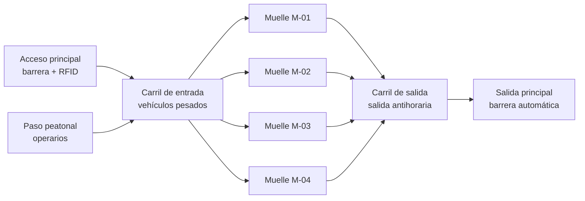
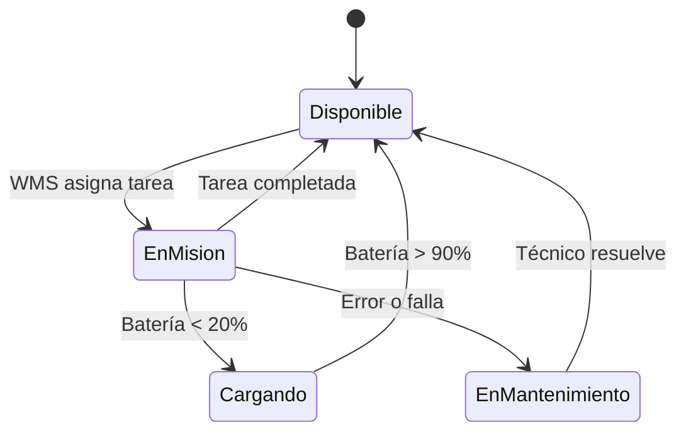
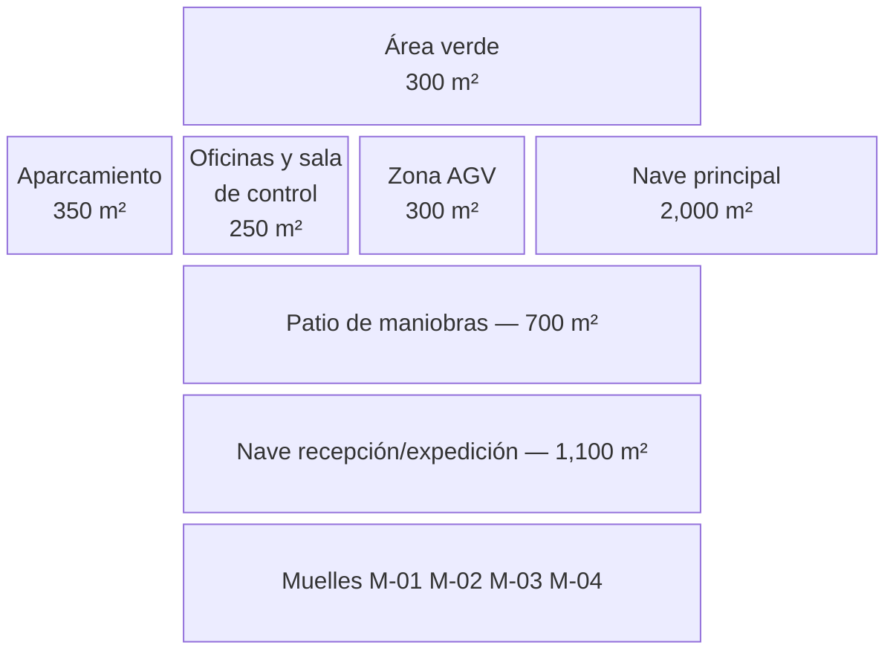
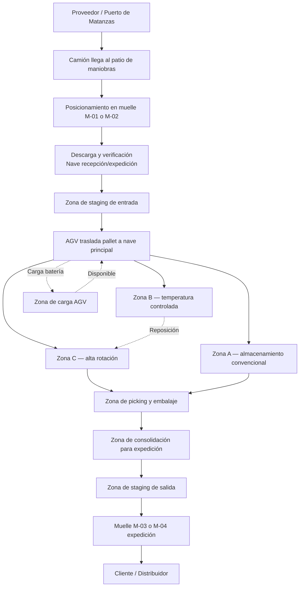
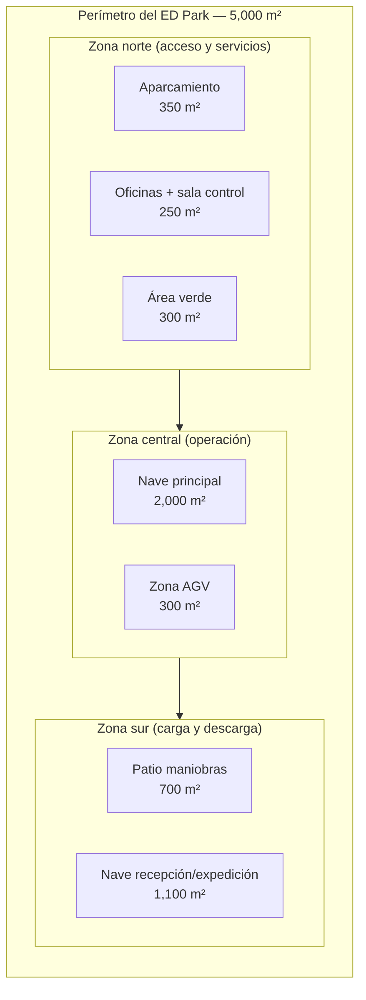

# Infraestructura física del ED Park

## Objetivo de la sección

El objetivo de esta sección es describir de forma técnica y detallada la infraestructura física del parque logístico ED Park, especificando la distribución de espacios, la organización interna de cada nave, los muelles de carga, el patio de maniobras, las zonas de almacenamiento y picking, las oficinas, la zona de carga de AGV, el aparcamiento y el área verde. Esta descripción constituye la base sobre la cual se diseña posteriormente la infraestructura de telecomunicaciones, la distribución de equipos y el plan de montaje e instalación.

---

> ⚠️ **Aclaración: diseño virtual, no construcción real**
>
> El presente documento forma parte de un proyecto académico de maestría. Toda la infraestructura descrita en esta sección corresponde a un **diseño virtual** elaborado con fines educativos y de gestión de proyectos. No se construye ninguna estructura física real, no se adquieren materiales de construcción, no se contrata obra civil y no se ejecuta ninguna labor de edificación. Los planos, dimensiones, capacidades y especificaciones indicadas se definen exclusivamente para soportar el análisis técnico, el diseño de redes, la planificación del montaje y la elaboración del presupuesto del proyecto.

---

## 1. Distribución general del terreno

El ED Park ocupa una superficie total de **5,000 m²** (0.5 hectáreas), distribuida entre siete zonas funcionales. La suma de todas las áreas es exactamente 5,000 m², sin superposiciones ni espacios sin asignar.

| Zona | Superficie (m²) | Función principal |
|------|:--------------:|-------------------|
| Nave principal | 2,000 | Almacenamiento de stock, zonas de picking y embalaje |
| Nave de recepción/expedición | 1,100 | Muelles de carga, verificación, consolidación y despacho |
| Patio de maniobras | 700 | Circulación de camiones, contenedores y vehículos de apoyo |
| Aparcamiento | 350 | Estacionamiento del personal y visitas |
| Zona AGV/AMR | 300 | Rutas de circulación y estación de carga de vehículos automatizados |
| Oficinas y sala de control | 250 | Administración, logística, soporte IT y control operativo |
| Área verde y expansión | 300 | Señalización perimetral, zonas ajardinadas y reserva de expansión |
| **TOTAL** | **5,000** | |

**Verificación**: 2,000 + 1,100 + 700 + 350 + 300 + 250 + 300 = **5,000 m²** ✓

---

## 2. Nave principal (2,000 m²)

### 2.1 Función y descripción general

La nave principal es el núcleo operativo del ED Park. En ella se almacena la mayor parte del inventario de productos electrónicos y se ejecutan los procesos de picking, preparación y embalaje de pedidos. Su diseño prioriza la accesibilidad de los pasillos para AGV y operarios, la eficiencia en la extracción de stock y el control ambiental para la mercancía sensible.

La nave tiene planta rectangular, estructura metálica con cubierta de panel sándwich, y está preparada para la instalación de infraestructura de red, sistemas de iluminación LED con sensor de presencia y control de acceso por zonas. La altura libre interior es de 8 m, lo que permite alojar estanterías de hasta 6 niveles.

### 2.2 Distribución interna

| Subzona | Superficie (m²) | Descripción |
|---------|:--------------:|-------------|
| Zona de almacenamiento A (estanterías convencionales) | 700 | Pallets de productos de mayor volumen y rotación media-alta |
| Zona de almacenamiento B (estanterías de temperatura controlada) | 250 | Componentes electrónicos sensibles a la humedad y temperatura |
| Zona de almacenamiento C (productos de alta rotación) | 300 | Stock de alta frecuencia de salida, ubicado cerca del área de picking |
| Zona de picking y preparación | 350 | Mesas de trabajo, escáneres, impresoras de etiquetas y embalaje |
| Pasillos de circulación AGV (principales) | 250 | Corredores de 3 m de ancho para AGV y carretillas |
| Pasillos de operario (secundarios) | 100 | Accesos laterales de 1.2 m para personal a pie |
| Zona de devoluciones y revisión | 50 | Área de clasificación e inspección de mercancía devuelta |
| **Subtotal nave principal** | **2,000** | |

### 2.3 Estanterías

| Tipo de estantería | Zona | Niveles | Altura (m) | Carga por nivel |
|---|---|:---:|:---:|---|
| Estantería selectiva convencional | A | 5 | hasta 6 m | 1,000–1,500 kg/nivel |
| Estantería de temperatura controlada | B | 4 | hasta 4.8 m | 500 kg/nivel |
| Estantería de flujo/FIFO | C | 3 | hasta 3.6 m | 800 kg/nivel |
| Mesa de picking (banco de trabajo) | Zona picking | — | 0.9 m | 200 kg |

### 2.4 Control ambiental en zona B

La zona B de temperatura controlada aloja productos electrónicos que requieren condiciones estables. Se instalan unidades de climatización de precisión capaces de mantener temperatura entre 18 °C y 25 °C y humedad relativa entre 40 % y 60 %. Esta zona está físicamente delimitada por mamparas fijas y cuenta con sistema de monitoreo de temperatura y humedad mediante sensores IoT conectados a la red industrial del parque.

Referencia normativa: **ГОСТ Р МЭК 62443-3-3-2016** (seguridad del entorno y datos de sensores IoT).

### 2.5 Zona de picking y preparación

La zona de picking (350 m²) está equipada con:

- mesas de trabajo modulares con iluminación localizada;
- terminales de mano con lector RFID y escáner de código de barras;
- impresoras de etiquetas para envíos y transferencias internas;
- estaciones de embalaje con film stretch y material de protección;
- pantallas de visualización con tareas del WMS;
- acceso directo a los pasillos de AGV para traslado inmediato de unidades preparadas.

La zona de devoluciones (50 m²) tiene una zona de cuarentena donde los productos esperan revisión antes de ser reintegrados al stock o enviados al área de revisión técnica.

---

## 3. Nave de recepción/expedición (1,100 m²)

### 3.1 Función y descripción general

La nave de recepción/expedición es el punto de entrada y salida de mercancías del ED Park. En ella se realizan las operaciones de descarga de camiones, verificación de bultos, control de calidad inicial, asignación de ubicaciones y consolidación de pedidos para despacho. Su posición en el plano es contigua a los muelles de carga y al patio de maniobras, optimizando el flujo de entrada y salida de vehículos.

La nave tiene altura libre de 7 m, cubierta metálica y puertas seccionales en los muelles. Está separada físicamente de la nave principal por un corredor de transferencia, lo que permite controlar el flujo de mercancías y mantener la seguridad del inventario.

### 3.2 Distribución interna

| Subzona | Superficie (m²) | Descripción |
|---------|:--------------:|-------------|
| Zona de muelles de carga (4 posiciones) | 280 | Área de descarga directa desde camiones, con rampas y niveladoras hidráulicas |
| Zona de verificación y control de calidad | 200 | Inspección visual, pesaje, escaneo RFID y verificación de albarán |
| Zona de staging de entrada | 150 | Espera temporal de mercancía recibida antes de clasificación y almacenamiento |
| Zona de consolidación para expedición | 200 | Agrupación de pedidos por ruta o cliente antes de carga |
| Zona de staging de salida | 120 | Carga lista para embarque en espera del camión asignado |
| Pasillos y zonas de circulación | 100 | Corredores de 3 m de ancho para transpaletas y operarios |
| Área de gestión documental y control | 50 | Puesto de trabajo para documentación de entradas/salidas |
| **Subtotal nave recepción/expedición** | **1,100** | |

### 3.3 Muelles de carga

El ED Park dispone de **4 muelles de carga** en la nave de recepción/expedición, con capacidad de ampliación a 6 posiciones si el volumen operativo lo requiere (este margen está contemplado en la variante completa del proyecto).

| Atributo | Especificación |
|----------|---------------|
| Número de muelles operativos | 4 (ampliables a 6) |
| Tipo de nivelador | Hidráulico, plataforma abatible |
| Capacidad de carga por nivelador | hasta 6,000 kg |
| Altura de nivelación | 0.85 m a 1.35 m sobre el nivel del suelo |
| Sellado de muelle | Cortina de goma con sello perimetral |
| Puerta seccional | Apertura automática, altura libre 4.5 m |
| Iluminación | LED industrial, 500 lux en zona de trabajo |
| Control de acceso | Lector RFID por muelle, integrado con WMS |
| Marcado vial | Franjas amarillas de delimitación, señalización GOST |

**Asignación de muelles:**

| Muelle | Uso principal | Turno operativo |
|--------|--------------|-----------------|
| M-01 | Recepción de mercancía (entrada) | Turno 1 y 2 |
| M-02 | Recepción de mercancía (entrada) | Turno 1 |
| M-03 | Expedición (salida de pedidos) | Turno 1 y 2 |
| M-04 | Expedición / devoluciones / multiuso | Turno 2 |

Referencia normativa: **ГОСТ Р ИСО 15745-4-2010** (integración de sistemas de control en infraestructura logística).

### 3.4 Zona de verificación y control de calidad

El proceso de verificación en la nave de recepción incluye:

1. Descarga de la mercancía del vehículo de transporte.
2. Identificación del bulto por código de barras o etiqueta RFID.
3. Verificación de albarán contra orden de compra en el WMS.
4. Pesaje en báscula digital integrada con el sistema.
5. Inspección visual de estado (daños, humedad, embalaje incorrecto).
6. Asignación automática de ubicación de destino por el WMS.
7. Traslado a zona de staging para transporte a nave principal.

---

## 4. Patio de maniobras (700 m²)

### 4.1 Función y descripción

El patio de maniobras es el espacio exterior cubierto entre los muelles y la vía de acceso al parque. Su función es proporcionar suficiente espacio para que los vehículos pesados (camiones de hasta 18 m de longitud) puedan maniobrar, posicionarse frente a los muelles y salir sin interferir con el tráfico de entrada.

| Atributo | Especificación |
|----------|---------------|
| Superficie | 700 m² |
| Pavimento | Hormigón armado, resistencia mínima 40 t/eje |
| Radio de giro libre | ≥ 13 m (para camiones articulados) |
| Anchura de carril de maniobra | ≥ 6 m |
| Iluminación exterior | LED industrial, 100 lux mínimo en toda la superficie |
| Señalización horizontal | Pintura vial reflectante, flechas de sentido, franjas de seguridad |
| Señalización vertical | Señales de velocidad máxima, peatones, prioridad de paso |
| Cámaras de vigilancia | 4 cámaras IP industriales con visión nocturna |
| Barrera de acceso | 2 brazos automáticos con lector de matrícula y RFID |

### 4.2 Circulación en el patio

El patio está diseñado con circulación en sentido único antihorario para eliminar cruces peligrosos entre vehículos entrantes y salientes. La separación entre la zona de maniobras de camiones y la zona de circulación de AGV se realiza mediante marcado vial y barreras físicas retráctiles.



---

## 5. Zonas de almacenamiento

### 5.1 Zona A — Almacenamiento convencional (700 m²)

Destinada al grueso del inventario: pallets de equipos de consumo, cajas de componentes y repuestos industriales de rotación media-alta. El sistema FIFO (First In, First Out) se implementa mediante la numeración de ubicaciones en el WMS y la asignación automática.

| Parámetro | Valor |
|-----------|-------|
| Superficie | 700 m² |
| Número de pasillos | 5 pasillos de 50 m × 3 m de ancho |
| Estanterías por pasillo | 2 filas (una a cada lado) |
| Niveles por estantería | 5 |
| Capacidad total de palets | ~1,400 posiciones |
| Temperatura de operación | 16 °C – 30 °C (ambiente) |
| Sistema de identificación | RFID en cada ubicación + código de barras de pasillo |

### 5.2 Zona B — Almacenamiento de temperatura controlada (250 m²)

Destinada a componentes electrónicos que requieren condiciones ambientales controladas: chips, módulos de memoria, sensores de precisión y dispositivos fotoeléctricos.

| Parámetro | Valor |
|-----------|-------|
| Superficie | 250 m² |
| Temperatura | 18 °C – 25 °C (±1 °C) |
| Humedad relativa | 40 % – 60 % (±3 %) |
| Sistema de climatización | 2 unidades de precisión de 5 kW cada una |
| Monitoreo | Red de sensores IoT (temperatura + humedad) cada 10 m² |
| Alarma | Activación automática ante desviación de ±3 °C |
| Acceso restringido | Control RFID, solo personal autorizado |
| Norma aplicable | **ГОСТ Р МЭК 62443-3-3-2016** (seguridad del entorno y acceso) |

### 5.3 Zona C — Stock de alta rotación (300 m²)

Área de acceso rápido para los productos con mayor frecuencia de salida diaria. Se ubica en la parte más próxima a la zona de picking para minimizar el tiempo de desplazamiento.

| Parámetro | Valor |
|-----------|-------|
| Superficie | 300 m² |
| Tipo de almacenamiento | Estanterías de flujo por gravedad (FIFO automático) |
| Reposición | Automática desde zona A mediante AGV |
| Capacidad | ~300 posiciones de picking |
| Sistema de identificación | RFID en cada cubículo de picking |

---

## 6. Zonas de picking y embalaje

### 6.1 Zona de picking (incluida en nave principal — 350 m²)

La zona de picking está equipada para que los operarios realicen la preparación de pedidos con el apoyo del sistema WMS y los AGV. El WMS genera rutas optimizadas de picking que el operario sigue mediante una terminal de mano o pantalla de picking by voice.

**Equipamiento de la zona de picking:**

| Elemento | Cantidad | Función |
|----------|:--------:|---------|
| Mesas de trabajo modulares | 8 | Preparación y revisión de pedidos |
| Terminales de mano (WMS) | 10 | Guía de picking, confirmación de unidades |
| Impresoras de etiquetas | 4 | Etiquetado de bultos y transferencias internas |
| Básculas digitales | 3 | Verificación de peso antes del embalaje |
| Lectores RFID fijos (pórtico) | 2 | Verificación de salida de la zona de picking |
| Puestos de embalaje con film | 4 | Sellado, precintado y preparación final |
| Contenedores de material de embalaje | 6 | Cajas, relleno, cinta adhesiva, esquineras |
| Pantallas de visualización WMS | 6 | Tareas pendientes, alertas, estado de AGV |

### 6.2 Proceso de picking paso a paso

```mermaid
sequenceDiagram
    participant WMS as WMS
    participant OP as Operario
    participant AGV as AGV/AMR
    participant RFID as Lector RFID

    WMS->>OP: Asignar orden de picking
    OP->>AGV: Solicitar traslado de pallet (vía WMS)
    AGV->>OP: Entregar pallet en zona de picking
    OP->>RFID: Escanear unidad extraída
    RFID->>WMS: Confirmar unidad y ubicación
    WMS->>OP: Confirmar cantidad; indicar siguiente ítem
    OP->>OP: Embalar y etiquetar bulto
    OP->>WMS: Confirmar orden completada
    WMS->>AGV: Trasladar bulto a zona de expedición
```

---

## 7. Oficinas y sala de control (250 m²)

### 7.1 Distribución de las oficinas

Las oficinas del ED Park están ubicadas en un módulo independiente adosado a la nave principal, con acceso separado del área operativa. Esto garantiza que el personal administrativo y técnico trabaje en condiciones adecuadas sin interferir con el flujo de mercancías.

| Área | Superficie (m²) | Ocupantes |
|------|:--------------:|-----------|
| Sala de control operativo (NOC/WMS) | 50 | 2–3 operadores de sistema, 1 supervisor de turno |
| Oficina de dirección y logística | 40 | Coordinador general, supervisor de almacén |
| Sala de reuniones | 30 | Capacidad 8 personas |
| Área de soporte IT y ciberseguridad | 30 | 1–2 técnicos de sistemas y red |
| Vestuarios y aseos del personal | 40 | Todo el personal operativo |
| Recepción y control de acceso | 25 | Recepcionista, control de visitas |
| Sala de descanso del personal | 35 | Comedor, microondas, nevera |
| **Subtotal oficinas** | **250** | |

### 7.2 Sala de control (NOC / WMS)

La sala de control es el centro nervioso de la operación del ED Park. Desde aquí el supervisor de turno y los operadores de sistema controlan el estado de todos los procesos en tiempo real.

**Equipamiento de la sala de control:**

| Elemento | Cantidad | Función |
|----------|:--------:|---------|
| Servidores rack (WMS, SCADA, control AGV) | 2–3 | Procesamiento central de la operación |
| Consolas de monitoreo (pantallas 27″) | 4 | Visualización de WMS, red, SCADA, cámaras |
| Panel de videovigilancia (pantalla 55″) | 1 | Vista consolidada de todas las cámaras del parque |
| Switches de núcleo de la red | 2 | Agregación de toda la infraestructura de red |
| SAI / UPS industrial | 2 | Alimentación ininterrumpida para equipos críticos |
| Sistema de climatización de precisión | 1 | Control de temperatura para equipos de rack |
| Acceso biométrico + RFID | 1 | Control de acceso restringido |
| Teléfono industrial | 2 | Comunicación con muelles y zona operativa |

Referencia normativa: **ГОСТ Р МЭК 61850-3** (requisitos de comunicación en entornos industriales críticos).

---

## 8. Zona de carga de AGV (300 m²)

### 8.1 Función y descripción

La zona AGV es el área reservada para la circulación, estacionamiento y recarga de los vehículos automatizados (AGV/AMR) del ED Park. Su diseño garantiza que los AGV puedan moverse sin obstáculos y recargarse sin interrumpir el flujo operativo de la nave principal.

| Atributo | Especificación |
|----------|---------------|
| Superficie | 300 m² |
| Número de estaciones de carga | 6 (para 5–8 AGV en rotación) |
| Tipo de carga | Inductiva automática (en reposo) + manual de emergencia |
| Tiempo de carga completa | 2–4 horas (dependiendo del modelo de AGV) |
| Tensión de carga | 48 V DC industrial |
| Ancho de pasillo de circulación AGV | 3 m mínimo |
| Sistema de guiado | Cinta magnética en suelo + Wi-Fi 6/6E para control de flota |
| Marcado en suelo | Franjas amarillas, señalización de prioridad, zonas de parada |
| Acceso humano | Restringido cuando hay AGV en movimiento (barreras de luz) |
| Integración con WMS | Comunicación permanente vía red industrial |

### 8.2 Flujo de operación de la zona AGV



### 8.3 Rutas de AGV en el parque

Los AGV circulan por rutas predefinidas que conectan:

- Zona de staging de entrada (nave recepción) → Zona A, B y C (nave principal)
- Zona C (alta rotación) → Zona de picking (nave principal)
- Zona de picking → Zona de consolidación (nave recepción/expedición)
- Zona AGV (estación de carga) → cualquier punto de origen

Las rutas se programan y supervisan desde la sala de control mediante el sistema de control de flota AGV, integrado con el WMS.

Referencia normativa: **ГОСТ Р 70982-2023** (V2X/V2I — interacción de vehículos y la infraestructura).

---

## 9. Aparcamiento (350 m²)

### 9.1 Descripción

El aparcamiento del ED Park está destinado al estacionamiento de los vehículos del personal, visitas, transportistas y vehículos de servicio. Está ubicado en la zona perimetral del parque, separado del patio de maniobras para evitar interferencias entre tráfico pesado y vehículos ligeros.

| Atributo | Especificación |
|----------|---------------|
| Superficie | 350 m² |
| Plazas para vehículos ligeros | 12–14 plazas (incluye 2 accesibles) |
| Plazas para motocicletas/bicicletas | 6 plazas |
| Pavimento | Asfalto o adoquín prefabricado |
| Iluminación | LED exterior, 50 lux en toda la zona |
| Cámara de vigilancia | 2 cámaras IP exteriores |
| Señalización horizontal | Pintura vial reflectante |
| Acceso | Conectado al acceso principal del parque |

---

## 10. Área verde y expansión (300 m²)

### 10.1 Descripción

El área verde cumple una doble función: por un lado, mejora el entorno del parque y contribuye a la imagen corporativa; por otro, actúa como reserva de expansión para futuras ampliaciones de la infraestructura física o la instalación de nuevos módulos de servicios.

| Atributo | Especificación |
|----------|---------------|
| Superficie | 300 m² |
| Uso actual | Zonas ajardinadas perimetrales, arbolado de sombra |
| Reserva de expansión | ~150 m² identificados para módulo de servicios o nave auxiliar |
| Puntos de servicio exterior | Tomas de agua, iluminación de emergencia, señalización |
| Valla perimetral | Malla metálica con cimentación, altura 2.4 m |
| Acceso de emergencia | Puerta de emergencia secundaria al perímetro |

---

## 11. Diagrama de planta del ED Park

### 11.1 Diagrama de distribución general (vista en planta)



### 11.2 Diagrama de flujo físico de mercancías



### 11.3 Esquema de zonificación funcional



---

## 12. Resumen de parámetros técnicos por zona

| Zona | Sup. (m²) | Altura libre (m) | Control ambiental | Acceso restringido | GOST de referencia |
|------|:---------:|:----------------:|:-----------------:|:-----------------:|-------------------|
| Nave principal — Zona A | 700 | 8 | No (ambiental) | Sí (RFID) | ГОСТ Р ИСО 15745-4-2010 |
| Nave principal — Zona B | 250 | 8 | Sí (T°/HR) | Sí (RFID) | ГОСТ Р МЭК 62443-3-3-2016 |
| Nave principal — Zona C | 300 | 8 | No | Sí (RFID) | ГОСТ Р ИСО 15745-4-2010 |
| Nave principal — Picking | 350 | 8 | No | Sí (RFID) | — |
| Nave recepción/expedición | 1,100 | 7 | No | Sí | ГОСТ Р ИСО 15745-4-2010 |
| Muelles (4 posiciones) | incl. NR | — | No | Sí | ГОСТ Р ИСО 15745-4-2010 |
| Patio de maniobras | 700 | Ext. | No | Cámaras+barrera | — |
| Zona AGV | 300 | 8 | No | Barreras de luz | ГОСТ Р 70982-2023 |
| Oficinas y sala control | 250 | 3 | Sí (AC) | Biométrico+RFID | ГОСТ Р МЭК 61850-3 |
| Aparcamiento | 350 | Ext. | No | No | — |
| Área verde | 300 | Ext. | No | No | — |

---

## 13. Referencias normativas de la sección

- **ГОСТ Р ИСО 15745-4-2010**. Системы автоматизации производства и их интеграция. Профили. Часть 4. Профили систем управления на основе Ethernet. — М.: Стандартинформ, 2010. — Aplicable a la integración de la infraestructura de control con la red de la nave y los muelles.

- **ГОСТ Р МЭК 62443-3-3-2016**. Системы и меры по обеспечению кибербезопасности промышленных автоматизированных систем. Часть 3-3. — М.: Стандартинформ, 2016. — Aplicable a la zona B (temperatura controlada), la sala de control y el acceso RFID/biométrico.

- **ГОСТ Р МЭК 61850-3**. Коммуникационные системы и сети в электроэнергетике. Часть 3. — Aplicable a la sala de control y la red de comunicaciones industriales del parque.

- **ГОСТ Р 70982-2023**. Безопасность дорожного движения. Системы связи и управления транспортными средствами. Взаимодействие транспортных средств и инфраструктуры. — М.: Стандартинформ, 2023. — Aplicable a la zona AGV, rutas de circulación y sistema V2X/V2I.

- **ГОСТ 7.32-2017**. Отчет о научно-исследовательской работе. Структура и правила оформления. — М.: Стандартинформ, 2017. — Aplicable al formato y estructura del presente documento.

---

## 14. Checklist de la sección

- [x] 2.2.1 Describir naves y su distribución interna (nave principal + nave recepción/expedición)
- [x] 2.2.2 Describir muelles de carga (4 posiciones, capacidad, asignación)
- [x] 2.2.3 Describir patio de maniobras (700 m², función, circulación)
- [x] 2.2.4 Describir zonas de almacenamiento (A convencional, B temperatura controlada, C alta rotación)
- [x] 2.2.5 Describir zonas de picking y embalaje (350 m², equipamiento, proceso)
- [x] 2.2.6 Describir oficinas y sala de control (250 m², NOC, equipamiento)
- [x] 2.2.7 Describir zona de carga de AGV (300 m², estaciones, rutas)
- [x] 2.2.8 Describir aparcamiento (350 m², plazas, acceso)
- [x] 2.2.9 Describir área verde y expansión (300 m², reserva)
- [x] 2.2.10 Generar diagrama de planta (Mermaid)
- [x] 2.2.11 Generar diagrama de flujo físico de mercancías (Mermaid)
- [x] 2.2.12 Verificar que la suma de superficies sea exactamente 5,000 m² ✓
- [x] 2.2.13 Incluir referencias normativas GOST correspondientes
- [x] 2.2.14 Revisar coherencia con la descripción del ED Park (sección 03_01)

---

## 15. Conclusión

La infraestructura física del ED Park está diseñada para soportar operaciones logísticas de productos electrónicos con un nivel de automatización medio. La distribución de 5,000 m² entre siete zonas funcionales garantiza la separación clara de flujos de entrada, almacenamiento, preparación y salida, minimizando la mezcla de actividades y facilitando el diseño posterior de la red de telecomunicaciones, la instalación de equipos y la planificación del montaje. Cada zona ha sido dimensionada en función del volumen operativo esperado, los requisitos técnicos de la mercancía y las necesidades de circulación de los AGV y el personal, asegurando coherencia con el alcance completo del proyecto.
