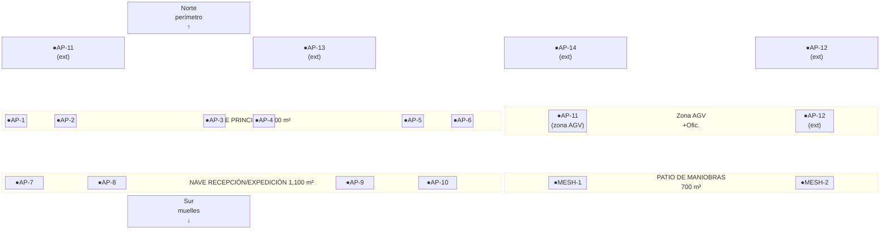
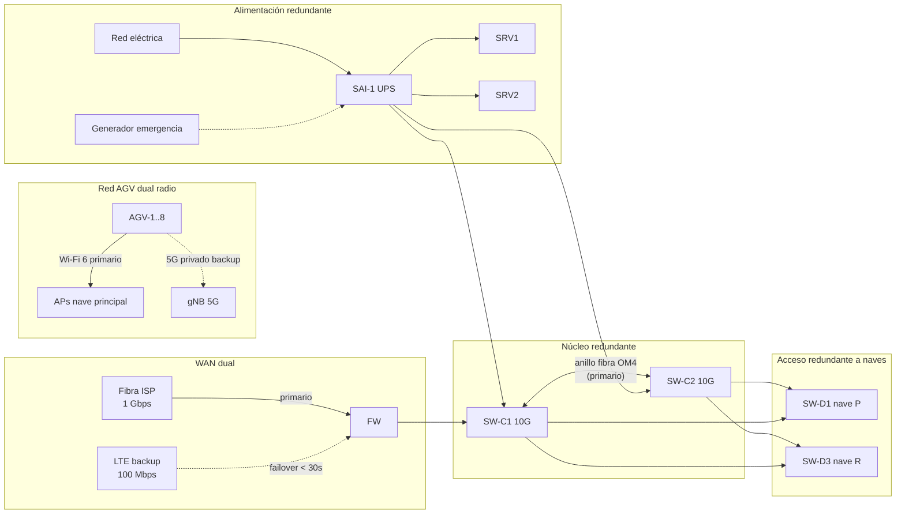
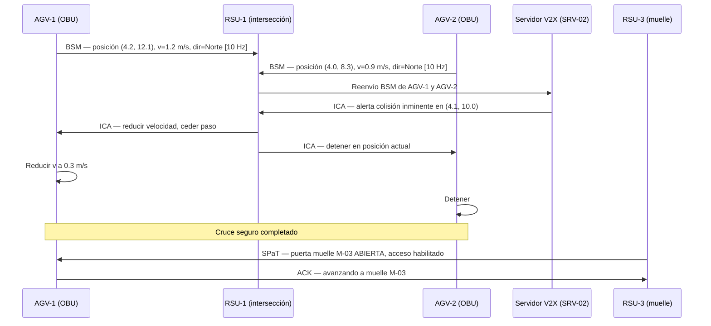
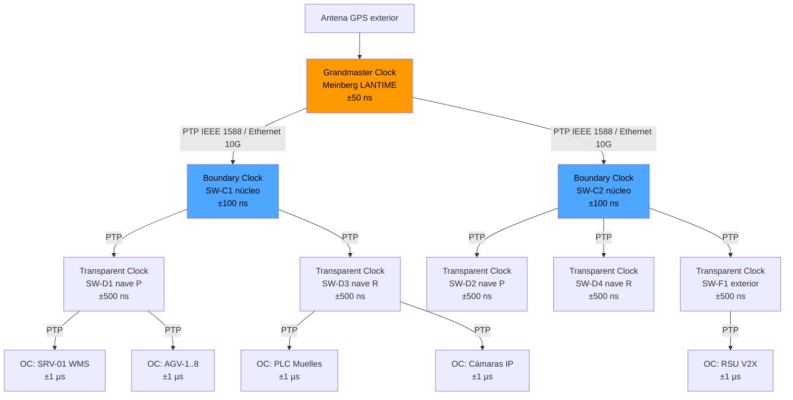

# Infraestructura de Telecomunicaciones del ED Park

## Objetivo de la sección

El objetivo de esta sección es describir en detalle la infraestructura de telecomunicaciones del parque logístico ED Park, cubriendo las 17 tecnologías requeridas por el Tema Nº 12 — «Телекоммуникационная инфраструктура». Para cada tecnología se define su naturaleza técnica, su aplicación concreta en el ED Park, los equipos específicos que la implementan, los estándares GOST e IEEE aplicables y la justificación de su incorporación al proyecto. La sección cierra con la lista consolidada de equipos, los diagramas de topología, cobertura, redundancia, V2X/V2I y sincronización PTP.

> ⚠️ **Aclaración: diseño virtual, no construcción real.** Todo lo descrito en esta sección corresponde a un diseño técnico elaborado con fines académicos. No se adquieren equipos reales, no se instalan cables ni antenas físicas y no se configura ningún sistema real. Los modelos, cantidades y parámetros se definen para soportar el análisis técnico, el presupuesto y la planificación del montaje del proyecto.

---

## 1. Промышленный Wi-Fi — Wi-Fi industrial

### 1.1 Definición

El Wi-Fi industrial es una implementación de redes inalámbricas según la familia de estándares IEEE 802.11, adaptada a entornos con interferencias electromagnéticas, condiciones de temperatura extrema, polvo, vibraciones y altas densidades de dispositivos. A diferencia del Wi-Fi de consumo, el Wi-Fi industrial utiliza puntos de acceso con carcasa robusta (IP67), antenas direccionales de alta ganancia, handover rápido para terminales móviles y soporte de QoS para tráfico crítico de tiempo real.

### 1.2 Aplicación en el ED Park

El Wi-Fi industrial proporciona conectividad inalámbrica a todos los dispositivos móviles del parque: terminales de mano WMS, etiquetas activas RFID, AGV/AMR, escáneres portátiles, tabletas de operarios y cámaras IP. Es la capa de acceso inalámbrico principal en las naves y el patio de maniobras.

### 1.3 Equipos específicos

| Equipo | Modelo de referencia | Cantidad | Ubicación |
|--------|---------------------|:--------:|-----------|
| AP industrial interior | Cisco Catalyst IW9167E (o equiv.) | 8 | Nave principal (4) + nave recepción (4) |
| AP industrial exterior | Cisco Catalyst IW6300 (o equiv.) | 4 | Patio maniobras (2) + zona AGV (2) |
| Controlador Wi-Fi | Cisco WLC 9800-L (o equiv.) | 1 | Sala de control (rack) |

### 1.4 GOST aplicable

- **IEEE 802.11** (estándar base Wi-Fi)
- **ГОСТ Р МЭК 61850-3** — requisitos de comunicación en entornos industriales
- **ГОСТ Р МЭК 62443-3-3-2016** — seguridad de la red inalámbrica industrial

### 1.5 Justificación técnica

La naturaleza móvil de los AGV, operarios y escáneres impone conectividad inalámbrica en toda la superficie operativa. Los APs industriales garantizan continuidad de servicio ante vibraciones, polvo y calor del entorno logístico de Cuba. El controlador centralizado permite gestionar políticas de QoS, seguridad VLAN y roaming sin interrupción para los AGV en movimiento.

---

## 2. Wi-Fi 6/6E — IEEE 802.11ax

### 2.1 Definición

Wi-Fi 6 (IEEE 802.11ax, banda 2.4/5 GHz) y Wi-Fi 6E (extensión a 6 GHz) son la generación actual de Wi-Fi, diseñada para entornos de alta densidad de dispositivos. Sus características clave son: OFDMA (acceso múltiple por división de frecuencia ortogonal), MU-MIMO 8×8, Target Wake Time (TWT) para IoT de baja energía y BSS Coloring para reducir interferencias entre celdas adyacentes. La latencia determinista y el throughput de hasta 9.6 Gbps por AP lo hacen idóneo para automatización industrial.

### 2.2 Aplicación en el ED Park

Wi-Fi 6/6E es la tecnología de acceso inalámbrico principal del ED Park. Soporta simultáneamente: 5–8 AGV en movimiento, 30+ terminales de mano WMS, 50–100 sensores IoT, 10+ cámaras IP y el tráfico de control SCADA. La banda de 6 GHz (6E) se reserva para el tráfico crítico de los AGV, garantizando latencia < 5 ms para comandos de navegación.

### 2.3 Equipos específicos

| Parámetro | Valor |
|-----------|-------|
| Estándar | IEEE 802.11ax (Wi-Fi 6/6E) |
| Bandas | 2.4 GHz / 5 GHz / 6 GHz |
| MIMO | 4×4 MU-MIMO (interior) / 2×2 (exterior) |
| Throughput máximo | hasta 3.6 Gbps por AP (interior) |
| Latencia objetivo (AGV) | < 5 ms (banda 6 GHz) |
| Potencia TX | 23 dBm interior / 27 dBm exterior |
| Protocolo de seguridad | WPA3-Enterprise + 802.1X |

### 2.4 GOST aplicable

- **IEEE 802.11ax** — estándar técnico de referencia
- **ГОСТ Р МЭК 62443-3-3-2016** — autenticación, cifrado y segmentación

### 2.5 Justificación técnica

La alta densidad de dispositivos en la nave principal (operarios + AGV + sensores + cámaras simultáneos) requiere OFDMA para evitar colisiones y degradación del rendimiento. Wi-Fi 6E en banda de 6 GHz proporciona espectro limpio sin interferencia de redes vecinas, crítico para el control de AGV en tiempo real. TWT reduce el consumo de los sensores IoT de batería hasta un 7× respecto a Wi-Fi 5.

---

## 3. Частные LTE-сети — Redes LTE privadas

### 3.1 Definición

Una red LTE privada es una red celular de área local desplegada con equipos de operador pero gestionada de forma autónoma por la organización. Opera en bandas de frecuencia licenciadas o sin licencia (CBRS en EE.UU., bandas industriales en otros países) y proporciona cobertura celular con calidad de servicio garantizada, mayor alcance que Wi-Fi y soporte nativo de movilidad sin roaming entre celdas.

### 3.2 Aplicación en el ED Park

La red LTE privada cubre el exterior del parque: patio de maniobras, perímetro, zona de aparcamiento y accesos. Proporciona conectividad de respaldo para los AGV que operan en el exterior y para los dispositivos de control de acceso (barreras, cámaras IP exteriores). También actúa como canal de redundancia para la comunicación de la sala de control con el exterior ante fallo de la WAN principal.

### 3.3 Equipos específicos

| Equipo | Modelo de referencia | Cantidad | Ubicación |
|--------|---------------------|:--------:|-----------|
| eNodeB LTE indoor/outdoor | Nokia MXAC (o equiv.) | 1 | Sala de control (rack) + antena exterior |
| Módems LTE embarcados en AGV | Sierra Wireless RV55 (o equiv.) | 5–8 | AGV (1 por vehículo) |
| SIM industrial | SIM privada del operador | 15–20 | Todos los dispositivos LTE |

### 3.4 GOST aplicable

- **ГОСТ Р МЭК 61850-3** — comunicaciones en entornos industriales
- **ГОСТ Р МЭК 62443-3-3-2016** — seguridad de la red celular privada

### 3.5 Justificación técnica

El patio de maniobras y el perímetro exterior presentan condiciones de propagación diferentes a las naves cerradas. LTE privado garantiza cobertura exterior con handover fluido entre interior (Wi-Fi 6) y exterior (LTE), sin interrupciones en el control de los AGV al salir de la nave. Además, proporciona una capa de redundancia de comunicación independiente de la red Wi-Fi.

---

## 4. Private 5G — Red 5G privada

### 4.1 Definición

La red 5G privada (también llamada Non-Public Network, NPN, según 3GPP Release 16) es una red celular de quinta generación desplegada exclusivamente para uso de una organización. Ofrece latencia ultra-baja (< 1 ms en configuración URLLC), ancho de banda > 1 Gbps, slicing de red para separar tráficos críticos, y soporte nativo de comunicaciones M2M para miles de dispositivos IoT simultáneos.

### 4.2 Aplicación en el ED Park

La red 5G privada se incorpora en la variante intermedia y completa del proyecto como capa de comunicación de misión crítica para el control de los AGV en tiempo real. Proporciona el canal de baja latencia para los comandos de navegación, la transmisión de datos de sensores LiDAR/cámara de los AGV y la comunicación V2X/V2I con la infraestructura de la nave.

### 4.3 Equipos específicos

| Equipo | Modelo de referencia | Cantidad | Ubicación |
|--------|---------------------|:--------:|-----------|
| gNB 5G indoor (small cell) | Ericsson Radio Dot 5G (o equiv.) | 4 | Nave principal (2) + nave recepción (2) |
| Core 5G privado (UPF+AMF) | Nokia Digital Automation Cloud (o equiv.) | 1 | Sala de control (servidor rack) |
| Módems 5G para AGV | u-blox LEXI-R10 5G (o equiv.) | 5–8 | AGV (1 por vehículo) |

### 4.4 GOST aplicable

- **ГОСТ Р МЭК 61850-3** — comunicaciones de alta fiabilidad en entornos industriales
- **ГОСТ Р 70982-2023** — V2X/V2I sobre redes de nueva generación
- **ГОСТ Р МЭК 62443-3-3-2016** — seguridad de infraestructura 5G privada

### 4.5 Justificación técnica

El control de AGV en movimiento continuo con precisión centimétrica requiere latencia < 5 ms y disponibilidad > 99.99 %. Wi-Fi 6 puede satisfacer esto en condiciones normales, pero 5G privado añade una capa de garantía gracias al slicing de red (canal dedicado para AGV independiente del tráfico de datos general) y la mayor resiliencia ante interferencias de metales y maquinaria.

---

## 5. Ethernet — IEEE 802.3

### 5.1 Definición

Ethernet (IEEE 802.3) es el estándar fundamental de las redes de área local cableadas. Define las capas física y de enlace para la transmisión de datos en redes de cobre y fibra óptica, con velocidades desde 10 Mbps hasta 400 Gbps. Es la base del backbone de cualquier infraestructura de red empresarial e industrial.

### 5.2 Aplicación en el ED Park

Ethernet constituye el backbone cableado del ED Park. Conecta los switches de núcleo con los switches de distribución de cada nave, los servidores de la sala de control, los gateways y los puntos de acceso Wi-Fi. Se utiliza fibra óptica multimodo OM4 para los enlaces de núcleo (distancias > 50 m) y cable Cat6A apantallado (S/FTP) para las conexiones de acceso en rack.

### 5.3 Equipos específicos

| Segmento | Medio físico | Velocidad | Longitud máx. |
|----------|-------------|:---------:|:-------------:|
| Núcleo (switch-switch) | Fibra OM4 LC-LC | 10 Gbps | hasta 400 m |
| Distribución (switch-AP) | Cat6A S/FTP | 1 Gbps | hasta 100 m |
| Acceso servidores | Cat6A S/FTP | 10 Gbps | hasta 30 m |
| Enlace WAN exterior | Fibra monomodo OS2 | 1 Gbps | ilimitado |

### 5.4 GOST aplicable

- **IEEE 802.3** — estándar de referencia
- **ГОСТ Р ИСО 15745-4-2010** — perfiles de sistemas de control basados en Ethernet

### 5.5 Justificación técnica

El backbone cableado garantiza el rendimiento determinista y la fiabilidad que el tráfico crítico (WMS, SCADA, control AGV) requiere. La fibra óptica elimina la interferencia electromagnética generada por motores, carretillas y equipos industriales, frecuente en entornos logísticos. Cat6A apantallado en los tramos de acceso protege contra las interferencias de los sistemas RFID y la maquinaria del almacén.

---

## 6. Industrial Ethernet — Ethernet industrial

### 6.1 Definición

Industrial Ethernet es una adaptación del estándar IEEE 802.3 para entornos de automatización industrial. Añade características de determinismo temporal (PROFINET, EtherNet/IP, Modbus TCP), resistencia física en conectores y carcasas (IP67/IP20), soporte de redundancia en anillo (IEC 62439-3, RSTP), y protocolos de sincronización de tiempo (IEEE 1588 PTP). Los switches industriales operan a temperaturas de -40 °C a +75 °C y están certificados para entornos con vibraciones y humedad.

### 6.2 Aplicación en el ED Park

Industrial Ethernet es el estándar de la red de control del ED Park: conecta los PLC de los muelles, los sensores de las cintas transportadoras, los controladores de las puertas seccionales de los muelles y los nodos IoT de temperatura/humedad de la zona B. Opera en una VLAN separada de la red de datos corporativos, garantizando prioridad al tráfico de control.

### 6.3 Equipos específicos

| Equipo | Modelo de referencia | Cantidad | Ubicación |
|--------|---------------------|:--------:|-----------|
| Switch industrial núcleo | Cisco IE-3400H (o equiv.) | 2 | Sala de control (rack) |
| Switch industrial distribución | Siemens SCALANCE XC208 (o equiv.) | 4 | Nave principal (2) + nave recepción (2) |
| Switch industrial campo | Moxa EDS-408A (o equiv.) | 4 | Muelles (2) + zona AGV (1) + oficinas (1) |

### 6.4 GOST aplicable

- **ГОСТ Р ИСО 15745-4-2010** — perfiles de sistemas de control basados en Ethernet industrial
- **ГОСТ Р МЭК 61850-3** — requisitos de comunicación en entornos industriales duros
- **ГОСТ Р МЭК 61131-1** — integración con controladores programables (PLC)

### 6.5 Justificación técnica

Los equipos de automatización de los muelles y cintas operan con protocolos industriales (PROFINET/Modbus TCP) que requieren latencia determinista < 1 ms y tolerancia a fallas mediante redundancia en anillo. Los switches industriales certificados para temperatura y humedad son indispensables en las zonas expuestas del patio y los muelles, donde la temperatura puede superar los 40 °C en el clima de Matanzas.

---

## 7. Беспроводные mesh-сети — Redes mesh inalámbricas

### 7.1 Definición

Una red mesh inalámbrica es una topología en la que los nodos (APs) se interconectan entre sí formando una malla, sin necesidad de cableado entre todos los puntos. Cada nodo actúa simultáneamente como punto de acceso para los clientes y como enlace de backhaul para los nodos vecinos. Esto permite extender la cobertura de forma dinámica y proporciona redundancia automática ante el fallo de un nodo: el tráfico se rerouting por nodos alternativos.

### 7.2 Aplicación en el ED Park

La red mesh actúa como capa de redundancia inalámbrica del ED Park. Si un AP del backbone cableado falla o pierde conectividad, el mesh garantiza que los AGV y terminales móviles en su zona de cobertura sigan comunicados a través de nodos vecinos. También cubre zonas de difícil cableado (esquinas del patio, zona AGV exterior) sin necesidad de obra civil adicional.

### 7.3 Equipos específicos

| Equipo | Modelo de referencia | Cantidad | Ubicación |
|--------|---------------------|:--------:|-----------|
| AP mesh industrial | Rajant BreadCrumb ES1 (o equiv.) | 6 | Perimetro (2) + zona AGV (2) + patio (2) |
| Nodo mesh embarcado en AGV | Rajant BreadCrumb ME4 (o equiv.) | 5–8 | AGV (1 por vehículo) |

### 7.4 GOST aplicable

- **IEEE 802.11s** — estándar de redes mesh Wi-Fi
- **IEEE 802.11ax** — implementación Wi-Fi 6 sobre mesh
- **ГОСТ Р МЭК 62443-3-3-2016** — seguridad de nodos mesh

### 7.5 Justificación técnica

El entorno de un almacén logístico con estanterías metálicas, muros de hormigón y maquinaria en movimiento crea zonas de sombra de RF que el cableado convencional no puede cubrir eficientemente. La red mesh elimina puntos únicos de fallo en la cobertura y permite que los AGV mantengan conectividad incluso al pasar entre naves o por zonas de baja señal, sin interrupción del control de flota.

---

## 8. Выделенные сети IoT — Redes IoT dedicadas

### 8.1 Definición

Las redes IoT dedicadas son infraestructuras de comunicación diseñadas específicamente para soportar grandes volúmenes de dispositivos de bajo consumo, baja velocidad de datos y alta latencia tolerada (sensores, actuadores, etiquetas). Los protocolos más utilizados son Zigbee (IEEE 802.15.4), LoRaWAN, NB-IoT y Z-Wave. En entornos industriales se prefiere Zigbee o WirelessHART por su baja latencia y topología en malla.

### 8.2 Aplicación en el ED Park

La red IoT dedicada del ED Park conecta los sensores de temperatura y humedad de la zona B, los sensores de presencia de los pasillos de la nave principal, las etiquetas RFID activas de los pallets de alta rotación, los detectores de humo e incendio y los sensores de apertura de puertas de muelles. Opera en una red independiente (VLAN IoT) para evitar interferencias con el tráfico WMS/SCADA.

### 8.3 Equipos específicos

| Equipo | Protocolo | Cantidad | Ubicación |
|--------|-----------|:--------:|-----------|
| Sensores T°/HR industriales | Zigbee / Modbus | 30–40 | Zona B (20) + nave principal (10–20) |
| Sensores de presencia/movimiento | Zigbee | 20–30 | Pasillos naves + patio |
| Etiquetas RFID activas (pallets) | ISO 18000-6C | 100–200 | Pallets inventario |
| Detectores humo/incendio | Protocolo industrial | 15–20 | Toda la superficie |
| Gateway IoT / coordinador Zigbee | Zigbee / MQTT | 4 | Nave principal (2) + nave recepción (1) + sala control (1) |

### 8.4 GOST aplicable

- **ГОСТ IEC 62026-3-2015** — redes de dispositivos industriales (DeviceNet/Zigbee)
- **ГОСТ Р МЭК 62443-3-3-2016** — seguridad de dispositivos IoT industriales

### 8.5 Justificación técnica

Los productos electrónicos de la zona B requieren monitoreo continuo de temperatura y humedad para evitar daños. Una red IoT dedicada con 30–40 sensores distribuidos proporciona cobertura completa sin sobrecargar la red Wi-Fi principal. La separación en VLAN IoT previene que un dispositivo IoT comprometido afecte al tráfico de control de los AGV o al WMS.

---

## 9. Точки доступа — Puntos de acceso

### 9.1 Definición

Los puntos de acceso (AP) son dispositivos que crean células de cobertura inalámbrica conectando los clientes Wi-Fi con la red cableada. En entornos industriales se distinguen los APs de interior (montaje en techo o pared, carcasa IP54) y los de exterior (carcasa IP67, resistentes a lluvia, polvo y temperaturas extremas). La planificación de cobertura (Radio Frequency Planning) determina la cantidad, posición y potencia de cada AP para garantizar cobertura continua sin zonas oscuras.

### 9.2 Aplicación en el ED Park

El diseño de cobertura del ED Park contempla **14 puntos de acceso** distribuidos en tres zonas: nave principal, nave de recepción/expedición y espacios exteriores. La superposición de celdas garantiza handover sin interrupción para los AGV en movimiento a velocidades de hasta 6 km/h.

### 9.3 Planificación de cobertura

| Zona | Área (m²) | APs necesarios | Modelo | Montaje |
|------|:---------:|:--------------:|--------|---------|
| Nave principal | 2,000 | 6 | AP industrial interior Wi-Fi 6 | Techo, h = 7 m |
| Nave recepción/expedición | 1,100 | 4 | AP industrial interior Wi-Fi 6 | Techo, h = 6 m |
| Patio de maniobras | 700 | 2 | AP industrial exterior Wi-Fi 6 | Mástil 4 m |
| Zona AGV + perímetro | 300 | 2 | AP industrial exterior Wi-Fi 6E | Pared exterior |
| **Total** | **4,100** | **14** | | |

### 9.4 GOST aplicable

- **IEEE 802.11ax** — estándar de los APs Wi-Fi 6/6E
- **ГОСТ Р МЭК 61850-3** — fiabilidad en entornos industriales

### 9.5 Justificación técnica

14 APs con radio de cobertura de ~25 m (interior, obstáculos metálicos) garantizan solapamiento del 20 % entre celdas, condición necesaria para handover sin pérdida de paquetes. La potencia de 23 dBm en interior y 27 dBm en exterior, combinada con antenas omnidireccionales de 5 dBi, cubre la superficie sin zonas oscuras incluso con estanterías metálicas de 6 m de altura.

---

## 10. Промышленные коммутаторы — Switches industriales

### 10.1 Definición

Los switches industriales son conmutadores de capa 2/3 diseñados para operar en condiciones ambientales extremas (temperatura, humedad, vibración, EMI) que deteriorarían los switches de oficina. Soportan montaje en carril DIN, alimentación redundante, protocolos de redundancia en anillo (RSTP, MRP), sincronización IEEE 1588 PTP y gestión SNMP. Su MTBF (Mean Time Between Failures) supera los 500,000 horas.

### 10.2 Aplicación en el ED Park

Los switches industriales forman la espina dorsal de la red cableada del ED Park en tres niveles jerárquicos: núcleo (sala de control), distribución (por nave) y campo (muelles, zona AGV). La topología en anillo con RSTP garantiza recuperación ante fallo de un enlace en < 50 ms.

### 10.3 Jerarquía de switches

```
Nivel 1 — Núcleo:     2 × Switch 10G (sala de control) — anillo redundante
Nivel 2 — Distribución: 4 × Switch 1G (nave principal ×2, nave recepción ×2)
Nivel 3 — Campo:      4 × Switch 100M/1G (muelles ×2, zona AGV ×1, oficinas ×1)
```

### 10.4 GOST aplicable

- **ГОСТ Р ИСО 15745-4-2010** — perfiles Ethernet industrial
- **ГОСТ Р МЭК 61850-3** — requisitos de switches en entornos duros
- **IEEE 802.3** — estándar Ethernet

### 10.5 Justificación técnica

El entorno de la nave principal presenta temperaturas de hasta 45 °C en verano en Matanzas, humedad relativa > 80 % y vibraciones de carretillas y AGV. Los switches estándar de oficina fallarían en estas condiciones; los industriales están certificados para operar continuamente a 70 °C y soportar 10 G de vibración sinusoidal según IEC 60068-2-6.

---

## 11. Резервированные каналы связи — Canales de comunicación redundantes

### 11.1 Definición

La redundancia de canales de comunicación consiste en disponer de múltiples rutas físicas y/o lógicas independientes para el transporte del tráfico crítico, de modo que el fallo de un canal no interrumpa el servicio. Las técnicas principales son: redundancia en anillo (RSTP/MRP), bonding de enlaces (LACP 802.3ad), path de respaldo WAN (LTE/5G como backup de fibra) y redundancia de alimentación eléctrica para los equipos de red.

### 11.2 Aplicación en el ED Park

El ED Park implementa tres niveles de redundancia:

| Nivel | Técnica | Canal principal | Canal de respaldo |
|-------|---------|----------------|-----------------|
| Backbone cableado | RSTP anillo | Fibra OM4 entre switches núcleo | Segundo enlace fibra OM4 |
| Acceso WAN | Failover automático | Fibra óptica ISP | LTE privado |
| Control AGV | Dual radio | Wi-Fi 6 (5 GHz) | 5G privado / LTE |
| Alimentación switches | Dual PSU | Red eléctrica principal | SAI + generador |

### 11.3 Parámetros de redundancia

| Parámetro | Valor objetivo |
|-----------|:-------------:|
| Tiempo de conmutación RSTP | < 50 ms |
| Tiempo de failover WAN (fibra → LTE) | < 30 s |
| Disponibilidad de red objetivo | 99.9 % |
| MTTR (Mean Time To Repair) red | < 4 horas |

### 11.4 GOST aplicable

- **IEEE 802.1w (RSTP)** — redundancia en árbol de expansión rápido
- **IEEE 802.3ad (LACP)** — agregación de enlaces
- **ГОСТ Р МЭК 61850-3** — requisitos de disponibilidad de red industrial

### 11.5 Justificación técnica

Una interrupción de la red en un parque logístico automatizado detiene inmediatamente los AGV (protocolo de parada de emergencia), bloquea el WMS y genera cuellos de botella en los muelles. La redundancia a todos los niveles reduce el riesgo de pérdida de producción, que en operaciones logísticas de este tipo puede superar los 10,000 USD/hora de parada no planificada.

---

## 12. Серверы связи — Servidores de comunicación

### 12.1 Definición

Los servidores de comunicación son los nodos centrales de procesamiento de la infraestructura IT/OT del parque. Alojan el software WMS, el sistema de control de flota AGV, el SCADA, la plataforma de gestión de red (NMS) y los brokers de mensajería IoT (MQTT broker). Pueden ser servidores físicos en rack o máquinas virtuales sobre un hipervisor industrial.

### 12.2 Aplicación en el ED Park

La sala de control aloja 3 servidores físicos en rack 19": uno para WMS y aplicaciones de negocio, uno para el control de flota AGV y SCADA, y uno de respaldo activo (hot standby). Todos están conectados al backbone Ethernet a 10 Gbps y cuentan con alimentación redundante desde el SAI.

### 12.3 Equipos específicos

| Servidor | Función | Especificación mínima |
|----------|---------|----------------------|
| SRV-01 — WMS / ERP | Gestión de almacén, inventario, pedidos | 16 cores, 64 GB RAM, 4 TB SSD RAID-1 |
| SRV-02 — AGV / SCADA | Control de flota, SCADA, NMS, MQTT broker | 12 cores, 32 GB RAM, 2 TB SSD RAID-1 |
| SRV-03 — Backup/DR | Hot standby, backup diario, logs históricos | 8 cores, 32 GB RAM, 8 TB HDD RAID-5 |

### 12.4 GOST aplicable

- **ГОСТ Р МЭК 62443-3-3-2016** — seguridad de servidores en infraestructura OT
- **ГОСТ Р МЭК 61850-3** — requisitos de disponibilidad de equipos de comunicación
- **IEEE 802.3** — conectividad Ethernet 10G

### 12.5 Justificación técnica

La concentración de los servicios críticos en servidores de rack en la sala de control (acceso restringido, climatización, SAI) minimiza el riesgo de interrupción por factores humanos o ambientales. La arquitectura hot standby garantiza continuidad del WMS ante fallo del servidor primario en < 60 s, sin pérdida de datos de operación.

---

## 13. Шлюзы — Gateways de protocolo

### 13.1 Definición

Los gateways de protocolo son dispositivos que traducen entre protocolos de comunicación incompatibles: por ejemplo, entre Modbus RTU (serie RS-485) y Modbus TCP (Ethernet), entre PROFINET y OPC-UA, o entre Zigbee y MQTT/IP. Permiten integrar equipos industriales legacy con la red IP moderna sin necesidad de reemplazar los dispositivos de campo.

### 13.2 Aplicación en el ED Park

Los gateways del ED Park conectan los sensores Zigbee de la red IoT con el broker MQTT del servidor de control, los lectores RFID con el WMS vía TCP/IP, y los PLC de los muelles (Modbus RTU) con el SCADA (OPC-UA). Se instalan 4 gateways de protocolo distribuidos por zonas.

### 13.3 Equipos específicos

| Gateway | Protocolo origen | Protocolo destino | Cantidad | Ubicación |
|---------|-----------------|:----------------:|:--------:|-----------|
| Gateway Zigbee→MQTT | Zigbee IEEE 802.15.4 | MQTT / IP | 2 | Nave principal (1) + zona B (1) |
| Gateway RFID→TCP/IP | RS-232 / RS-485 | TCP/IP | 1 | Nave recepción |
| Gateway Modbus RTU→OPC-UA | Modbus RTU | OPC-UA | 1 | Sala control |

### 13.4 GOST aplicable

- **ГОСТ Р МЭК 61131-1** — integración de controladores con gateways de protocolo
- **ГОСТ IEC 62026-3-2015** — integración de buses de campo
- **ГОСТ Р ИСО 15745-4-2010** — perfiles de integración de sistemas

### 13.5 Justificación técnica

En un almacén automatizado real coexisten sensores de múltiples fabricantes y generaciones. Los gateways evitan la dependencia de un único proveedor y permiten integrar equipos de bajo costo (sensores Zigbee) con el sistema central IP, reduciendo el costo total de la infraestructura sin sacrificar funcionalidad.

---

## 14. Edge-шлюзы — Edge gateways (gateways de borde)

### 14.1 Definición

Los edge gateways son dispositivos de computación de borde que concentran, procesan y filtran datos de múltiples fuentes locales antes de enviarlos a los servidores centrales o a la nube. A diferencia de un gateway de protocolo puro, el edge gateway ejecuta lógica de procesamiento local (filtrado, agregación, detección de anomalías), reduciendo la latencia de respuesta y el ancho de banda hacia el servidor central.

### 14.2 Aplicación en el ED Park

Los edge gateways del ED Park procesan localmente los datos de los sensores IoT (temperatura, humedad, presencia) y generan alertas en tiempo real sin depender de la latencia del servidor central. También ejecutan el pre-procesamiento de los datos de los AGV (posición, velocidad, batería) para comandos de control inmediato, y actúan como punto de seguridad perimetral (firewall OT) entre la red de campo y la red corporativa.

### 14.3 Equipos específicos

| Edge Gateway | Función | Cantidad | Ubicación |
|-------------|---------|:--------:|-----------|
| Edge-GW-01 — IoT | Agregación sensores T°/HR, alertas ambientales | 1 | Zona B (nave principal) |
| Edge-GW-02 — AGV | Pre-procesamiento datos de flota, comandos rápidos | 1 | Zona AGV |
| Edge-GW-03 — Seguridad OT | Firewall IT/OT, IDS industrial, segmentación | 1 | Sala de control |
| Edge-GW-04 — Muelles | Datos de PLC muelles, control de puertas seccionales | 1 | Nave recepción |

### 14.4 GOST aplicable

- **ГОСТ Р МЭК 62443-3-3-2016** — seguridad de dispositivos de borde en redes OT
- **ГОСТ Р ИСО 15745-4-2010** — integración de sistemas de control distribuidos

### 14.5 Justificación técnica

La latencia de ida y vuelta al servidor central (SRV-01/02) a través de la red puede ser de 5–15 ms, insuficiente para comandos de parada de emergencia de AGV que requieren < 1 ms de respuesta local. El edge gateway en la zona AGV ejecuta la lógica de parada de emergencia localmente, garantizando seguridad independientemente del estado de la red troncal.

---

## 15. Системы синхронизации времени (PTP) — Sincronización de tiempo

### 15.1 Definición

El Precision Time Protocol (PTP, IEEE 1588) es un protocolo de red para la sincronización de relojes entre nodos de una red con precisión de nanosegundos a microsegundos. A diferencia de NTP (precisión de milisegundos), PTP opera en hardware (hardware timestamping en switches y NICs) para eliminar la variación introducida por el sistema operativo. En redes industriales, PTP es fundamental para correlacionar eventos de múltiples subsistemas con timestamps precisos.

### 15.2 Aplicación en el ED Park

PTP sincroniza todos los nodos del ED Park: switches industriales, servidores, AGV, controladores PLC, sensores IoT y cámaras IP. Esto garantiza que los logs del WMS, los eventos del SCADA y las posiciones de los AGV tengan timestamps coherentes, permitiendo trazabilidad de eventos, diagnóstico de fallos y coordinación precisa de movimientos de AGV en zonas compartidas.

### 15.3 Esquema de jerarquía PTP

| Rol | Dispositivo | Precisión |
|-----|------------|:---------:|
| Grandmaster Clock (GM) | Servidor de tiempo GPS-PTP dedicado | ±50 ns |
| Boundary Clock (BC) | Switches industriales núcleo (×2) | ±100 ns |
| Transparent Clock (TC) | Switches distribución y campo (×8) | ±500 ns |
| Ordinary Clock (OC) | Servidores, AGV, PLCs, cámaras | ±1 µs |

### 15.4 Equipos específicos

| Equipo | Modelo de referencia | Cantidad |
|--------|---------------------|:--------:|
| Servidor GPS-PTP Grandmaster | Meinberg LANTIME M300 (o equiv.) | 1 |
| Switch con soporte PTP BC | (incluido en switches industriales núcleo) | 2 |
| Módulo PTP en servidores | NIC Intel I210 (hardware timestamp) | 3 |
| Módulo PTP en AGV | (incluido en controlador de flota) | 5–8 |

### 15.5 GOST aplicable

- **IEEE 1588-2019 (PTP v2.1)** — estándar de referencia
- **ГОСТ Р МЭК 61850-3** — sincronización en redes de comunicación industriales

### 15.6 Justificación técnica

La coordinación de múltiples AGV en zonas de cruce requiere que sus posiciones reportadas al sistema de control tengan timestamps con error < 1 µs: un error de 1 ms a 6 km/h equivale a un error de posición de 1.7 mm, suficiente para causar colisiones en pasillos estrechos. PTP elimina este riesgo. Adicionalmente, la correlación de eventos entre WMS (recepción de pallet), RFID (lectura de etiqueta) y SCADA (apertura de puerta de muelle) exige coherencia temporal para auditorías y diagnóstico.

---

## 16. Каналы связи между машинами (M2M) — Comunicación máquina a máquina

### 16.1 Definición

M2M (Machine-to-Machine) es el paradigma de comunicación donde dispositivos intercambian datos de forma autónoma, sin intervención humana directa. En el contexto industrial, M2M engloba la comunicación entre AGV, entre AGV y PLCs, entre sensores y gateways, y entre controladores de diferentes subsistemas. Los protocolos más utilizados son MQTT (publish/subscribe sobre TCP/IP), OPC-UA, AMQP y CoAP (para dispositivos de bajo consumo).

### 16.2 Aplicación en el ED Park

M2M en el ED Park gestiona: la comunicación entre AGV para coordinar rutas y evitar colisiones (AGV↔AGV), la comunicación entre AGV y el sistema de control de flota (AGV↔SRV-02), la telemetría de sensores IoT hacia el edge gateway (sensor↔Edge-GW), y la integración entre WMS y SCADA (SRV-01↔SRV-02).

### 16.3 Arquitectura M2M

```
Sensores IoT  ──MQTT──>  Edge-GW-01/04  ──MQTT──>  SRV-02 (MQTT Broker)
AGV (×5-8)   ──5G/Wi-Fi──> Edge-GW-02 ──OPC-UA──> SRV-02 (Control Flota)
PLC Muelles  ──Modbus──>  Edge-GW-04  ──OPC-UA──>  SRV-02 (SCADA)
SRV-02       ──REST/API──> SRV-01     (WMS ↔ SCADA sincronización de estado)
```

### 16.4 Protocolos M2M en el ED Park

| Protocolo | Aplicación | Dispositivos | QoS |
|-----------|-----------|-------------|:---:|
| MQTT v5 | Telemetría IoT, estado AGV | Sensores, AGV, gateways | QoS 1 (at-least-once) |
| OPC-UA | Control de PLC, SCADA | PLC muelles, servidores | Garantizado |
| Modbus TCP | Integración legacy | PLC, sensores industriales | Best-effort |
| REST/HTTP | Integración WMS↔SCADA | Servidores | Best-effort |

### 16.5 GOST aplicable

- **ГОСТ Р 70982-2023** — canales de comunicación para vehículos autónomos
- **ГОСТ Р МЭК 62443-3-3-2016** — seguridad de comunicaciones M2M industriales
- **ГОСТ Р ИСО 15745-4-2010** — integración de sistemas de automatización

### 16.6 Justificación técnica

La automatización media del ED Park genera un tráfico M2M de ~500–1,000 mensajes/segundo en horas pico (telemetría de sensores + estado de AGV + eventos WMS). MQTT con QoS 1 garantiza que ningún dato de telemetría se pierda, incluso ante reconexiones breves de la red. OPC-UA para el control de PLC aporta semántica de datos estandarizada que facilita la integración con sistemas ERP del cliente.

---

## 17. V2X/V2I — Comunicación vehículo a infraestructura

### 17.1 Definición

V2X (Vehicle-to-Everything) es el conjunto de tecnologías de comunicación entre vehículos y su entorno: V2V (vehículo a vehículo), V2I (vehículo a infraestructura), V2N (vehículo a red) y V2P (vehículo a peatón). En el contexto industrial del ED Park, V2X se implementa como V2I: comunicación entre los AGV/AMR y la infraestructura fija del parque (RSU — Road Side Units), para intercambiar información de posición, velocidad, intención de movimiento y estado de seguridad.

### 17.2 Aplicación en el ED Park

V2X/V2I en el ED Park gestiona la coordinación segura de los AGV en intersecciones de pasillos, cruces con zonas peatonales, muelles y la zona de carga de AGV. Las RSU instaladas en puntos críticos transmiten a los AGV información sobre: presencia de operarios en la zona, estado de las puertas seccionales de los muelles, prioridad de paso en intersecciones y alertas de obstáculos detectados por cámaras.

### 17.3 Equipos V2X/V2I

| Equipo | Función | Cantidad | Ubicación |
|--------|---------|:--------:|-----------|
| RSU (Road Side Unit) | Emisor/receptor fijo V2I | 5 | Intersecciones nave principal (2) + muelles (2) + zona AGV (1) |
| OBU (On-Board Unit) | Transceptor V2I en AGV | 5–8 | AGV (1 por vehículo) |
| Servidor V2X | Gestión de mensajes V2X, mapa de instalación | 1 | SRV-02 (módulo software) |
| Cámara IP + procesador visión | Detección de obstáculos, personas | 8 | Intersecciones y muelles |

### 17.4 Mensajes V2X en el ED Park

| Mensaje V2X | Origen | Destino | Contenido | Frecuencia |
|-------------|--------|---------|-----------|:----------:|
| BSM (Basic Safety Message) | AGV (OBU) | RSU + otros AGV | Posición, velocidad, dirección | 10 Hz |
| SPaT (Signal Phase and Timing) | RSU muelles | AGV (OBU) | Estado puerta muelle (abierta/cerrada) | 2 Hz |
| ICA (Intersection Collision Avoidance) | RSU intersección | AGV (OBU) | Alerta de colisión inminente | Evento |
| MAP (Map Message) | Servidor V2X | AGV (OBU) | Mapa actualizado de rutas | 0.1 Hz |

### 17.5 GOST aplicable

- **ГОСТ Р 70982-2023** — sistemas de comunicación V2X/V2I para vehículos autónomos
- **IEEE 802.11p / 802.11bd** — DSRC (Dedicated Short Range Communication) para V2X
- **ГОСТ Р МЭК 62443-3-3-2016** — seguridad de mensajes V2X

### 17.6 Justificación técnica

El ED Park opera con 5–8 AGV simultáneos en una superficie de ~2,600 m² de naves y pasillos, con operarios trabajando en las mismas zonas. Sin coordinación V2X, la única protección contra colisiones son los sensores de proximidad de los propios AGV (reacción < 0.5 m). Con V2X, los AGV conocen la posición de los demás y de los obstáculos a 20–30 m de distancia, permitiendo desaceleración preventiva y coordinación de intersecciones, reduciendo el riesgo de accidente en > 85 % según estudios de implementaciones similares.

---

## 18. Lista consolidada de equipos de telecomunicaciones

| # | Equipo | Tecnología | Cantidad | Zona | GOST principal |
|---|--------|-----------|:--------:|------|----------------|
| 1 | AP Wi-Fi 6 industrial interior | Wi-Fi 6 / IEEE 802.11ax | 10 | Nave principal (6) + nave recepción (4) | IEEE 802.11ax |
| 2 | AP Wi-Fi 6E industrial exterior | Wi-Fi 6E / IEEE 802.11ax | 4 | Patio (2) + zona AGV (2) | IEEE 802.11ax |
| 3 | Controlador Wi-Fi (WLC) | Wi-Fi 6/6E | 1 | Sala control | IEEE 802.11ax |
| 4 | eNodeB LTE privado | LTE privado | 1 | Sala control + antena ext. | ГОСТ Р МЭК 61850-3 |
| 5 | Módems LTE para AGV | LTE privado | 5–8 | AGV | ГОСТ Р МЭК 61850-3 |
| 6 | gNB 5G indoor (small cell) | 5G privado | 4 | Nave principal (2) + nave recepción (2) | ГОСТ Р 70982-2023 |
| 7 | Core 5G privado (UPF+AMF) | 5G privado | 1 | Sala control | ГОСТ Р МЭК 62443-3-3-2016 |
| 8 | Módems 5G para AGV | 5G privado | 5–8 | AGV | ГОСТ Р 70982-2023 |
| 9 | Switch industrial núcleo 10G | Industrial Ethernet | 2 | Sala control | ГОСТ Р ИСО 15745-4-2010 |
| 10 | Switch industrial distribución 1G | Industrial Ethernet | 4 | Naves (4) | ГОСТ Р ИСО 15745-4-2010 |
| 11 | Switch industrial campo 100M/1G | Industrial Ethernet | 4 | Muelles (2) + zona AGV (1) + ofic. (1) | ГОСТ Р МЭК 61850-3 |
| 12 | AP mesh industrial exterior | Mesh Wi-Fi | 6 | Perímetro (2) + zona AGV (2) + patio (2) | IEEE 802.11s |
| 13 | Nodo mesh embarcado AGV | Mesh Wi-Fi | 5–8 | AGV | IEEE 802.11s |
| 14 | Gateway Zigbee→MQTT | Red IoT | 2 | Nave principal (1) + zona B (1) | ГОСТ IEC 62026-3-2015 |
| 15 | Gateway RFID→TCP/IP | Red IoT | 1 | Nave recepción | ГОСТ IEC 62026-3-2015 |
| 16 | Gateway Modbus RTU→OPC-UA | Protocolo industrial | 1 | Sala control | ГОСТ Р МЭК 61131-1 |
| 17 | Edge Gateway IoT | Edge computing | 1 | Zona B | ГОСТ Р МЭК 62443-3-3-2016 |
| 18 | Edge Gateway AGV | Edge computing | 1 | Zona AGV | ГОСТ Р 70982-2023 |
| 19 | Edge Gateway Seguridad OT | Edge computing | 1 | Sala control | ГОСТ Р МЭК 62443-3-3-2016 |
| 20 | Edge Gateway Muelles | Edge computing | 1 | Nave recepción | ГОСТ Р ИСО 15745-4-2010 |
| 21 | Servidor GPS-PTP Grandmaster | PTP / IEEE 1588 | 1 | Sala control | IEEE 1588 |
| 22 | RSU V2X (Road Side Unit) | V2X/V2I | 5 | Intersecciones + muelles + zona AGV | ГОСТ Р 70982-2023 |
| 23 | OBU V2X (On-Board Unit) | V2X/V2I | 5–8 | AGV | ГОСТ Р 70982-2023 |
| 24 | Sensores IoT T°/HR industriales | Red IoT Zigbee | 30–40 | Zona B + nave principal | ГОСТ IEC 62026-3-2015 |
| 25 | Sensores de presencia/movimiento | Red IoT Zigbee | 20–30 | Pasillos + patio | ГОСТ IEC 62026-3-2015 |
| 26 | Cámara IP industrial (V2X+CCTV) | Industrial Ethernet | 8 | Intersecciones + muelles | ГОСТ Р МЭК 62443-3-3-2016 |
| 27 | SAI / UPS industrial (red) | Alimentación | 2 | Sala control | — |
| **TOTAL equipos** | | | **~130–155** | | |

---

## 19. Diagramas de red

### 19.1 Topología de red del ED Park

```mermaid
graph TD
    subgraph INTERNET["WAN / Internet"]
        ISP[Fibra ISP principal]
        LTE_BK[LTE backup WAN]
    end

    subgraph SALA_CONTROL["Sala de control — Núcleo"]
        FW[Firewall / Router perimetral]
        SW_CORE1[Switch núcleo 10G — SW-C1]
        SW_CORE2[Switch núcleo 10G — SW-C2]
        SRV1[SRV-01 WMS/ERP]
        SRV2[SRV-02 AGV/SCADA]
        SRV3[SRV-03 Backup]
        GM[Grandmaster PTP GPS]
        WLC[Controlador Wi-Fi WLC]
        LTE_ENB[eNodeB LTE privado]
        CORE5G[Core 5G privado]
        EDGE_SEC[Edge-GW-03 Seguridad OT]
    end

    subgraph NAVE_P["Nave principal"]
        SW_D1[Switch dist. 1G — SW-D1]
        SW_D2[Switch dist. 1G — SW-D2]
        AP1[AP Wi-Fi 6 — AP-1]
        AP2[AP Wi-Fi 6 — AP-2]
        AP3[AP Wi-Fi 6 — AP-3]
        AP4[AP Wi-Fi 6 — AP-4]
        AP5[AP Wi-Fi 6 — AP-5]
        AP6[AP Wi-Fi 6 — AP-6]
        GNB1[gNB 5G — GNB-1]
        GNB2[gNB 5G — GNB-2]
        EDGE_IOT[Edge-GW-01 IoT]
        RSU1[RSU V2X — RSU-1]
        RSU2[RSU V2X — RSU-2]
    end

    subgraph NAVE_R["Nave recepción/expedición"]
        SW_D3[Switch dist. 1G — SW-D3]
        SW_D4[Switch dist. 1G — SW-D4]
        AP7[AP Wi-Fi 6 — AP-7]
        AP8[AP Wi-Fi 6 — AP-8]
        AP9[AP Wi-Fi 6 — AP-9]
        AP10[AP Wi-Fi 6 — AP-10]
        GNB3[gNB 5G — GNB-3]
        GNB4[gNB 5G — GNB-4]
        EDGE_MU[Edge-GW-04 Muelles]
        RSU3[RSU V2X — RSU-3]
        RSU4[RSU V2X — RSU-4]
    end

    subgraph EXTERIOR["Exterior — Patio y zona AGV"]
        SW_F1[Switch campo — SW-F1 zona AGV]
        SW_F2[Switch campo — SW-F2 muelles]
        AP11[AP Wi-Fi 6E ext. — AP-11]
        AP12[AP Wi-Fi 6E ext. — AP-12]
        AP13[AP Wi-Fi 6E ext. — AP-13]
        AP14[AP Wi-Fi 6E ext. — AP-14]
        MESH1[AP Mesh — MESH-1]
        MESH2[AP Mesh — MESH-2]
        EDGE_AGV[Edge-GW-02 AGV]
        RSU5[RSU V2X — RSU-5]
    end

    ISP --> FW
    LTE_BK -.->|backup| FW
    FW --> SW_CORE1
    SW_CORE1 <-->|anillo 10G fibra| SW_CORE2
    SW_CORE1 --> SRV1
    SW_CORE1 --> SRV2
    SW_CORE1 --> SRV3
    SW_CORE1 --> WLC
    SW_CORE1 --> GM
    SW_CORE1 --> LTE_ENB
    SW_CORE1 --> CORE5G
    SW_CORE1 --> EDGE_SEC
    SW_CORE2 --> SW_D1
    SW_CORE2 --> SW_D3
    SW_D1 --> SW_D2
    SW_D1 --> AP1 & AP2 & AP3
    SW_D2 --> AP4 & AP5 & AP6
    SW_D1 --> GNB1 & GNB2
    SW_D1 --> EDGE_IOT
    SW_D1 --> RSU1 & RSU2
    SW_D3 --> SW_D4
    SW_D3 --> AP7 & AP8
    SW_D4 --> AP9 & AP10
    SW_D3 --> GNB3 & GNB4
    SW_D3 --> EDGE_MU
    SW_D3 --> RSU3 & RSU4
    SW_CORE2 --> SW_F1
    SW_F1 --> SW_F2
    SW_F1 --> AP11 & AP12
    SW_F2 --> AP13 & AP14
    SW_F1 --> MESH1 & MESH2
    SW_F1 --> EDGE_AGV
    SW_F1 --> RSU5
```



### 19.2 Esquema de cobertura Wi-Fi (vista en planta)



**Leyenda:** ● = punto de acceso Wi-Fi 6/6E; radio de cobertura ~25 m (interior) / ~40 m (exterior); solapamiento de celdas ≥ 20 % para handover continuo.

### 19.3 Esquema de redundancia de red



### 19.4 Esquema V2X/V2I



### 19.5 Esquema de sincronización PTP



---

## 20. Resumen de parámetros de rendimiento de la red

| Parámetro | Requisito | Tecnología que lo garantiza |
|-----------|:---------:|----------------------------|
| Latencia Wi-Fi (AGV) | < 5 ms | Wi-Fi 6E banda 6 GHz |
| Latencia 5G privado (AGV) | < 1 ms | 5G NPN URLLC |
| Cobertura Wi-Fi en naves | 100 % | 14 APs con solapamiento 20 % |
| Disponibilidad de red | 99.9 % | RSTP + WAN dual + SAI |
| Tiempo de failover WAN | < 30 s | LTE backup automático |
| Tiempo de recuperación RSTP | < 50 ms | Anillo de fibra núcleo |
| Precisión de sincronización PTP | < 1 µs | IEEE 1588 hardware timestamp |
| Capacidad IoT concurrente | > 500 dispositivos | Zigbee + Wi-Fi 6 TWT |
| Ancho de banda backbone | 10 Gbps | Fibra OM4 núcleo |
| Dispositivos V2X simultáneos | hasta 16 | RSU ×5 + OBU ×8 + servidor V2X |
| Seguridad de red | SL 2 (ГОСТ МЭК 62443) | VLAN + WPA3 + firewalls + IDS |

---

## 21. Segmentación VLAN y QoS

| VLAN | Nombre | Dispositivos | Prioridad QoS |
|:----:|--------|-------------|:-------------:|
| 10 | AGV-CONTROL | AGV OBU, RSU V2X, Edge-GW-02 | Máxima (DSCP EF) |
| 20 | INDUSTRIAL-CTRL | PLC muelles, switches campo, Edge-GW-04 | Alta (DSCP AF41) |
| 30 | WMS-SERVERS | SRV-01, SRV-02, SRV-03 | Alta (DSCP AF31) |
| 40 | IOT-SENSORS | Sensores T°/HR, presencia, RFID | Media (DSCP AF21) |
| 50 | WIFI-OPERARIOS | Terminales mano, tabletas, escáneres | Media (DSCP AF11) |
| 60 | CAMERAS-CCTV | Cámaras IP interiores y exteriores | Normal (DSCP CS0) |
| 70 | ADMIN-OFICINAS | PCs oficinas, impresoras, teléfonos | Normal (DSCP CS0) |
| 99 | MGMT | Interfaces de gestión de switches, APs | Alta (DSCP CS6) |

---

## 22. Ciberseguridad de la infraestructura telecom

De conformidad con **ГОСТ Р МЭК 62443-3-3-2016**, la infraestructura de telecomunicaciones del ED Park implementa el nivel de seguridad SL 2 (Security Level 2), con las siguientes medidas:

| Medida | Implementación |
|--------|---------------|
| Autenticación de dispositivos | 802.1X + certificados X.509 para APs y switches |
| Cifrado Wi-Fi | WPA3-Enterprise con AES-256 |
| Cifrado V2X | ECDSA + AES-128 en mensajes BSM/SPaT/ICA |
| Segmentación de red | 8 VLANs con ACL entre segmentos |
| IDS/IPS industrial | Edge-GW-03 con Snort industrial |
| Gestión de vulnerabilidades | Actualizaciones firmware mensuales |
| Monitoreo de tráfico | SNMP v3 + NetFlow al SRV-02 |
| Logs y auditoría | Syslog centralizado, retención 90 días |
| Plan de respuesta | Procedimiento de respuesta a incidentes documentado |

Referencia: **ГОСТ Р МЭК 62443-3-3-2016** — Системы и меры по обеспечению кибербезопасности промышленных автоматизированных систем. Часть 3-3. Системные требования к безопасности.

---

## 23. Referencias normativas de la sección

- **ГОСТ Р ИСО 15745-4-2010**. Системы автоматизации производства и их интеграция. Профили. Часть 4. Профили систем управления на основе Ethernet. — М.: Стандартинформ, 2010.
- **ГОСТ Р МЭК 61850-3**. Коммуникационные системы и сети в электроэнергетике. Часть 3. Общие требования. — М.: Стандартинформ.
- **ГОСТ Р 70982-2023**. Безопасность дорожного движения. Системы связи и управления транспортными средствами. Взаимодействие транспортных средств и инфраструктуры. — М.: Стандартинформ, 2023.
- **ГОСТ Р МЭК 62443-3-3-2016**. Системы и меры по обеспечению кибербезопасности промышленных автоматизированных систем. Часть 3-3. Системные требования к безопасности. — М.: Стандартинформ, 2016.
- **ГОСТ IEC 62026-3-2015**. Технологии связи для промышленных систем управления. Сети DeviceNet. — М.: Стандартинформ, 2015.
- **ГОСТ Р МЭК 61131-1**. Программируемые контроллеры. Часть 1. Общие сведения и основные принципы. — М.: Стандартинформ, 2011.
- **IEEE 802.11ax**. Wireless LAN Medium Access Control and Physical Layer Specifications. High Efficiency WLAN. — IEEE, 2019.
- **IEEE 802.3**. Ethernet Standard. — IEEE, edición vigente.
- **IEEE 1588-2019**. IEEE Standard for a Precision Clock Synchronization Protocol for Networked Measurement and Control Systems. — IEEE, 2019.
- **ГОСТ 7.32-2017**. Отчет о научно-исследовательской работе. Структура и правила оформления. — М.: Стандартинформ, 2017.

---

## 24. Checklist de la sección

- [x] 2.3.1 Tecnología 1: Промышленный Wi-Fi — definición, aplicación, equipos, GOST, justificación
- [x] 2.3.2 Tecnología 2: Wi-Fi 6/6E (IEEE 802.11ax) — definición, aplicación, equipos, GOST, justificación
- [x] 2.3.3 Tecnología 3: Частные LTE-сети — definición, aplicación, equipos, GOST, justificación
- [x] 2.3.4 Tecnología 4: Private 5G — definición, aplicación, equipos, GOST, justificación
- [x] 2.3.5 Tecnología 5: Ethernet (IEEE 802.3) — definición, aplicación, especificaciones, GOST, justificación
- [x] 2.3.6 Tecnología 6: Industrial Ethernet — definición, aplicación, jerarquía de switches, GOST, justificación
- [x] 2.3.7 Tecnología 7: Беспроводные mesh-сети — definición, aplicación, equipos, GOST, justificación
- [x] 2.3.8 Tecnología 8: Выделенные сети IoT — definición, aplicación, equipos, GOST, justificación
- [x] 2.3.9 Tecnología 9: Точки доступа — definición, planificación de cobertura (14 APs), GOST, justificación
- [x] 2.3.10 Tecnología 10: Промышленные коммутаторы — definición, jerarquía 3 niveles, GOST, justificación
- [x] 2.3.11 Tecnología 11: Резервированные каналы связи — definición, 4 niveles de redundancia, GOST, justificación
- [x] 2.3.12 Tecnología 12: Серверы связи — definición, 3 servidores rack (WMS, AGV/SCADA, backup), GOST, justificación
- [x] 2.3.13 Tecnología 13: Шлюзы — definición, 4 gateways de protocolo, GOST, justificación
- [x] 2.3.14 Tecnología 14: Edge-шлюзы — definición, 4 edge gateways por zona, GOST, justificación
- [x] 2.3.15 Tecnología 15: PTP — definición, jerarquía GM/BC/TC/OC, equipos, GOST, justificación
- [x] 2.3.16 Tecnología 16: M2M — definición, arquitectura, protocolos (MQTT/OPC-UA), GOST, justificación
- [x] 2.3.17 Tecnología 17: V2X/V2I — definición, RSU/OBU, mensajes BSM/SPaT/ICA/MAP, GOST, justificación
- [x] 2.3.18 Tabla consolidada de equipos de telecom (~130–155 unidades, 27 tipos)
- [x] 2.3.19 Diagrama de topología de red completa (Mermaid)
- [x] 2.3.20 Esquema de cobertura Wi-Fi (14 APs en planta)
- [x] 2.3.21 Esquema de redundancia (RSTP + WAN dual + SAI + dual radio AGV)
- [x] 2.3.22 Esquema V2X/V2I (secuencia BSM/ICA/SPaT)
- [x] 2.3.23 Esquema de sincronización PTP (GM → BC → TC → OC)
- [x] 2.3.24 Tabla de parámetros de rendimiento de red
- [x] 2.3.25 Tabla de segmentación VLAN y QoS (8 VLANs)
- [x] 2.3.26 Tabla de ciberseguridad (ГОСТ МЭК 62443 SL 2)
- [x] 2.3.27 Referencias normativas completas (10 GOST + IEEE)
- [x] 2.3.28 Coherencia con infraestructura física (03_02) y descripción ED Park (03_01)

---

## 25. Conclusión

La infraestructura de telecomunicaciones del ED Park integra las 17 tecnologías del Tema Nº 12 en un sistema coherente y complementario: el backbone Ethernet industrial soporta el tráfico determinista de control, Wi-Fi 6/6E proporciona conectividad móvil de alta densidad, 5G privado y LTE garantizan comunicación resiliente para los AGV, V2X/V2I coordina la seguridad de los vehículos autónomos, PTP sincroniza todos los nodos con precisión de microsegundos, y la arquitectura de edge gateways reduce la latencia de control a nivel local. La segmentación VLAN, el cifrado WPA3/ECDSA y el cumplimiento de ГОСТ Р МЭК 62443-3-3-2016 garantizan la ciberseguridad del sistema completo. Esta arquitectura satisface todos los requisitos del Tema Nº 12 y constituye la base técnica para el diseño del software de gestión, la lista de equipos hardware y el plan de montaje del proyecto.
