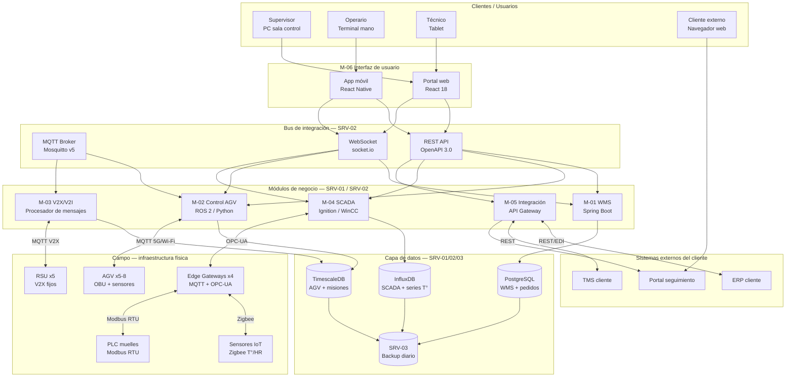
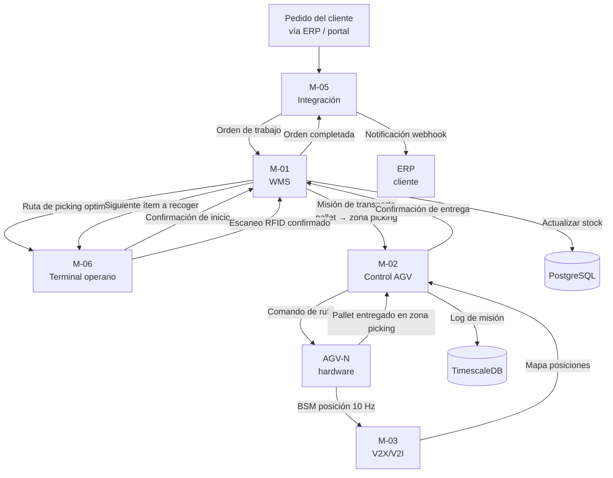
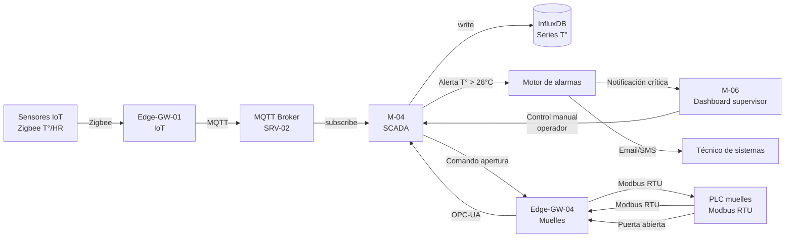
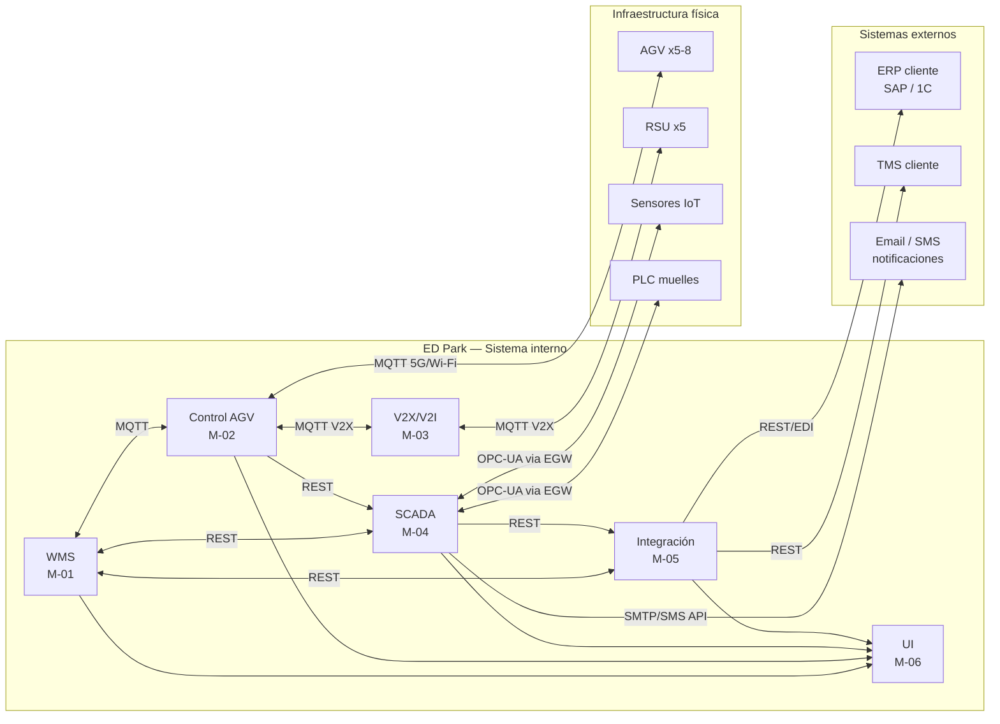

# Software de Gestión del ED Park — Diseño Virtual

## Objetivo de la sección

El objetivo de esta sección es describir el diseño conceptual y funcional del software de gestión del ED Park, cubriendo los seis módulos principales que soportan la operación logística automatizada del parque: WMS, control de AGV, integración V2X/V2I, SCADA, integración con sistemas del cliente e interfaces de usuario. Para cada módulo se definen su función, requisitos funcionales y no funcionales, tecnología sugerida, integración con los demás módulos y normas GOST aplicables. La sección incluye además la composición del equipo de desarrollo, la metodología de trabajo, los plazos estimados y los requisitos de ciberseguridad.

---

> ⚠️ **Aclaración fundamental: diseño virtual, no programación real**
>
> Esta sección forma parte de un proyecto académico de maestría. **No se escribe ni se entrega ningún código fuente.** No se configura ningún entorno de desarrollo real, no se compilan aplicaciones, no se despliegan servicios y no se integra ningún sistema externo real. Lo que se describe aquí es el **diseño virtual** del software: su arquitectura, módulos, flujos de datos, interfaces, requisitos, tecnologías sugeridas y plan de desarrollo. Este diseño sirve para estimar el costo del software, planificar su desarrollo como parte del proyecto, y justificar técnicamente las decisiones de arquitectura ante el cliente y el evaluador académico.

---

## 1. Visión general de la arquitectura de software

El software del ED Park se organiza en seis módulos principales que operan sobre una infraestructura de servidores físicos en la sala de control (SRV-01, SRV-02, SRV-03) y se comunican entre sí mediante una capa de integración basada en mensajería MQTT y APIs REST internas. Todos los módulos comparten una base de datos relacional centralizada y un bus de eventos para la sincronización de estado en tiempo real.

```
┌─────────────────────────────────────────────────────────────────┐
│                    PLATAFORMA ED PARK SOFTWARE                  │
│                                                                 │
│  ┌──────────┐  ┌──────────┐  ┌──────────┐  ┌──────────────┐   │
│  │  M-01    │  │  M-02    │  │  M-03    │  │    M-04      │   │
│  │   WMS    │  │  AGV Ctrl│  │  V2X/V2I │  │    SCADA     │   │
│  └────┬─────┘  └────┬─────┘  └────┬─────┘  └──────┬───────┘   │
│       │              │              │               │           │
│  ════════════════ BUS DE INTEGRACIÓN (MQTT + REST) ═══════════  │
│       │              │              │               │           │
│  ┌────┴─────────────────────────────┴───────────────┴───────┐   │
│  │           M-05: MÓDULO DE INTEGRACIÓN EXTERNA            │   │
│  └──────────────────────────┬────────────────────────────────┘  │
│                              │                                  │
│  ┌───────────────────────────┴───────────────────────────────┐  │
│  │              M-06: INTERFAZ DE USUARIO (UI)               │  │
│  └───────────────────────────────────────────────────────────┘  │
│                                                                 │
│  ┌─────────────────────────────────────────────────────────┐    │
│  │          BASE DE DATOS CENTRALIZADA (PostgreSQL)         │    │
│  └─────────────────────────────────────────────────────────┘    │
└─────────────────────────────────────────────────────────────────┘
```

---

## 2. Módulo M-01 — WMS (Warehouse Management System)

### 2.1 Función

El WMS es el núcleo operativo del software del ED Park. Gestiona el inventario, las ubicaciones de almacenamiento, las órdenes de recepción y expedición, las tareas de picking, las devoluciones y los reportes de operación. Es el sistema de registro de verdad para todo el stock del parque.

### 2.2 Requisitos funcionales

| ID | Requisito |
|----|-----------|
| WMS-F01 | Registro de entrada de mercancía con validación de albarán, cantidad y peso |
| WMS-F02 | Asignación automática de ubicación de almacenamiento por tipo, rotación y temperatura |
| WMS-F03 | Gestión de órdenes de picking con rutas optimizadas (shortest path por zona) |
| WMS-F04 | Control de stock en tiempo real con alerta de mínimos y máximos |
| WMS-F05 | Gestión de devoluciones con flujo de cuarentena y reintegración |
| WMS-F06 | Generación de informes de inventario, productividad y trazabilidad |
| WMS-F07 | Integración bidireccional con el módulo de control de AGV (M-02) |
| WMS-F08 | Soporte de metodologías FIFO y FEFO por zona de almacenamiento |
| WMS-F09 | Control de lotes y números de serie para trazabilidad de productos electrónicos |
| WMS-F10 | API de exportación de datos para integración con ERP del cliente (M-05) |

### 2.3 Requisitos no funcionales

| Parámetro | Valor |
|-----------|-------|
| Disponibilidad | 99.5 % (< 4 h de parada al año) |
| Tiempo de respuesta | < 2 s para operaciones de consulta de stock |
| Usuarios concurrentes | hasta 30 (operarios + supervisores + técnicos) |
| Volumen de transacciones | hasta 5,000 operaciones/día |
| Retención de datos | 5 años (requisito de trazabilidad) |
| Idioma de interfaz | Español + inglés (extensible a ruso) |

### 2.4 Tecnología sugerida

| Componente | Tecnología |
|-----------|-----------|
| Backend | Java 17 + Spring Boot (o Python 3.11 + FastAPI) |
| Base de datos | PostgreSQL 15 con extensión TimescaleDB para series temporales |
| API | REST + JSON, documentada con OpenAPI 3.0 |
| Servidor de aplicaciones | Tomcat / Gunicorn en SRV-01 |
| Mensajería interna | MQTT v5 (broker Mosquitto en SRV-02) |

### 2.5 Integración con otros módulos

| Módulo | Tipo de integración | Datos intercambiados |
|--------|-------------------|---------------------|
| M-02 AGV | MQTT bidireccional | Órdenes de transporte, confirmación de entrega, posición AGV |
| M-04 SCADA | REST API | Estado de zonas, alertas de temperatura, apertura de muelles |
| M-05 Integración | REST API | Órdenes de cliente, estado de pedidos, facturas |
| M-06 UI | REST API + WebSocket | Datos de pantalla en tiempo real, confirmaciones de operario |

### 2.6 GOST aplicable

- **ГОСТ Р МЭК 62443-3-3-2016** — control de acceso por rol, autenticación, cifrado de datos en tránsito
- **ГОСТ 7.32-2017** — formato de documentación del sistema (manuales, especificaciones)

---

## 3. Módulo M-02 — Sistema de control de AGV

### 3.1 Función

El sistema de control de AGV gestiona la flota de 5–8 vehículos automatizados del ED Park: asigna misiones, calcula rutas sin colisión, gestiona la carga de baterías, monitorea el estado de cada vehículo en tiempo real y ejecuta protocolos de parada de emergencia. Es el sistema de tiempo real más crítico del parque.

### 3.2 Requisitos funcionales

| ID | Requisito |
|----|-----------|
| AGV-F01 | Asignación automática de misiones de transporte desde el WMS |
| AGV-F02 | Cálculo de rutas óptimas con evasión dinámica de obstáculos |
| AGV-F03 | Gestión de tráfico en intersecciones (coordinación con V2X/V2I) |
| AGV-F04 | Monitoreo en tiempo real de posición, velocidad y nivel de batería |
| AGV-F05 | Gestión de cola de misiones con priorización por urgencia |
| AGV-F06 | Despacho automático a estación de carga cuando batería < 20 % |
| AGV-F07 | Protocolo de parada de emergencia ante obstáculo o fallo de red |
| AGV-F08 | Log histórico de misiones, tiempos y eventos de cada AGV |
| AGV-F09 | Simulación de rutas antes de enviar misión (digital twin básico) |
| AGV-F10 | Interfaz de gestión manual para el operador de sistema (override) |

### 3.3 Requisitos no funcionales

| Parámetro | Valor |
|-----------|-------|
| Latencia de comando AGV | < 50 ms (Wi-Fi 6) / < 10 ms (5G privado) |
| Frecuencia de actualización de posición | 10 Hz (cada 100 ms) |
| Tiempo de parada de emergencia | < 500 ms desde detección de obstáculo |
| Disponibilidad del servicio | 99.9 % durante horario operativo |
| AGV gestionados simultáneamente | hasta 8 |

### 3.4 Tecnología sugerida

| Componente | Tecnología |
|-----------|-----------|
| Motor de control de flota | ROS 2 (Robot Operating System 2) — diseño conceptual |
| Protocolo de comunicación AGV | MQTT v5 + mensajes BSM/V2X sobre 5G/Wi-Fi 6 |
| Algoritmo de rutas | A* con mapa de grafo actualizable dinámicamente |
| Base de datos de misiones | PostgreSQL + TimescaleDB |
| Servidor de ejecución | SRV-02 (dedicado a tiempo real) |
| Protocolo de emergencia | Watchdog por heartbeat UDP cada 100 ms |

### 3.5 Integración con otros módulos

| Módulo | Tipo de integración | Datos intercambiados |
|--------|-------------------|---------------------|
| M-01 WMS | MQTT bidireccional | Órdenes de misión, confirmación de entrega |
| M-03 V2X/V2I | MQTT + mensajes V2X | Posición AGV, alertas de intersección, SPaT |
| M-04 SCADA | REST API | Estado de flota, alertas, KPIs de productividad |
| M-06 UI | WebSocket | Panel de mapa en tiempo real, estado de cada AGV |

### 3.6 GOST aplicable

- **ГОСТ Р 70982-2023** — comunicaciones V2X para vehículos autónomos
- **ГОСТ Р МЭК 62443-3-3-2016** — autenticación de vehículos, cifrado de comandos
- **ГОСТ Р МЭК 61131-1** — integración con controladores lógicos de los AGV

---

## 4. Módulo M-03 — Sistema de integración V2X/V2I

### 4.1 Función

El módulo V2X/V2I gestiona el intercambio de mensajes de seguridad entre los AGV (OBU) y las unidades de infraestructura fija (RSU) instaladas en intersecciones y muelles. Procesa los mensajes BSM (posición), SPaT (estado de semáforos/puertas) e ICA (alertas de colisión) y coordina la respuesta del sistema de control de AGV.

### 4.2 Requisitos funcionales

| ID | Requisito |
|----|-----------|
| V2X-F01 | Recepción y procesamiento de mensajes BSM de todos los AGV a 10 Hz |
| V2X-F02 | Generación y envío de mensajes SPaT desde RSU de muelles |
| V2X-F03 | Detección de riesgo de colisión y generación de mensajes ICA |
| V2X-F04 | Distribución del mapa de rutas actualizado (mensaje MAP) a todos los AGV |
| V2X-F05 | Registro de todos los mensajes V2X con timestamp PTP para auditoría |
| V2X-F06 | Gestión del ciclo de vida de RSU (configuración, monitoreo, firmware) |
| V2X-F07 | Integración con cámaras IP para detección de peatones en zonas V2X |

### 4.3 Requisitos no funcionales

| Parámetro | Valor |
|-----------|-------|
| Latencia de procesamiento ICA | < 5 ms desde recepción hasta envío de alerta |
| Frecuencia de mensajes BSM | 10 Hz por AGV |
| Mensajes V2X procesados/s | hasta 500 (8 AGV × 10 Hz + RSU broadcasts) |
| Precisión de timestamp | < 1 µs (sincronizado con PTP Grandmaster) |

### 4.4 Tecnología sugerida

| Componente | Tecnología |
|-----------|-----------|
| Protocolo de mensajes | IEEE 1609.2 / ETSI ITS-G5 (adaptado a entorno indoor) |
| Formato de mensaje | ASN.1 / JSON sobre MQTT |
| Procesamiento de colisiones | Motor de reglas en SRV-02 (lógica de zona de seguridad) |
| Sincronización temporal | PTP IEEE 1588 hardware timestamp en SRV-02 |

### 4.5 Integración con otros módulos

| Módulo | Tipo de integración | Datos intercambiados |
|--------|-------------------|---------------------|
| M-02 AGV | MQTT | Mensajes BSM recibidos, ICA enviados, SPaT enviados |
| M-04 SCADA | REST API | Estado de RSU, alertas de seguridad V2X |
| M-06 UI | WebSocket | Mapa de posiciones AGV en tiempo real |

### 4.6 GOST aplicable

- **ГОСТ Р 70982-2023** — sistema V2X/V2I, mensajes y protocolos
- **ГОСТ Р МЭК 62443-3-3-2016** — cifrado y autenticación de mensajes V2X (ECDSA)

---

## 5. Módulo M-04 — SCADA

### 5.1 Función

El SCADA (Supervisory Control And Data Acquisition) es el sistema de supervisión y control de la infraestructura física del ED Park: temperatura y humedad de la zona B, estado de las puertas seccionales de los muelles, consumo eléctrico, estado de los sistemas de climatización, alertas de incendio y sistema de alarmas. Proporciona al supervisor de turno visibilidad completa de las instalaciones.

### 5.2 Requisitos funcionales

| ID | Requisito |
|----|-----------|
| SCA-F01 | Visualización en tiempo real de temperatura y humedad de zona B (50+ sensores) |
| SCA-F02 | Control remoto de apertura/cierre de puertas seccionales de muelles |
| SCA-F03 | Monitoreo de consumo eléctrico por zona (nave principal, nave recepción, exterior) |
| SCA-F04 | Gestión de alarmas con clasificación por severidad (crítica, mayor, menor) |
| SCA-F05 | Historial de tendencias de variables de proceso (últimos 90 días) |
| SCA-F06 | Integración con sistema de detección de incendio (FAS) |
| SCA-F07 | Generación de reportes de disponibilidad de infraestructura |
| SCA-F08 | Control de acceso de operadores al SCADA por rol y zona |

### 5.3 Requisitos no funcionales

| Parámetro | Valor |
|-----------|-------|
| Latencia de visualización | < 1 s desde evento hasta pantalla |
| Retención de datos históricos | 90 días (online) + 5 años (archivo) |
| Disponibilidad | 99.9 % |
| Número de puntos de datos (tags) | hasta 2,000 |

### 5.4 Tecnología sugerida

| Componente | Tecnología |
|-----------|-----------|
| Plataforma SCADA | Ignition (Inductive Automation) o WinCC OA — diseño conceptual |
| Protocolo de campo | OPC-UA + Modbus TCP (desde edge gateways) |
| Base de datos de proceso | InfluxDB (series temporales) en SRV-02 |
| Comunicación con PLC | OPC-UA vía Edge-GW-04 |
| Servidor | SRV-02 (módulo coexistente con control AGV) |

### 5.5 Integración con otros módulos

| Módulo | Tipo de integración | Datos intercambiados |
|--------|-------------------|---------------------|
| M-01 WMS | REST API | Estado de zonas de almacenamiento, alertas T°/HR |
| M-02 AGV | REST API | Órdenes de apertura de muelle, estado de zona AGV |
| M-03 V2X | REST API | Estado de RSU, mapa de zonas activas |
| M-06 UI | WebSocket | Datos de dashboards SCADA en tiempo real |

### 5.6 GOST aplicable

- **ГОСТ Р МЭК 60870-5-104** — telecontrol y supervisión remota
- **ГОСТ Р МЭК 62443-3-3-2016** — seguridad del sistema SCADA (zona OT)
- **ГОСТ Р МЭК 61131-1** — integración con PLC de campo

---

## 6. Módulo M-05 — Integración con sistemas del cliente

### 6.1 Función

El módulo de integración gestiona el intercambio de datos entre el ED Park y los sistemas externos del cliente: ERP (Enterprise Resource Planning), TMS (Transportation Management System) y plataformas de seguimiento de pedidos. Expone una API documentada que permite al cliente consultar el estado de su inventario, recibir notificaciones de despacho y enviar órdenes de trabajo.

### 6.2 Requisitos funcionales

| ID | Requisito |
|----|-----------|
| INT-F01 | API REST documentada (OpenAPI 3.0) para consulta de inventario del cliente |
| INT-F02 | Webhooks para notificación de eventos: recepción, despacho, devolución |
| INT-F03 | Integración bidireccional con ERP del cliente vía API o EDI |
| INT-F04 | Portal web de seguimiento de pedidos para el cliente (solo lectura) |
| INT-F05 | Exportación de reportes en formatos estándar (CSV, PDF, XML/EDI) |
| INT-F06 | Gestión de credenciales de acceso de múltiples clientes (multi-tenant básico) |
| INT-F07 | Log de auditoría de todas las consultas externas (quién consultó, cuándo, qué) |

### 6.3 Requisitos no funcionales

| Parámetro | Valor |
|-----------|-------|
| Latencia de API | < 500 ms para consultas de inventario |
| Disponibilidad de API | 99 % (mantenimientos programados nocturnos) |
| Autenticación | OAuth 2.0 + JWT para acceso externo |
| Cifrado en tránsito | TLS 1.3 obligatorio en todas las conexiones externas |

### 6.4 Tecnología sugerida

| Componente | Tecnología |
|-----------|-----------|
| API Gateway | Kong API Gateway (o equiv.) en SRV-01 |
| Protocolo de integración | REST/JSON + EDI X12/EDIFACT para ERP legacy |
| Notificaciones | Webhooks HTTPS + colas de mensajes (RabbitMQ) |
| Autenticación externa | OAuth 2.0 + JWT (Keycloak como IdP) |
| Portal web cliente | React SPA servida desde SRV-01 (diseño conceptual) |

### 6.5 Integración con otros módulos

| Módulo | Tipo de integración | Datos intercambiados |
|--------|-------------------|---------------------|
| M-01 WMS | REST API interna | Stock, pedidos, recepciones, despachos |
| M-04 SCADA | REST API interna | Estado de infraestructura para reportes |
| M-06 UI | Componente embebido | Portal de cliente como sección del UI |

### 6.6 GOST aplicable

- **ГОСТ Р МЭК 62443-3-3-2016** — seguridad de la zona de integración IT/exterior
- **ГОСТ Р ИСО 15745-4-2010** — perfiles de integración de sistemas de automatización

---

## 7. Módulo M-06 — Interfaz de usuario (UI)

### 7.1 Función

La interfaz de usuario es el punto de interacción entre el software del ED Park y los distintos perfiles de usuarios: supervisores de turno (sala de control), operarios de almacén (terminales de mano), técnicos de sistemas (panel de administración) y clientes (portal web). Proporciona vistas adaptadas a cada rol, con acceso restringido por permisos.

### 7.2 Perfiles de usuario y vistas

| Perfil | Dispositivo | Vistas principales |
|--------|------------|-------------------|
| Supervisor de turno | PC sala control (monitor 27″) | Dashboard operativo, mapa AGV, alertas SCADA, KPIs |
| Operario de almacén | Terminal de mano (Android 10+) | Tareas de picking, recepción, confirmaciones |
| Técnico de sistemas | PC oficina o tablet | Panel de red, estado AGV, logs, configuración |
| Cliente externo | Navegador web | Seguimiento de pedidos, inventario propio, reportes |
| Administrador | PC sala control | Configuración del sistema, usuarios, parámetros |

### 7.3 Pantallas principales del dashboard (supervisor)

**Vista 1 — Panel de operaciones en tiempo real:**
- Mapa 2D del parque con posición de AGV actualizada a 10 Hz
- Indicador de estado de cada AGV (en misión / cargando / error / disponible)
- Cola de misiones pendientes y completadas
- Alertas activas del SCADA (temperatura zona B, puertas muelles)
- KPIs del turno: unidades recibidas, unidades despachadas, tiempo medio de ciclo

**Vista 2 — Gestión de inventario:**
- Árbol de zonas y ubicaciones con estado de ocupación
- Búsqueda de SKU con localización en plano
- Alertas de stock mínimo y máximo
- Historial de movimientos por SKU

**Vista 3 — Panel SCADA simplificado:**
- Temperatura y humedad de zona B (gráfica en tiempo real)
- Estado de puertas seccionales de muelles (abierta/cerrada/en movimiento)
- Consumo eléctrico por zona
- Estado de climatización

### 7.4 Requisitos no funcionales de la UI

| Parámetro | Valor |
|-----------|-------|
| Tiempo de carga inicial | < 3 s |
| Actualización en tiempo real | WebSocket, latencia < 500 ms |
| Compatibilidad | Chrome 110+, Firefox 110+, Android 10+ |
| Accesibilidad | WCAG 2.1 nivel AA |
| Soporte offline (terminal operario) | Modo degradado con sincronización al reconectar |
| Idiomas | Español; extensible a ruso |

### 7.5 Tecnología sugerida

| Componente | Tecnología |
|-----------|-----------|
| Frontend web | React 18 + TypeScript (diseño conceptual) |
| Mapas 2D del parque | Leaflet.js con capa SVG personalizada |
| Gráficas en tiempo real | Chart.js / Recharts |
| Comunicación backend | REST API + WebSocket (socket.io) |
| App móvil operario | React Native (reutiliza lógica frontend) |
| Autenticación | JWT + sesión con refresh token |

### 7.6 GOST aplicable

- **ГОСТ Р МЭК 62443-3-3-2016** — autenticación de usuarios, control de acceso por rol (RBAC)
- **ГОСТ 7.32-2017** — formato de documentación de la interfaz (manuales de usuario)

---

## 8. Arquitectura de software — Diagramas

### 8.1 Diagrama de arquitectura de software



### 8.2 Diagrama de flujo de datos — Proceso de picking



### 8.3 Diagrama de flujo de datos — Monitoreo SCADA



### 8.4 Diagrama de integración de sistemas



---

## 9. Ciberseguridad del software

De conformidad con **ГОСТ Р МЭК 62443-3-3-2016**, el software del ED Park implementa el nivel de seguridad **SL 2** (protección contra atacantes con motivación y medios básicos). Las medidas se organizan en los siguientes dominios:

| Dominio | Medida | Módulo afectado |
|---------|--------|----------------|
| Identificación y autenticación | OAuth 2.0 + JWT para todos los accesos externos | M-05, M-06 |
| Control de acceso | RBAC (5 roles: admin, supervisor, operario, técnico, cliente) | M-01, M-04, M-06 |
| Integridad de datos | Hash SHA-256 de cada transacción WMS registrada en DB | M-01 |
| Cifrado en tránsito | TLS 1.3 obligatorio en todas las APIs externas e internas | M-05, M-06 |
| Cifrado en reposo | AES-256 para datos de inventario y logs de auditoría | M-01, M-04 |
| Seguridad de mensajes V2X | ECDSA P-256 para firma de mensajes BSM/ICA/SPaT | M-02, M-03 |
| Auditoría | Log inmutable de todas las operaciones con timestamp PTP | Todos |
| Gestión de vulnerabilidades | Análisis de dependencias mensual (OWASP Dependency Check) | Todos |
| Segmentación | Módulos M-02/M-03 (OT) aislados de M-05 (IT/exterior) por firewall | M-02, M-03, M-05 |
| Plan de respuesta | Procedimiento documentado de respuesta ante incidente de seguridad | Todos |

Referencia: **ГОСТ Р МЭК 62443-3-3-2016** — Системы и меры по обеспечению кибербезопасности промышленных автоматизированных систем. Часть 3-3. Системные требования к безопасности.

---

## 10. Equipo de desarrollo necesario

| Rol | Cantidad | Responsabilidades principales | Fase de mayor actividad |
|-----|:--------:|-------------------------------|------------------------|
| Arquitecto de software | 1 | Diseño de arquitectura, decisiones tecnológicas, integración entre módulos | Diseño + todo el proyecto |
| Desarrollador backend senior | 2 | M-01 WMS, M-05 Integración, base de datos, APIs REST | Desarrollo (meses 5–12) |
| Desarrollador backend | 1 | M-04 SCADA, conectores OPC-UA/Modbus, pipelines de datos | Desarrollo (meses 6–12) |
| Desarrollador de sistemas (tiempo real) | 1 | M-02 Control AGV, M-03 V2X/V2I, MQTT, ROS 2 | Desarrollo (meses 7–13) |
| Desarrollador frontend | 2 | M-06 UI web + app móvil operario, dashboards, mapas 2D | Desarrollo (meses 8–14) |
| Ingeniero de integración | 1 | M-05 ERP/TMS, API Gateway, OAuth, EDI, webhooks | Integración (meses 10–15) |
| Ingeniero DevOps | 1 | CI/CD, despliegue en servidores, monitoreo, backups | Transversal |
| QA / Tester | 2 | Pruebas funcionales, de rendimiento, de seguridad, UAT | Testing (meses 11–16) |
| Especialista en ciberseguridad | 1 | Revisión de seguridad, GOST МЭК 62443, pentest básico | Diseño + pre-entrega |
| Gestor técnico / Scrum Master | 1 | Coordinación del equipo, gestión de sprints, reportes | Transversal |
| **TOTAL** | **13** | | |

---

## 11. Metodología de desarrollo

El proyecto de software del ED Park adopta la metodología **Scrum** con adaptaciones para entornos de sistema embebido y tiempo real (Agile for Embedded Systems).

### 11.1 Estructura de sprints

| Parámetro | Valor |
|-----------|-------|
| Duración de sprint | 2 semanas |
| Ceremonia de planificación | Lunes de inicio de sprint (2 h) |
| Daily standup | Diario, 15 minutos |
| Sprint review | Viernes de cierre (1 h) |
| Retrospectiva | Viernes de cierre (30 min) |
| Herramienta de gestión | Jira / YouTrack (diseño conceptual) |
| Control de versiones | Git con rama principal protegida + feature branches |
| Integración continua | Pipeline CI con análisis estático y pruebas unitarias |

### 11.2 Fases de desarrollo

| Fase | Actividades | Duración estimada |
|------|------------|:-----------------:|
| Análisis y diseño | Especificación de requisitos, arquitectura, prototipos de UI | 2 meses |
| Desarrollo M-01 WMS + M-04 SCADA | Backend, APIs, base de datos, conectores de campo | 4 meses |
| Desarrollo M-02 AGV + M-03 V2X | Control de flota, mensajes V2X, pruebas en simulación | 3 meses |
| Desarrollo M-05 + M-06 | API Gateway, integración ERP, UI web y app móvil | 3 meses |
| Integración y pruebas | Pruebas de integración, rendimiento, seguridad, UAT | 2 meses |
| Despliegue y puesta en marcha | Instalación en servidores de producción, capacitación | 1 mes |
| **TOTAL** | | **15 meses** |

### 11.3 Hitos principales del desarrollo de software

| Hito | Entregable | Mes estimado |
|------|-----------|:------------:|
| MS-01 | Arquitectura de software aprobada | Mes 2 |
| MS-02 | WMS v1.0 funcional (recepción + inventario) | Mes 6 |
| MS-03 | SCADA funcional (temperatura + muelles) | Mes 7 |
| MS-04 | Control AGV funcional (rutas básicas, 3 AGV) | Mes 9 |
| MS-05 | V2X/V2I funcional (BSM + ICA en laboratorio) | Mes 10 |
| MS-06 | UI completa (web + app móvil) | Mes 12 |
| MS-07 | Integración ERP cliente completada | Mes 13 |
| MS-08 | Sistema completo integrado y probado | Mes 15 |
| MS-09 | Sistema en producción, equipo capacitado | Mes 16 |

---

## 12. Plazos y esfuerzo estimado

| Módulo | Esfuerzo estimado (persona-mes) | Duración | Costo estimado* |
|--------|:-------------------------------:|:--------:|-----------------|
| M-01 WMS | 18 | 6 meses | ~1,800,000 ₽ |
| M-02 Control AGV | 12 | 5 meses | ~1,200,000 ₽ |
| M-03 V2X/V2I | 6 | 3 meses | ~600,000 ₽ |
| M-04 SCADA | 8 | 4 meses | ~800,000 ₽ |
| M-05 Integración | 8 | 3 meses | ~800,000 ₽ |
| M-06 UI | 10 | 4 meses | ~1,000,000 ₽ |
| Arquitectura + QA + DevOps + Seguridad | 12 | 15 meses | ~1,200,000 ₽ |
| **TOTAL** | **74 persona-mes** | **15 meses** | **~7,400,000 ₽** |

*Costo estimado a 100,000 ₽/persona-mes (tarifa media de mercado para equipo de desarrollo en Rusia, 2024). Este valor se incorpora al presupuesto global del proyecto en la Fase 4.

---

## 13. Resumen de tecnologías por módulo

| Módulo | Backend | Base de datos | Protocolo | Estándar GOST |
|--------|---------|--------------|-----------|--------------|
| M-01 WMS | Java/Spring Boot | PostgreSQL | REST + MQTT | ГОСТ Р МЭК 62443-3-3 |
| M-02 AGV | Python/ROS 2 | TimescaleDB | MQTT + 5G/Wi-Fi | ГОСТ Р 70982-2023 |
| M-03 V2X | Python | TimescaleDB | MQTT + ASN.1 | ГОСТ Р 70982-2023 |
| M-04 SCADA | Ignition/WinCC | InfluxDB | OPC-UA + Modbus | ГОСТ Р МЭК 60870-5-104 |
| M-05 Integración | Node.js/Kong | PostgreSQL | REST + EDI | ГОСТ Р ИСО 15745-4 |
| M-06 UI | React 18 | — (consume APIs) | REST + WebSocket | ГОСТ 7.32-2017 |

---

## 14. Referencias normativas de la sección

- **ГОСТ Р МЭК 62443-3-3-2016**. Системы и меры по обеспечению кибербезопасности промышленных автоматизированных систем. Часть 3-3. Системные требования к безопасности. — М.: Стандартинформ, 2016.
- **ГОСТ Р 70982-2023**. Безопасность дорожного движения. Системы связи и управления транспортными средствами. Взаимодействие транспортных средств и инфраструктуры. — М.: Стандартинформ, 2023.
- **ГОСТ Р МЭК 60870-5-104**. Системы дистанционного управления. Часть 5-104. Протокол передачи данных для телемеханики. — М.: Стандартинформ.
- **ГОСТ Р МЭК 61131-1**. Программируемые контроллеры. Часть 1. Общие сведения и основные принципы. — М.: Стандартинформ, 2011.
- **ГОСТ Р ИСО 15745-4-2010**. Системы автоматизации производства и их интеграция. Профили. Часть 4. — М.: Стандартинформ, 2010.
- **ГОСТ 7.32-2017**. Отчет о научно-исследовательской работе. Структура и правила оформления. — М.: Стандартинформ, 2017.
- **IEEE 1588-2019**. IEEE Standard for a Precision Clock Synchronization Protocol. — IEEE, 2019.

---

## 15. Checklist de la sección

- [x] 2.4.1 Definir módulo M-01 WMS (función, requisitos, tecnología, integración, GOST)
- [x] 2.4.2 Definir módulo M-02 Control de AGV (función, requisitos, ROS 2, MQTT, GOST)
- [x] 2.4.3 Definir módulo M-03 V2X/V2I (función, mensajes BSM/SPaT/ICA, GOST)
- [x] 2.4.4 Definir módulo M-04 SCADA (función, requisitos, OPC-UA, InfluxDB, GOST)
- [x] 2.4.5 Definir módulo M-05 Integración (función, API Gateway, OAuth, EDI, GOST)
- [x] 2.4.6 Definir módulo M-06 UI (perfiles, vistas, React, WebSocket, GOST)
- [x] 2.4.7 Definir tabla de equipo de desarrollo (13 roles, responsabilidades, fases)
- [x] 2.4.8 Definir metodología Scrum con sprints de 2 semanas
- [x] 2.4.9 Definir hitos de desarrollo (9 hitos, meses 2–16)
- [x] 2.4.10 Estimar plazos y esfuerzo (74 persona-mes, 15 meses, ~7,400,000 ₽)
- [x] 2.4.11 Definir requisitos de ciberseguridad SL 2 (ГОСТ МЭК 62443, 10 medidas)
- [x] 2.4.12 Generar diagrama de arquitectura de software (Mermaid)
- [x] 2.4.13 Generar diagrama de flujo de datos — picking (Mermaid)
- [x] 2.4.14 Generar diagrama de flujo de datos — SCADA (Mermaid)
- [x] 2.4.15 Generar diagrama de integración de sistemas (Mermaid)
- [x] 2.4.16 Aclaración explícita: diseño virtual, no código
- [x] 2.4.17 Referencias normativas (7 GOST + IEEE)
- [x] 2.4.18 Coherencia con telecom (03_03), infraestructura física (03_02) y descripción ED Park (03_01)

---

## 16. Conclusión

El diseño virtual del software de gestión del ED Park contempla seis módulos funcionales cohesionados mediante un bus de integración basado en MQTT y REST, desplegados sobre tres servidores físicos en la sala de control. La arquitectura separa explícitamente los módulos de tiempo real (M-02, M-03) de los módulos de negocio (M-01, M-04) y de integración externa (M-05), garantizando que una incidencia en la red corporativa no afecte al control de los AGV. El equipo de 13 personas, trabajando con metodología Scrum durante 15 meses, desarrollará los ~74 persona-mes de trabajo estimados a un costo aproximado de 7,400,000 ₽, valor que se incorporará al presupuesto global del proyecto. El cumplimiento del nivel SL 2 de ГОСТ Р МЭК 62443-3-3-2016 garantiza la protección del sistema frente a los riesgos cibernéticos identificados en el análisis de riesgos del proyecto.
