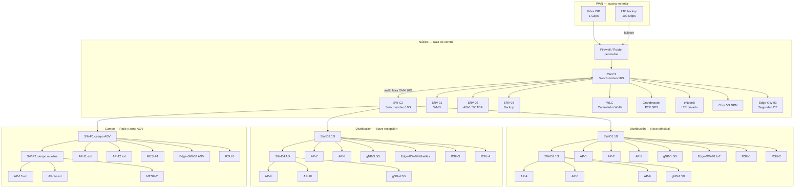
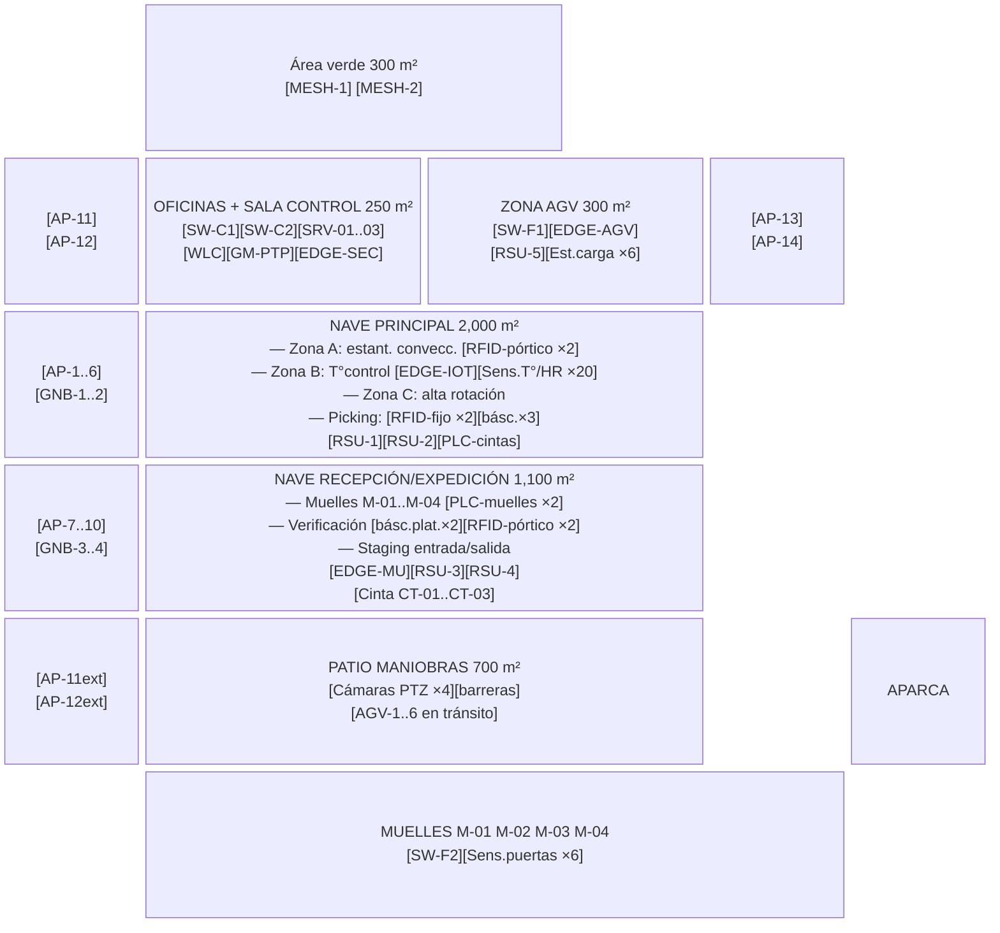
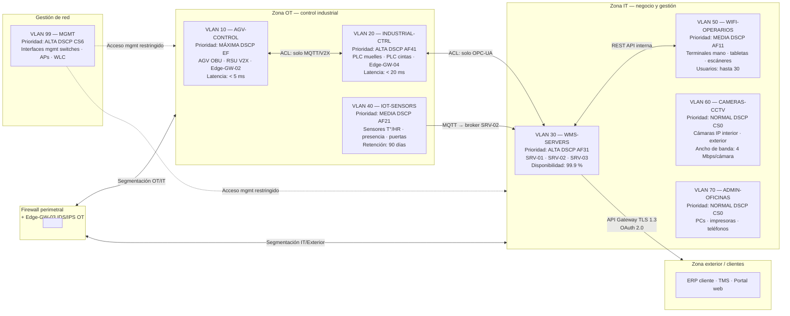
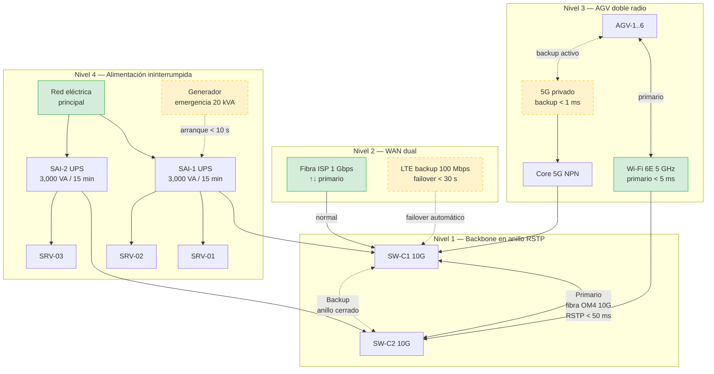
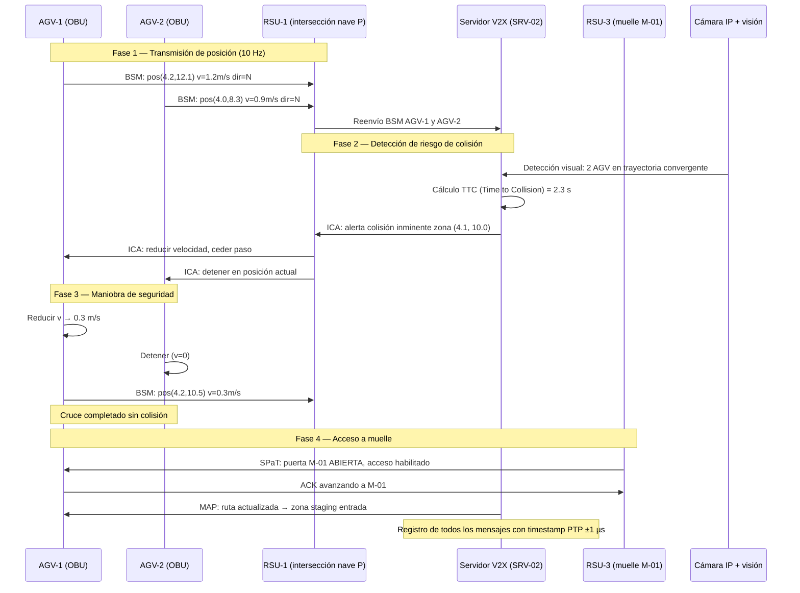
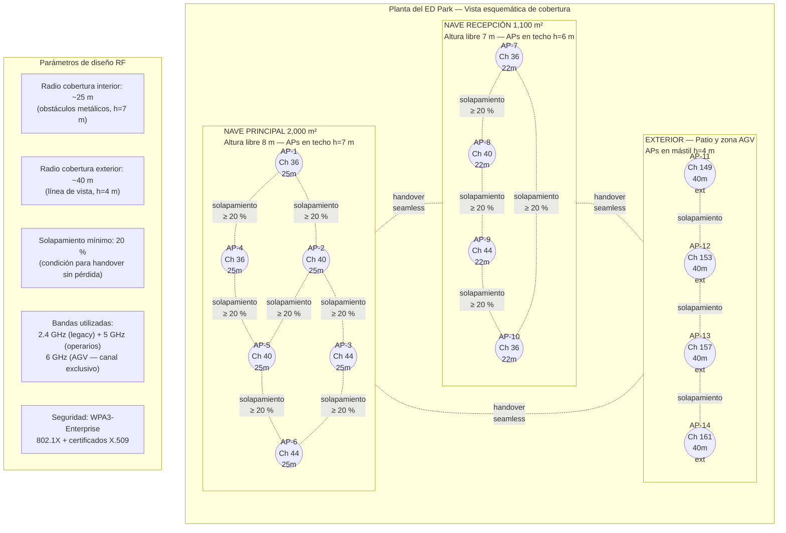
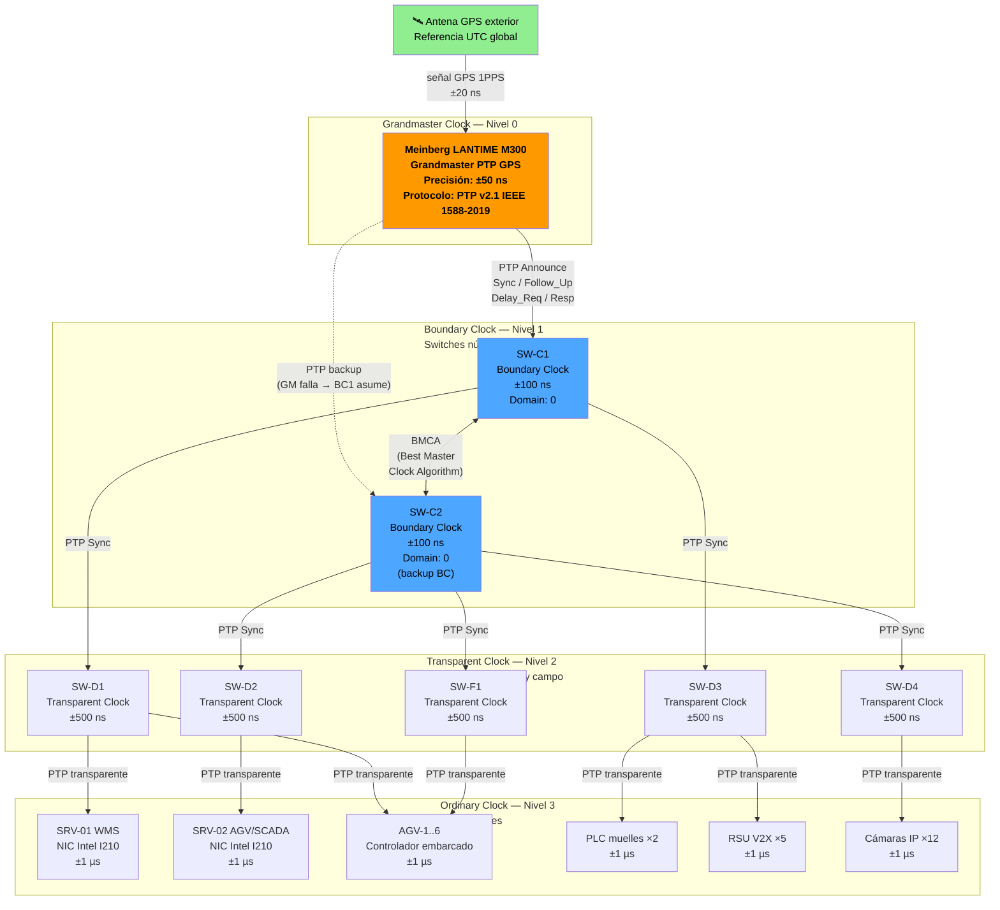
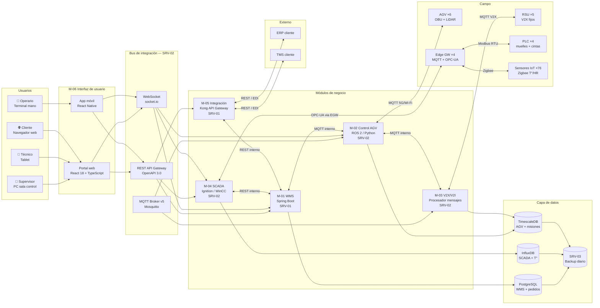
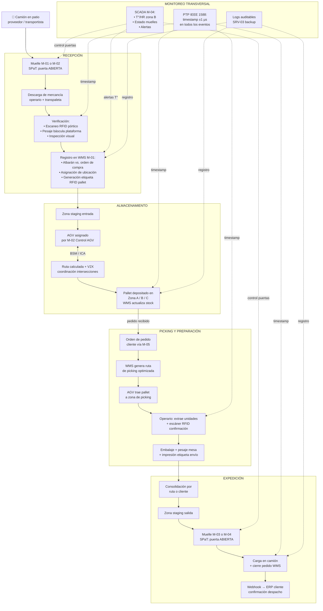
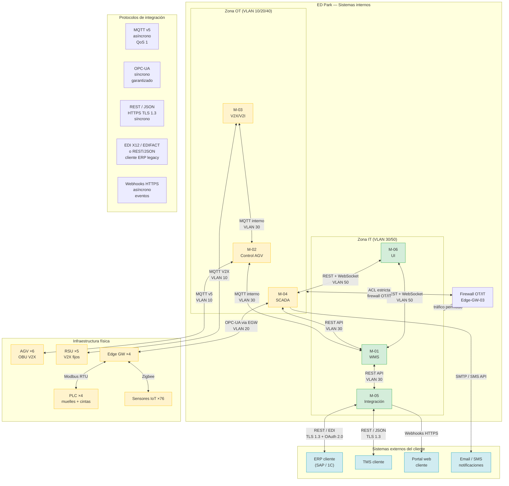

# Esquemas y Diagramas del ED Park

## Objetivo de la sección

Esta sección consolida en un único documento de referencia visual los diez diagramas principales del proyecto ED Park. Cada diagrama se presenta con su título, una descripción de su propósito, el código Mermaid correspondiente y una interpretación que explica los elementos clave y las decisiones de diseño que refleja. Los diagramas cubren la red de telecomunicaciones, la distribución física de equipos, la segmentación lógica de red, la redundancia, el sistema V2X/V2I, la cobertura Wi-Fi, la sincronización PTP, la arquitectura de software, el flujo de datos y la integración de sistemas.

> Esta sección es el documento de referencia visual del proyecto. Los diagramas aquí presentados sintetizan el diseño técnico completo descrito en las secciones `03_02` a `03_05`.

---

## Diagrama 1 — Topología de red

**Título**: Topología de red del ED Park — arquitectura jerárquica con redundancia

**Descripción**: Representa la estructura completa de la red de telecomunicaciones del ED Park en tres niveles jerárquicos (núcleo, distribución y campo), con la topología en anillo redundante en el núcleo, los enlaces de fibra óptica entre niveles, los puntos de acceso Wi-Fi 6/6E, las small cells 5G privado y la conexión WAN dual (fibra ISP + LTE backup).

**Interpretación**: El núcleo forma un anillo de fibra OM4 a 10 Gbps entre SW-C1 y SW-C2, eliminando el punto único de fallo en la capa más crítica. Cada nave tiene su propio par de switches de distribución conectados a ambos switches de núcleo (conexión dual upstream). Los switches de campo en el exterior dependen del SW-C2 pero cuentan con MESH como respaldo inalámbrico. Los gNB de 5G privado y los APs Wi-Fi 6 se conectan a los switches de distribución de su nave, garantizando cobertura celular y Wi-Fi independiente por zona.

---

## Diagrama 2 — Ubicación física de equipos en el plano

**Título**: Plano de distribución de equipos del ED Park (vista en planta esquemática)

**Descripción**: Muestra la posición relativa de los principales equipos de red, sensores, AGV y PLC sobre el plano del parque, organizado por zonas físicas. Permite visualizar la lógica de despliegue de la infraestructura sobre la planta de 5,000 m².

**Interpretación**: Los switches de núcleo y los servidores se concentran en la sala de control (zona segura, climatizada, acceso restringido). Los edge gateways se distribuyen por zonas funcionales: Edge-GW-01 en zona B (IoT), Edge-GW-02 en zona AGV, Edge-GW-04 en muelles. Las RSU V2X se ubican en los puntos de mayor riesgo de colisión: intersecciones de pasillos y muelles. Los APs se posicionan en el techo de cada nave y en mástiles en el exterior para garantizar cobertura continua.

---

## Diagrama 3 — Segmentación VLAN y QoS

**Título**: Arquitectura de segmentación lógica — VLANs y políticas QoS del ED Park

**Descripción**: Muestra las ocho VLANs del ED Park, su función, los dispositivos que las componen y la prioridad QoS asignada a cada segmento. La separación lógica entre OT (operación) e IT (negocio) es el principio central de seguridad de la red.

**Interpretación**: La VLAN 10 (AGV-CONTROL) recibe máxima prioridad QoS (DSCP EF — Expedited Forwarding) para garantizar latencia < 5 ms en los comandos de navegación. Las VLANs OT (10, 20, 40) están separadas de las IT (30, 50, 60, 70) por el Edge-GW-03 que actúa como firewall OT con ACLs estrictas. El tráfico exterior pasa por el API Gateway con TLS 1.3 y OAuth 2.0, sin acceso directo a las VLANs internas. La VLAN 99 de gestión está aislada y solo accesible desde la sala de control.

---

## Diagrama 4 — Redundancia de canales de comunicación

**Título**: Arquitectura de redundancia a cuatro niveles del ED Park

**Descripción**: Ilustra las cuatro capas de redundancia implementadas en la infraestructura de comunicaciones: backbone en anillo (RSTP), WAN dual (fibra + LTE), doble radio para AGV (Wi-Fi 6 + 5G privado) y alimentación ininterrumpida (SAI + generador).

**Interpretación**: El tiempo de recuperación ante fallo del backbone es < 50 ms (RSTP). El failover WAN tarda < 30 s (detección + conmutación LTE). Los AGV nunca pierden conectividad: si Wi-Fi 6E cae, 5G privado asume en < 100 ms (handover). Los SAI garantizan 15 minutos de operación para arranque ordenado del generador. El generador cubre una parada eléctrica total indefinida. Disponibilidad resultante de la red: 99.9 %.

---

## Diagrama 5 — Arquitectura V2X/V2I para AGV

**Título**: Sistema V2X/V2I del ED Park — flujo de mensajes y coordinación de vehículos

**Descripción**: Muestra el flujo completo de mensajes V2X entre los AGV (OBU), las unidades de infraestructura fija (RSU) y el servidor V2X, incluyendo los cuatro tipos de mensaje (BSM, SPaT, ICA, MAP) y el proceso de coordinación en intersecciones y muelles.

**Interpretación**: El sistema V2X opera en cuatro fases: transmisión continua de posición (BSM a 10 Hz), detección de riesgo por el servidor V2X con apoyo de visión artificial, generación de alertas ICA para maniobra de seguridad, y sincronización con la infraestructura de muelles (SPaT). La latencia máxima desde detección hasta envío de ICA es < 5 ms, suficiente para detener un AGV a 6 km/h con una distancia de seguridad > 0.8 m. Todos los mensajes se registran con timestamp PTP para auditoría.

---

## Diagrama 6 — Cobertura Wi-Fi en las 2 naves y patio

**Título**: Plan de cobertura Wi-Fi 6/6E del ED Park — 14 puntos de acceso

**Descripción**: Representa la distribución de los 14 puntos de acceso Wi-Fi 6/6E del ED Park sobre el plano en planta, con los radios de cobertura estimados, el solapamiento entre celdas y la asignación de canales para evitar interferencias.

**Interpretación**: La nave principal (2,000 m²) requiere 6 APs en disposición 2×3 para garantizar cobertura total con solapamiento ≥ 20 % entre celdas adyacentes. La nave de recepción (1,100 m²) requiere 4 APs en disposición 2×2. El exterior se cubre con 4 APs de mayor potencia (27 dBm) montados en mástiles. La banda de 6 GHz (Wi-Fi 6E) se asigna exclusivamente a los AGV, eliminando interferencias con otros dispositivos. El solapamiento del 20 % garantiza handover sin pérdida de paquetes para AGV en movimiento a 6 km/h.

---

## Diagrama 7 — Sincronización de tiempo PTP

**Título**: Jerarquía de sincronización PTP (IEEE 1588) del ED Park

**Descripción**: Muestra la jerarquía completa del protocolo PTP desde el reloj maestro GPS (Grandmaster) hasta los relojes ordinarios en los nodos finales (AGV, servidores, PLC), con los roles de cada dispositivo y la precisión alcanzada en cada nivel.

**Interpretación**: El Grandmaster sincroniza su reloj interno con GPS (precisión ±20 ns), propagando PTP a los Boundary Clocks de los switches de núcleo (±100 ns). Los Transparent Clocks en los switches de distribución y campo no modifican los timestamps PTP sino que corrigen el retardo de transit (±500 ns al final). Los nodos finales (AGV, servidores, PLC, RSU) mantienen sincronización ±1 µs, suficiente para correlacionar eventos entre sistemas y coordinar AGV en intersecciones sin ambigüedad de posición. Si el GM falla, el BC1 asume el rol de maestro mediante el algoritmo BMCA.

---

## Diagrama 8 — Arquitectura del software

**Título**: Arquitectura de la plataforma de software del ED Park — 6 módulos integrados

**Descripción**: Representa la arquitectura completa del software de gestión del ED Park, mostrando los seis módulos principales, el bus de integración (MQTT + REST + WebSocket), la capa de datos, los clientes de usuario y la conexión con la infraestructura física de campo.

**Interpretación**: La arquitectura separa explícitamente los módulos de tiempo real (M-02, M-03 — en SRV-02) de los módulos de negocio (M-01 — en SRV-01) y de integración externa (M-05). El bus de integración permite que los módulos se comuniquen sin acoplamiento directo: MQTT para tráfico de tiempo real (AGV, sensores), REST para operaciones transaccionales (WMS, integración), WebSocket para actualizaciones en tiempo real del dashboard. La capa de datos usa tres motores especializados: PostgreSQL para datos relacionales (inventario), InfluxDB para series temporales de proceso (SCADA) y TimescaleDB para telemetría de AGV.

---

## Diagrama 9 — Flujo de datos principal

**Título**: Flujo de datos del proceso de recepción, almacenamiento y expedición

**Descripción**: Muestra el flujo completo de datos desde la llegada de mercancía al muelle hasta la confirmación de expedición al cliente, pasando por todos los sistemas (SCADA, WMS, AGV, V2X, integración). Es el diagrama de flujo de datos operativo central del ED Park.

**Interpretación**: El flujo de datos sigue el ciclo operativo completo: recepción (datos de proveedor → WMS), almacenamiento (WMS → AGV → ubicación física), picking (pedido cliente → WMS → AGV → operario) y expedición (WMS → muelle → confirmación cliente). El SCADA monitorea transversalmente el proceso controlando las condiciones ambientales y el estado de los muelles. El PTP garantiza que todos los eventos del flujo tengan timestamps coherentes para trazabilidad de lote completa. Todos los datos se replican en SRV-03 para auditoría.

---

## Diagrama 10 — Integración de sistemas

**Título**: Mapa de integración de sistemas del ED Park — interfaces internas y externas

**Descripción**: Muestra todas las interfaces de integración entre los módulos internos del ED Park y los sistemas externos (ERP, TMS, portal cliente), incluyendo los protocolos, el tipo de integración (síncrona/asíncrona) y las VLANs que atraviesan.

**Interpretación**: El mapa de integración muestra tres zonas claramente separadas: OT (naranja) con los módulos de control en tiempo real y la infraestructura física, IT (verde) con los módulos de negocio y la interfaz de usuario, y exterior (azul) con los sistemas del cliente. La separación OT/IT la implementa el Edge-GW-03 con ACLs que solo permiten el tráfico estrictamente necesario (MQTT desde M-02 a M-01 para confirmaciones de misión, REST desde M-04 a M-01 para alertas SCADA). Toda la integración externa pasa por M-05 con TLS 1.3 y OAuth 2.0, sin acceso directo a las zonas internas.

---

## Resumen de diagramas

| # | Diagrama | Tipo Mermaid | Sección origen | Elementos clave |
|---|----------|:------------:|---------------|-----------------|
| 1 | Topología de red | `graph TD` | `03_03` | Anillo núcleo 10G, 3 niveles jerárquicos, 14 APs, 4 gNB |
| 2 | Ubicación física de equipos | `block-beta` | `03_02` + `03_03` | 5,000 m² en 7 zonas, posición de todos los equipos |
| 3 | Segmentación VLAN y QoS | `graph LR` | `03_03` | 8 VLANs, DSCP EF/AF/CS, zonas OT/IT/exterior |
| 4 | Redundancia de canales | `graph TD` | `03_03` | 4 niveles: RSTP + WAN dual + dual radio + SAI |
| 5 | V2X/V2I para AGV | `sequenceDiagram` | `03_03` + `03_04` | BSM / SPaT / ICA / MAP, latencia < 5 ms |
| 6 | Cobertura Wi-Fi | `graph TB` | `03_03` | 14 APs, 3 bandas, solapamiento 20 %, WPA3 |
| 7 | Sincronización PTP | `graph TD` | `03_03` | GM GPS → BC → TC → OC, precisión ±1 µs |
| 8 | Arquitectura del software | `graph LR` | `03_04` | 6 módulos, bus MQTT/REST/WS, 3 bases de datos |
| 9 | Flujo de datos | `flowchart TD` | `03_04` | Recepción → almacenamiento → picking → expedición |
| 10 | Integración de sistemas | `graph TB` | `03_04` + `03_05` | OT/IT/exterior, protocolos, VLANs, firewall |

---

## Referencias normativas de la sección

- **ГОСТ Р ИСО 15745-4-2010** — Topología Industrial Ethernet (D-01, D-10)
- **ГОСТ Р МЭК 61850-3** — Requisitos de disponibilidad de red (D-01, D-04)
- **ГОСТ Р 70982-2023** — V2X/V2I, mensajes BSM/SPaT/ICA/MAP (D-05)
- **ГОСТ Р МЭК 62443-3-3-2016** — Segmentación VLAN, zonas OT/IT, ciberseguridad (D-03, D-10)
- **IEEE 802.11ax** — Planificación de cobertura Wi-Fi 6/6E (D-06)
- **IEEE 1588-2019 (PTP v2.1)** — Jerarquía de sincronización GM/BC/TC/OC (D-07)
- **ГОСТ 7.32-2017** — Formato del documento de diseño técnico

---

## Checklist de la sección

- [x] D-01 Diagrama de topología de red (jerarquía 3 niveles + anillo núcleo, Mermaid graph TD)
- [x] D-02 Esquema de ubicación física de equipos en el plano (5,000 m², Mermaid block-beta)
- [x] D-03 Esquema de segmentación VLAN y QoS (8 VLANs + DSCP + zonas OT/IT, Mermaid graph LR)
- [x] D-04 Esquema de redundancia de canales (4 niveles: RSTP + WAN + dual radio + SAI, Mermaid graph TD)
- [x] D-05 Esquema V2X/V2I para AGV (BSM/SPaT/ICA/MAP + fases, Mermaid sequenceDiagram)
- [x] D-06 Esquema de cobertura Wi-Fi (14 APs + 3 bandas + solapamiento 20 %, Mermaid graph TB)
- [x] D-07 Esquema de sincronización PTP (GM → BC → TC → OC ±1 µs, Mermaid graph TD)
- [x] D-08 Diagrama de arquitectura del software (6 módulos + bus + datos + campo, Mermaid graph LR)
- [x] D-09 Diagrama de flujo de datos (recepción → almacenamiento → picking → expedición, Mermaid flowchart)
- [x] D-10 Diagrama de integración de sistemas (OT/IT/exterior + protocolos + VLANs, Mermaid graph TB)
- [x] Cada diagrama incluye: título, descripción, código Mermaid e interpretación
- [x] Tabla resumen de 10 diagramas con tipo Mermaid, sección origen y elementos clave
- [x] Referencias normativas de la sección
- [x] Coherencia visual con todas las secciones del diseño técnico (03_02 a 03_07)
