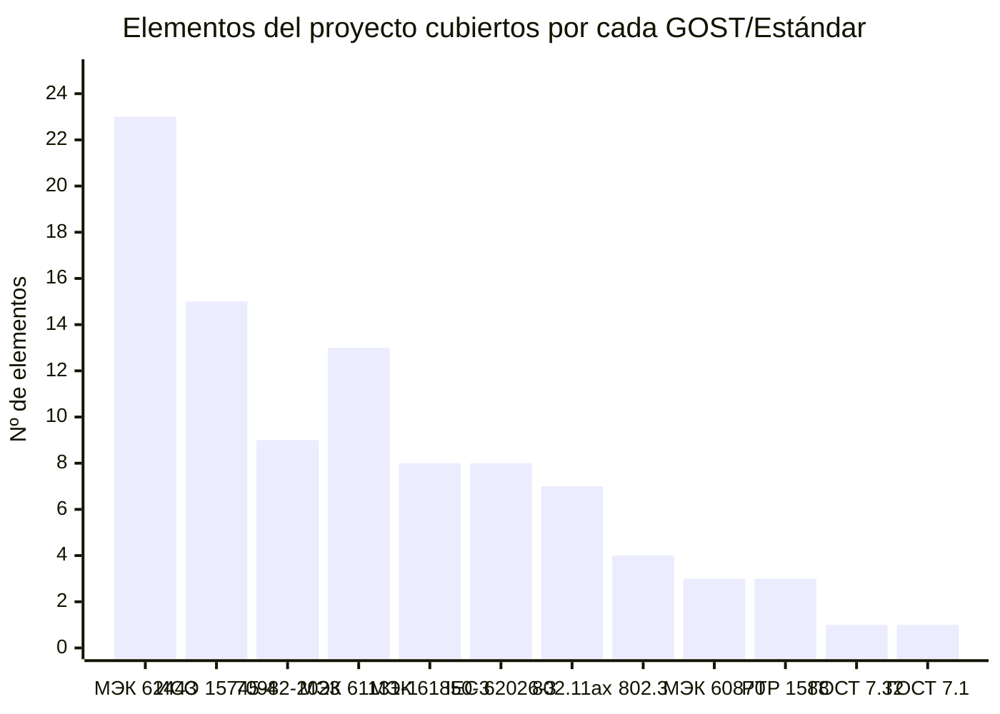

# Trazabilidad normativa del ED Park — Equipo / Tecnología → GOST

## Objetivo de la sección

El objetivo de esta sección es demostrar la coherencia normativa completa del proyecto ED Park mediante una tabla de trazabilidad que mapea cada equipo, tecnología y módulo de software con los estándares GOST e IEEE que lo regulan, indicando la sección específica del estándar aplicable y la justificación técnica de por qué ese estándar aplica a ese elemento del proyecto. Esta tabla es el instrumento central de verificación normativa del proyecto y es fundamental para la defensa académica ante el evaluador.

La trazabilidad abarca todos los componentes descritos en las secciones anteriores:
- Infraestructura física (`03_02`)
- 17 tecnologías de telecomunicaciones (`03_03`)
- 6 módulos de software (`03_04`)
- 13 categorías de equipos hardware (`03_05`)

---

## 1. Base normativa del proyecto

Los doce estándares que regulan el ED Park son:

| # | Código | Título abreviado | Año | Organismo |
|---|--------|-----------------|:---:|-----------|
| N-01 | **ГОСТ Р ИСО 15745-4-2010** | Sistemas de automatización. Perfiles. Parte 4: Ethernet industrial | 2010 | Росстандарт / ISO |
| N-02 | **ГОСТ Р МЭК 61850-3** | Comunicaciones industriales. Requisitos generales de red | 2010+ | Росстандарт / IEC |
| N-03 | **ГОСТ Р 70982-2023** | V2X/V2I — Interacción vehículos e infraestructura | 2023 | Росстандарт |
| N-04 | **ГОСТ Р МЭК 62443-3-3-2016** | Ciberseguridad industrial. Requisitos de sistema SL 1–4 | 2016 | Росстандарт / IEC |
| N-05 | **ГОСТ IEC 62026-3-2015** | Redes de dispositivos industriales (DeviceNet / buses de campo) | 2015 | Росстандарт / IEC |
| N-06 | **ГОСТ Р МЭК 61131-1** | Controladores programables. Parte 1: Principios generales | 2011 | Росстандарт / IEC |
| N-07 | **ГОСТ Р МЭК 60870-5-104** | Telecontrol. Protocolo de transmisión de datos | 2013+ | Росстандарт / IEC |
| N-08 | **IEEE 802.11ax** | Wi-Fi 6/6E — High Efficiency WLAN | 2019 | IEEE |
| N-09 | **IEEE 802.3** | Ethernet estándar | vigente | IEEE |
| N-10 | **IEEE 1588-2019 (PTP v2.1)** | Protocolo de sincronización de tiempo de precisión | 2019 | IEEE |
| N-11 | **ГОСТ 7.32-2017** | Informe de investigación. Estructura y formato | 2017 | Росстандарт |
| N-12 | **ГОСТ 7.1-2003** | Bibliografía. Descripción bibliográfica | 2003 | Росстандарт |

---

## 2. Tabla de trazabilidad completa

### 2.1 Infraestructura de telecomunicaciones

| # | Equipo / Tecnología | Categoría | GOST / Estándar | Código | Sección del estándar | Justificación |
|---|--------------------|-----------|--------------------|:------:|----------------------|---------------|
| T-01 | Wi-Fi industrial (APs industriales interiores, 10 uds.) | Red inalámbrica | IEEE 802.11ax | N-08 | §17 (PHY HE), §26 (MAC HE) | Define las capas física y MAC de Wi-Fi 6 que implementan los APs industriales del parque |
| T-02 | Wi-Fi industrial (APs industriales interiores, 10 uds.) | Red inalámbrica | ГОСТ Р МЭК 61850-3 | N-02 | §5 (requisitos de disponibilidad), §7 (entorno) | Los APs operan en entornos industriales con vibraciones y temperatura extrema; la norma exige certificación de entorno |
| T-03 | Wi-Fi industrial (APs industriales interiores, 10 uds.) | Ciberseguridad | ГОСТ Р МЭК 62443-3-3-2016 | N-04 | §SR 1.1 (autenticación), §SR 3.1 (integridad) | WPA3-Enterprise + 802.1X en los APs requiere cumplimiento del SL 2 de la norma de ciberseguridad |
| T-04 | Wi-Fi 6/6E (banda 6 GHz para AGV, controlador WLC) | Red inalámbrica | IEEE 802.11ax | N-08 | §27 (6 GHz band operation) | La banda de 6 GHz usada para AGV está definida en la enmienda Wi-Fi 6E del estándar |
| T-05 | Red LTE privada (eNodeB + módems AGV) | Red celular | ГОСТ Р МЭК 61850-3 | N-02 | §5.3 (requisitos de rendimiento), §8 (interoperabilidad) | La red LTE privada debe cumplir requisitos de disponibilidad industrial para el control de AGV exterior |
| T-06 | Red LTE privada (eNodeB + módems AGV) | Ciberseguridad | ГОСТ Р МЭК 62443-3-3-2016 | N-04 | §SR 1.1, §SR 3.3 (integridad de sesión) | Los módems LTE de los AGV son dispositivos OT conectados en red; requieren autenticación y cifrado |
| T-07 | Red 5G privada (gNB ×4, core NPN, módems 5G) | Red celular | ГОСТ Р МЭК 61850-3 | N-02 | §5.3, §6 (latencia y determinismo) | 5G privado debe cumplir requisitos de latencia < 1 ms para comunicaciones de control industrial |
| T-08 | Red 5G privada (gNB ×4, core NPN, módems 5G) | V2X | ГОСТ Р 70982-2023 | N-03 | §6 (requisitos de comunicación V2X), §8 (interfaz de red) | 5G es uno de los medios de transporte habilitados para mensajes V2X según la norma rusa |
| T-09 | Red 5G privada (gNB ×4, core NPN, módems 5G) | Ciberseguridad | ГОСТ Р МЭК 62443-3-3-2016 | N-04 | §SR 1.1, §SR 3.1, §SR 5.2 (particionamiento de zonas) | El core 5G privado debe segmentar el tráfico AGV (OT) del tráfico corporativo (IT) |
| T-10 | Ethernet backbone (fibra OM4, Cat6A S/FTP) | Red cableada | IEEE 802.3 | N-09 | §38 (100BASE-FX), §52 (1000BASE-LX) | Define las especificaciones físicas de fibra óptica y cobre para el backbone del parque |
| T-11 | Ethernet backbone (fibra OM4, Cat6A S/FTP) | Automatización | ГОСТ Р ИСО 15745-4-2010 | N-01 | §5 (perfiles de red), §6 (interoperabilidad) | El backbone Ethernet soporta la integración de sistemas de automatización del parque |
| T-12 | Industrial Ethernet (switches + protocolos PROFINET/Modbus TCP) | Automatización | ГОСТ Р ИСО 15745-4-2010 | N-01 | §4 (arquitectura), §7 (perfiles de control) | Industrial Ethernet es la tecnología de red de control definida en los perfiles de la norma |
| T-13 | Industrial Ethernet (switches + protocolos PROFINET/Modbus TCP) | Red industrial | ГОСТ Р МЭК 61850-3 | N-02 | §6 (requisitos de red), §7 (calidad de servicio) | Los switches industriales deben cumplir los requisitos de entorno y QoS definidos en la norma |
| T-14 | Red mesh inalámbrica (nodos fijos + embarcados en AGV) | Red inalámbrica | IEEE 802.11ax | N-08 | §35 (mesh networking, 802.11s) | La topología mesh está definida en la enmienda 802.11s incorporada al estándar 802.11ax |
| T-15 | Red mesh inalámbrica (nodos fijos + embarcados en AGV) | Ciberseguridad | ГОСТ Р МЭК 62443-3-3-2016 | N-04 | §SR 1.1, §SR 3.1 | Los nodos mesh son dispositivos de red expuestos; requieren autenticación y protección de integridad |
| T-16 | Red IoT dedicada Zigbee (sensores T°/HR, presencia, puertas) | Red IoT | ГОСТ IEC 62026-3-2015 | N-05 | §4 (modelo de comunicación), §6 (capa de enlace) | Los sensores Zigbee son dispositivos de campo que se integran con la red de control según esta norma |
| T-17 | Red IoT dedicada Zigbee (sensores T°/HR, presencia, puertas) | Ciberseguridad | ГОСТ Р МЭК 62443-3-3-2016 | N-04 | §SR 1.3 (gestión de autenticadores), §SR 2.1 (autorización) | Los dispositivos IoT son el vector de ataque más frecuente; la norma exige autenticación y control de acceso |
| T-18 | Puntos de acceso Wi-Fi (planificación RF, 14 APs) | Red inalámbrica | IEEE 802.11ax | N-08 | §17, §26, §27 | Los APs implementan las especificaciones PHY y MAC definidas en el estándar |
| T-19 | Switches industriales (núcleo 10G ×2, dist. 1G ×4, campo ×4) | Red industrial | ГОСТ Р ИСО 15745-4-2010 | N-01 | §5 (perfiles de red), §6 | Los switches son los nodos de integración del Ethernet industrial definido en la norma |
| T-20 | Switches industriales (núcleo 10G ×2, dist. 1G ×4, campo ×4) | Red industrial | ГОСТ Р МЭК 61850-3 | N-02 | §5 (disponibilidad), §7 (entorno industrial) | Los switches deben operar a 70 °C, soportar vibraciones y mantener disponibilidad 99.9 % |
| T-21 | Switches industriales (núcleo 10G ×2, dist. 1G ×4, campo ×4) | Red cableada | IEEE 802.3 | N-09 | §30 (gestión), §43 (10GBASE-T) | Los switches 10G del núcleo implementan las especificaciones 10GBASE-T del estándar |
| T-22 | Canales redundantes (RSTP + WAN dual + SAI + dual radio AGV) | Redundancia | ГОСТ Р МЭК 61850-3 | N-02 | §5.3 (tiempo de recuperación < 50 ms), §8.4 (redundancia) | La norma define requisitos de tiempo de recuperación ante fallo de red en sistemas industriales |
| T-23 | Servidores de comunicación (SRV-01 WMS, SRV-02 AGV/SCADA, SRV-03 backup) | IT/OT | ГОСТ Р МЭК 62443-3-3-2016 | N-04 | §SR 1.1, §SR 7.1 (disponibilidad), §SR 7.3 (backup) | Los servidores son los activos más críticos del sistema; la norma exige protección, backup y alta disponibilidad |
| T-24 | Servidores de comunicación (SRV-01 WMS, SRV-02 AGV/SCADA, SRV-03 backup) | Red cableada | IEEE 802.3 | N-09 | §52 (10GBASE-SR fibra), §45 (MDIO) | Los servidores se conectan al backbone a 10 Gbps mediante interfaces 10GBASE-SR |
| T-25 | Gateways de protocolo (Zigbee→MQTT, RFID→TCP, Modbus→OPC-UA) | Automatización | ГОСТ Р МЭК 61131-1 | N-06 | §4 (modelo de comunicación), §6.7 (interfaz con entorno) | Los gateways conectan los PLC y dispositivos de campo con la red IP corporativa |
| T-26 | Gateways de protocolo (Zigbee→MQTT, RFID→TCP, Modbus→OPC-UA) | Red IoT | ГОСТ IEC 62026-3-2015 | N-05 | §5 (capa de red), §7 (mensajería) | Los gateways trasladan los datos de los buses de campo industriales a la red IP |
| T-27 | Gateways de protocolo (Zigbee→MQTT, RFID→TCP, Modbus→OPC-UA) | Automatización | ГОСТ Р ИСО 15745-4-2010 | N-01 | §6 (perfiles de integración) | Los gateways implementan los perfiles de integración de sistemas de automatización |
| T-28 | Edge gateways (IoT, AGV, Seguridad OT, Muelles) | Edge computing | ГОСТ Р МЭК 62443-3-3-2016 | N-04 | §SR 5.1 (segmentación de red), §SR 5.2 (protección de zona) | Los edge gateways implementan el firewall entre la zona OT y la zona IT/exterior |
| T-29 | Edge gateways (IoT, AGV, Seguridad OT, Muelles) | Automatización | ГОСТ Р ИСО 15745-4-2010 | N-01 | §4.3 (gestión de perfiles), §6 | Los edge gateways ejecutan perfiles de integración definidos en la norma |
| T-30 | Servidor GPS-PTP Grandmaster (IEEE 1588, ±50 ns) | Sincronización | IEEE 1588-2019 | N-10 | §7 (relojes), §9 (Best Master Clock), §11 (PTP dataset) | El servidor Grandmaster implementa el rol de reloj maestro PTP definido en la norma |
| T-31 | Boundary Clock en switches núcleo (±100 ns) | Sincronización | IEEE 1588-2019 | N-10 | §8.2 (Boundary Clock), §11.3 | Los switches núcleo implementan el rol Boundary Clock según el estándar PTP |
| T-32 | Transparent Clock en switches distribución/campo (±500 ns) | Sincronización | IEEE 1588-2019 | N-10 | §8.3 (Transparent Clock) | Los switches de distribución implementan Transparent Clock para propagar PTP sin degradación |
| T-33 | Comunicaciones M2M (MQTT + OPC-UA + Modbus TCP) | M2M | ГОСТ Р 70982-2023 | N-03 | §7 (canales de comunicación M2M para vehículos autónomos) | M2M entre AGV y servidor de control está directamente regulado por esta norma |
| T-34 | Comunicaciones M2M (MQTT + OPC-UA + Modbus TCP) | Automatización | ГОСТ Р ИСО 15745-4-2010 | N-01 | §6.3 (interoperabilidad de sistemas), §7 | OPC-UA sobre Ethernet industrial es uno de los perfiles de integración de la norma |
| T-35 | V2X/V2I — RSU (×5 unidades fijas) | V2X | ГОСТ Р 70982-2023 | N-03 | §4 (terminología), §6 (requisitos RSU), §8.2 (interfaz V2I) | Las RSU son la infraestructura fija V2I cuya especificación está directamente definida en la norma |
| T-36 | V2X/V2I — RSU (×5 unidades fijas) | Ciberseguridad | ГОСТ Р МЭК 62443-3-3-2016 | N-04 | §SR 3.1 (integridad de comunicaciones), §SR 1.1 | Los mensajes V2X (BSM, ICA) deben firmarse con ECDSA según los requisitos de integridad de la norma |
| T-37 | V2X/V2I — OBU (×6 embarcados en AGV) | V2X | ГОСТ Р 70982-2023 | N-03 | §5 (requisitos OBU), §8.1 (interfaz V2V/V2I) | Las OBU son el componente embarcado V2X cuya especificación está definida en la norma |
| T-38 | V2X/V2I — OBU (×6 embarcados en AGV) | Red inalámbrica | IEEE 802.11ax | N-08 | §27 (6 GHz), §35 (802.11p/bd herencia) | Las OBU usan Wi-Fi 6 como medio de transporte para mensajes V2X en entorno indoor |

### 2.2 Equipos hardware

| # | Equipo / Tecnología | Categoría | GOST / Estándar | Código | Sección del estándar | Justificación |
|---|--------------------|-----------|--------------------|:------:|----------------------|---------------|
| H-01 | AGV/AMR ×6 (STILL RX 20-20 equiv.) — control de flota | Vehículo autónomo | ГОСТ Р 70982-2023 | N-03 | §5 (requisitos vehículo autónomo), §6 (comunicaciones) | Los AGV son los vehículos autónomos que implementan V2X/V2I según la norma |
| H-02 | AGV/AMR ×6 — controladores embarcados | Control industrial | ГОСТ Р МЭК 61131-1 | N-06 | §2 (definiciones), §3 (modelo del sistema), §4 (software) | Los AGV llevan PLC/controladores embarcados que ejecutan la lógica de navegación |
| H-03 | AGV/AMR ×6 — comunicación Wi-Fi 6E | Red inalámbrica | IEEE 802.11ax | N-08 | §17, §26, §27 | Los AGV se comunican con el servidor de control mediante Wi-Fi 6E |
| H-04 | AGV/AMR ×6 — ciberseguridad de comunicaciones | Ciberseguridad | ГОСТ Р МЭК 62443-3-3-2016 | N-04 | §SR 1.1 (autenticación), §SR 3.3 (integridad de sesión) | Las comunicaciones de control de AGV deben estar autenticadas y cifradas |
| H-05 | Carretillas elevadoras ×4 (Toyota 8FBMKT equiv.) | Manutención | ГОСТ Р МЭК 61131-1 | N-06 | §3.1 (modelo del sistema), §4.1 (unidad de procesamiento) | Los controladores eléctricos de las carretillas son PLC que deben cumplir la norma |
| H-06 | Transpaletas eléctricas ×4 (Crown WP 3035 equiv.) | Manutención | ГОСТ Р МЭК 61131-1 | N-06 | §3.1, §4.1 | Los controladores eléctricos de las transpaletas son PLC que deben cumplir la norma |
| H-07 | Cintas transportadoras ×3 (Hytrol / Interroll / Mettler equiv.) | Automatización | ГОСТ Р МЭК 61131-1 | N-06 | §3 (modelo del sistema), §4 (software PLC), §5 (lenguajes) | Las cintas están controladas por PLC que implementan lógica ladder o structured text |
| H-08 | Cintas transportadoras ×3 — integración con WMS | Automatización | ГОСТ Р ИСО 15745-4-2010 | N-01 | §6 (perfiles de integración), §7.2 | Las cintas se integran con el WMS vía Industrial Ethernet según los perfiles de la norma |
| H-09 | Lectores RFID fijos (pórticos ×6, Zebra FX9600 equiv.) | Identificación | ГОСТ IEC 62026-3-2015 | N-05 | §4 (capa física), §6.2 (trama de datos) | Los lectores RFID son dispositivos de campo que se integran con buses industriales según la norma |
| H-10 | Lectores RFID fijos (pórticos ×6) — seguridad | Ciberseguridad | ГОСТ Р МЭК 62443-3-3-2016 | N-04 | §SR 1.3 (gestión de autenticadores), §SR 2.1 | Los lectores RFID conectados en red son dispositivos OT que requieren autenticación |
| H-11 | Terminales RFID portátiles ×6 (Zebra MC9300 equiv.) | Identificación | ГОСТ IEC 62026-3-2015 | N-05 | §4, §6 | Terminales de campo; se integran con la red de control según la norma |
| H-12 | Terminales RFID portátiles ×6 — Wi-Fi | Red inalámbrica | IEEE 802.11ax | N-08 | §26 (MAC HE para dispositivos de baja latencia) | Los terminales portátiles usan Wi-Fi 6 para comunicarse con el WMS |
| H-13 | Escáneres de código de barras ×10 (Honeywell Granit equiv.) | Identificación | ГОСТ IEC 62026-3-2015 | N-05 | §4, §7 (mensajería de aplicación) | Los escáneres son dispositivos de campo que transmiten datos al WMS |
| H-14 | Escáneres de código de barras ×10 — integración WMS | Automatización | ГОСТ Р ИСО 15745-4-2010 | N-01 | §6.3 (interoperabilidad) | Los escáneres se integran con el WMS mediante perfiles de comunicación de la norma |
| H-15 | Básculas digitales ×3 (Mettler Toledo ICS685 equiv.) | Pesaje | ГОСТ Р ИСО 15745-4-2010 | N-01 | §6 (perfiles de integración con WMS) | Las básculas se integran con el WMS vía Ethernet para transferencia automática de datos de peso |
| H-16 | Básculas digitales ×3 — seguridad de datos | Ciberseguridad | ГОСТ Р МЭК 62443-3-3-2016 | N-04 | §SR 3.1 (integridad de datos de proceso) | Los datos de peso son datos de proceso; su integridad debe estar garantizada por la norma |
| H-17 | Sensores T°/HR Zigbee ×30 (Vaisala HMT120 equiv.) | IoT ambiental | ГОСТ IEC 62026-3-2015 | N-05 | §4 (modelo físico), §6 (enlace de datos) | Los sensores Zigbee son dispositivos de campo de bus industrial según la norma |
| H-18 | Sensores T°/HR Zigbee ×30 — ciberseguridad | Ciberseguridad | ГОСТ Р МЭК 62443-3-3-2016 | N-04 | §SR 1.3, §SR 2.1 (autorización por dispositivo) | Los sensores IoT son el vector de ataque más común; la norma exige autenticación individual |
| H-19 | Sensores de presencia ×20 (Sick PLS101 equiv.) | IoT seguridad | ГОСТ IEC 62026-3-2015 | N-05 | §4, §6 | Sensores de campo que se integran con el sistema de seguridad de zona AGV |
| H-20 | Sensores de presencia ×20 — PLC | Control industrial | ГОСТ Р МЭК 61131-1 | N-06 | §4.2 (entradas digitales del PLC) | Los sensores de presencia se conectan como entradas digitales al PLC de zona AGV |
| H-21 | Detectores de humo e incendio ×20 (Hochiki ESP equiv.) | IoT seguridad | ГОСТ IEC 62026-3-2015 | N-05 | §4, §7 | Dispositivos de campo del sistema de detección de incendio integrado con SCADA |
| H-22 | Sensores apertura puertas/muelles ×6 (Sick WL12L equiv.) | IoT control | ГОСТ Р МЭК 61131-1 | N-06 | §4.2 (entradas digitales del PLC de muelles) | Los sensores de posición de puertas se conectan como entradas al PLC de muelles |
| H-23 | Sensores apertura puertas/muelles ×6 — integración | Automatización | ГОСТ Р ИСО 15745-4-2010 | N-01 | §6.2 (perfil de entrada/salida digital) | Integración de sensores de posición con el SCADA vía perfil I/O de la norma |
| H-24 | Servidores físicos SRV-01/02/03 (Dell PowerEdge equiv.) | IT/OT | ГОСТ Р МЭК 62443-3-3-2016 | N-04 | §SR 1.1, §SR 7.1 (disponibilidad), §SR 7.3 (backup y recuperación) | Los servidores alojan los sistemas de control; la norma exige protección, disponibilidad y backup |
| H-25 | Servidores físicos SRV-01/02/03 — red | Red cableada | IEEE 802.3 | N-09 | §52 (10GBASE-SR), §45 (gestión) | Los servidores usan interfaces 10GBASE-SR para conectarse al backbone de fibra |
| H-26 | SAI / UPS ×2 (APC Smart-UPS equiv.) | Alimentación | ГОСТ Р МЭК 61850-3 | N-02 | §5.4 (disponibilidad de alimentación), §8.5 (continuidad de servicio) | La norma exige alimentación ininterrumpida para los equipos de comunicación industrial críticos |
| H-27 | Climatización de precisión zona B ×2 (Stulz CyberAir equiv.) | Ambiental | ГОСТ Р МЭК 61131-1 | N-06 | §4.1 (PLC de control de proceso), §5.2 (bloques funcionales) | Las unidades de precisión se controlan mediante PLC con bloques funcionales de control PID |
| H-28 | Climatización de precisión zona B ×2 — IoT | Ciberseguridad | ГОСТ Р МЭК 62443-3-3-2016 | N-04 | §SR 2.1, §SR 3.1 | Los datos de T°/HR de la climatización son datos de proceso críticos que deben protegerse |
| H-29 | Climatización industrial naves ×2 + sala control ×1 + oficinas ×1 | Ambiental | ГОСТ Р МЭК 61131-1 | N-06 | §4.1, §5 | Los controladores electrónicos de los climatizadores son PLC que deben cumplir la norma |
| H-30 | Impresoras de etiquetas ×4 (Zebra ZT411 equiv.) | Periférico | ГОСТ Р ИСО 15745-4-2010 | N-01 | §6.3 (integración con WMS vía Ethernet) | Las impresoras se integran con el WMS para recibir trabajos de impresión de etiquetas |
| H-31 | Cámaras IP industriales interiores ×8 (Axis P3245 equiv.) | Seguridad / V2X | ГОСТ Р МЭК 62443-3-3-2016 | N-04 | §SR 1.1 (autenticación de dispositivo), §SR 3.1 | Las cámaras IP conectadas en red son dispositivos OT que requieren autenticación y cifrado |
| H-32 | Cámaras IP industriales interiores ×8 — V2X | V2X | ГОСТ Р 70982-2023 | N-03 | §6.3 (sensores de percepción de infraestructura V2I) | Las cámaras aportan percepción del entorno a la infraestructura V2I para detección de obstáculos |
| H-33 | Cámaras IP PTZ exteriores ×4 (Axis Q6135 equiv.) | Seguridad | ГОСТ Р МЭК 62443-3-3-2016 | N-04 | §SR 1.1, §SR 3.1 | Cámaras exteriores conectadas en red; mismos requisitos de ciberseguridad |
| H-34 | PLC muelles ×2 (Siemens S7-1200 equiv.) | Control industrial | ГОСТ Р МЭК 61131-1 | N-06 | §3 (modelo del sistema PLC), §4 (hardware), §5 (lenguajes de programación) | Los PLC de muelles controlan las puertas seccionales; deben cumplir la norma de controladores |
| H-35 | PLC muelles ×2 — integración con SCADA | Automatización | ГОСТ Р ИСО 15745-4-2010 | N-01 | §6 (perfil de integración Modbus TCP / OPC-UA) | Los PLC se integran con el SCADA vía Modbus TCP según el perfil de integración de la norma |
| H-36 | PLC muelles ×2 — telecontrol | Telecontrol | ГОСТ Р МЭК 60870-5-104 | N-07 | §5 (estructura de trama), §7 (funciones de aplicación) | Si se implementa supervisión remota de muelles, el protocolo de telecontrol 104 es la referencia |
| H-37 | PLC cintas ×1 (Siemens S7-1200 equiv.) | Control industrial | ГОСТ Р МЭК 61131-1 | N-06 | §3, §4, §5 | PLC de control de cintas; mismos requisitos que PLC de muelles |
| H-38 | PLC cintas ×1 — integración con WMS | Automatización | ГОСТ Р ИСО 15745-4-2010 | N-01 | §6.2 (perfil I/O digital / analógico) | El PLC de cintas reporta estado al WMS vía Industrial Ethernet |
| H-39 | PLC climatización ×1 (Honeywell Spyder equiv.) | Control industrial | ГОСТ Р МЭК 61131-1 | N-06 | §3, §4.1, §5.2 (bloques funcionales PID) | PLC de control de precisión T°/HR zona B; implementa bloques funcionales de regulación |
| H-40 | PLC climatización ×1 — SCADA | Telecontrol | ГОСТ Р МЭК 60870-5-104 | N-07 | §7 (funciones de adquisición de datos) | Si el SCADA supervisa la climatización remotamente, el protocolo 104 aplica |

### 2.3 Software de gestión

| # | Módulo de software | Categoría | GOST / Estándar | Código | Sección del estándar | Justificación |
|---|-------------------|-----------|--------------------|:------:|----------------------|---------------|
| S-01 | M-01 WMS — control de acceso RBAC | Ciberseguridad | ГОСТ Р МЭК 62443-3-3-2016 | N-04 | §SR 1.1 (autenticación), §SR 2.1 (autorización) | El WMS gestiona datos de inventario críticos; requiere control de acceso por rol (SL 2) |
| S-02 | M-01 WMS — cifrado de datos en tránsito (TLS 1.3) | Ciberseguridad | ГОСТ Р МЭК 62443-3-3-2016 | N-04 | §SR 4.1 (confidencialidad de información), §SR 4.2 | Las APIs del WMS transmiten datos de inventario; deben cifrarse en tránsito |
| S-03 | M-01 WMS — integración Industrial Ethernet | Automatización | ГОСТ Р ИСО 15745-4-2010 | N-01 | §6.3 (interoperabilidad con sistemas de automatización) | El WMS se integra con cintas, RFID y PLC vía Industrial Ethernet; aplica el perfil de la norma |
| S-04 | M-02 Control AGV — protocolo V2X | V2X | ГОСТ Р 70982-2023 | N-03 | §7 (canales M2M), §8 (interfaz vehículo-infraestructura) | El sistema de control AGV implementa las comunicaciones V2X reguladas por la norma |
| S-05 | M-02 Control AGV — controladores PLC embarcados | Control industrial | ГОСТ Р МЭК 61131-1 | N-06 | §3 (modelo del sistema), §4 (PLC embarcado), §5 | Los AGV llevan PLC embarcados cuya lógica de control debe cumplir la norma |
| S-06 | M-02 Control AGV — ciberseguridad de comandos | Ciberseguridad | ГОСТ Р МЭК 62443-3-3-2016 | N-04 | §SR 1.1, §SR 3.3 (integridad de sesión de control) | Los comandos de navegación son críticos; requieren autenticación y verificación de integridad |
| S-07 | M-03 V2X/V2I — mensajes BSM/SPaT/ICA/MAP | V2X | ГОСТ Р 70982-2023 | N-03 | §4 (terminología), §6 (requisitos de mensaje), §8 | El módulo implementa exactamente los mensajes y protocolos definidos en la norma |
| S-08 | M-03 V2X/V2I — cifrado ECDSA de mensajes | Ciberseguridad | ГОСТ Р МЭК 62443-3-3-2016 | N-04 | §SR 3.1 (integridad de comunicaciones) | Los mensajes V2X deben firmarse digitalmente; la norma exige integridad de comunicaciones |
| S-09 | M-04 SCADA — telecontrol de muelles y PLC | Telecontrol | ГОСТ Р МЭК 60870-5-104 | N-07 | §5 (estructura de trama ASDU), §7 (funciones de control) | El SCADA supervisa y controla los PLC de muelles mediante el protocolo de telecontrol de la norma |
| S-10 | M-04 SCADA — integración OPC-UA / Modbus | Automatización | ГОСТ Р ИСО 15745-4-2010 | N-01 | §6.3 (interoperabilidad OPC-UA en perfil Ethernet industrial) | El SCADA se integra con los PLC mediante OPC-UA, que es uno de los perfiles de la norma |
| S-11 | M-04 SCADA — seguridad de la zona OT | Ciberseguridad | ГОСТ Р МЭК 62443-3-3-2016 | N-04 | §SR 5.1 (segmentación), §SR 5.2 (protección de zona OT) | El SCADA reside en la zona OT, que debe estar segmentada y protegida según la norma |
| S-12 | M-05 Integración — API externa (TLS 1.3 + OAuth 2.0) | Ciberseguridad | ГОСТ Р МЭК 62443-3-3-2016 | N-04 | §SR 1.1, §SR 4.1, §SR 5.2 (zona de integración IT/exterior) | La zona de integración con sistemas externos es la superficie de ataque IT más expuesta |
| S-13 | M-05 Integración — interoperabilidad con ERP/TMS | Automatización | ГОСТ Р ИСО 15745-4-2010 | N-01 | §6.3 (integración de sistemas externos mediante perfiles) | La integración con ERP del cliente usa los mismos perfiles de interoperabilidad de la norma |
| S-14 | M-06 UI — autenticación de usuarios (RBAC + JWT) | Ciberseguridad | ГОСТ Р МЭК 62443-3-3-2016 | N-04 | §SR 1.1 (autenticación de factores), §SR 2.1 (autorización basada en rol) | La interfaz de usuario es el punto de entrada de todos los operadores; requiere autenticación robusta |
| S-15 | Documentación técnica del proyecto | Documentación | ГОСТ 7.32-2017 | N-11 | §4 (estructura del informe), §5 (reglas de formato), §6 (elementos del informe) | Todo el proyecto académico debe seguir el formato del informe de investigación de la norma |
| S-16 | Bibliografía y citas normativas del proyecto | Documentación | ГОСТ 7.1-2003 | N-12 | §4 (descripción bibliográfica), §5 (formato de cita) | Todas las referencias bibliográficas del documento final deben seguir el formato de la norma |

---

## 3. Resumen por GOST — Número de elementos cubiertos

| Código | GOST / Estándar | Elementos cubiertos | Categorías |
|:------:|-----------------|--------------------|-----------|
| N-01 | **ГОСТ Р ИСО 15745-4-2010** | T-11, T-12, T-27, T-29, T-34, H-08, H-14, H-15, H-23, H-30, H-35, H-38, S-03, S-10, S-13 | **15 elementos** — Automatización industrial, Ethernet industrial, integración de sistemas |
| N-02 | **ГОСТ Р МЭК 61850-3** | T-02, T-05, T-07, T-13, T-20, T-22, T-24, H-26 | **8 elementos** — Disponibilidad de red, entornos industriales duros, alimentación continua |
| N-03 | **ГОСТ Р 70982-2023** | T-08, T-33, T-35, T-36, T-37, H-01, H-32, S-04, S-07 | **9 elementos** — V2X/V2I, AGV, comunicaciones vehículo-infraestructura |
| N-04 | **ГОСТ Р МЭК 62443-3-3-2016** | T-03, T-06, T-09, T-15, T-17, T-23, T-28, T-36, H-04, H-10, H-16, H-18, H-24, H-28, H-31, H-33, S-01, S-02, S-06, S-08, S-11, S-12, S-14 | **23 elementos** — Ciberseguridad en toda la cadena IT/OT |
| N-05 | **ГОСТ IEC 62026-3-2015** | T-16, T-26, H-09, H-11, H-13, H-17, H-19, H-21 | **8 elementos** — Dispositivos de campo IoT, RFID, sensores, buses industriales |
| N-06 | **ГОСТ Р МЭК 61131-1** | T-25, H-02, H-05, H-06, H-07, H-20, H-22, H-27, H-29, H-34, H-37, H-39, S-05 | **13 elementos** — PLC en AGV, carretillas, cintas, muelles, climatización, sensores |
| N-07 | **ГОСТ Р МЭК 60870-5-104** | H-36, H-40, S-09 | **3 elementos** — Telecontrol remoto de PLC, SCADA, supervisión remota de muelles |
| N-08 | **IEEE 802.11ax** | T-01, T-04, T-14, T-18, T-38, H-03, H-12 | **7 elementos** — Wi-Fi 6/6E en APs, AGV, terminales, mesh, OBU V2X |
| N-09 | **IEEE 802.3** | T-10, T-21, T-24, H-25 | **4 elementos** — Backbone Ethernet, switches 10G, interfaces de servidores |
| N-10 | **IEEE 1588-2019 (PTP)** | T-30, T-31, T-32 | **3 elementos** — Grandmaster, Boundary Clock, Transparent Clock |
| N-11 | **ГОСТ 7.32-2017** | S-15 | **1 elemento** — Formato del documento académico completo |
| N-12 | **ГОСТ 7.1-2003** | S-16 | **1 elemento** — Bibliografía y referencias del proyecto |
| **TOTAL** | | **95 vínculos de trazabilidad** | |

---

## 4. Mapa de calor de cobertura normativa

---

## 5. Trazabilidad inversa — por sección del proyecto

La siguiente tabla muestra desde qué sección del proyecto se referencia cada estándar:

| GOST / Estándar | 03_02 Física | 03_03 Telecom | 03_04 Software | 03_05 Hardware | Total secciones |
|----------------|:------------:|:-------------:|:--------------:|:--------------:|:---------------:|
| ГОСТ Р ИСО 15745-4-2010 | ✓ | ✓ | ✓ | ✓ | 4 |
| ГОСТ Р МЭК 61850-3 | ✓ | ✓ | — | ✓ | 3 |
| ГОСТ Р 70982-2023 | ✓ | ✓ | ✓ | ✓ | 4 |
| ГОСТ Р МЭК 62443-3-3-2016 | ✓ | ✓ | ✓ | ✓ | 4 |
| ГОСТ IEC 62026-3-2015 | — | ✓ | — | ✓ | 2 |
| ГОСТ Р МЭК 61131-1 | — | ✓ | ✓ | ✓ | 3 |
| ГОСТ Р МЭК 60870-5-104 | — | — | ✓ | ✓ | 2 |
| IEEE 802.11ax | — | ✓ | — | ✓ | 2 |
| IEEE 802.3 | — | ✓ | — | ✓ | 2 |
| IEEE 1588-2019 (PTP) | — | ✓ | — | — | 1 |
| ГОСТ 7.32-2017 | ✓ | ✓ | ✓ | — | 3 |
| ГОСТ 7.1-2003 | — | — | — | — | transversal |

Los cuatro estándares con cobertura en las cuatro secciones de diseño técnico (ГОСТ Р ИСО 15745-4-2010, ГОСТ Р 70982-2023 y ГОСТ Р МЭК 62443-3-3-2016) son los pilares normativos del proyecto ED Park.

---

## 6. Referencias normativas de la sección

- **ГОСТ Р ИСО 15745-4-2010**. Системы автоматизации производства и их интеграция. Профили. Часть 4. Профили систем управления на основе Ethernet. — М.: Стандартинформ, 2010. — 48 с.
- **ГОСТ Р МЭК 61850-3**. Коммуникационные системы и сети в электроэнергетике. Часть 3. Общие требования к коммуникационным системам и сетям. — М.: Стандартинформ.
- **ГОСТ Р 70982-2023**. Безопасность дорожного движения. Системы связи и управления транспортными средствами. Взаимодействие транспортных средств и инфраструктуры. — М.: Стандартинформ, 2023.
- **ГОСТ Р МЭК 62443-3-3-2016**. Системы и меры по обеспечению кибербезопасности промышленных автоматизированных систем. Часть 3-3. Системные требования к безопасности. — М.: Стандартинформ, 2016.
- **ГОСТ IEC 62026-3-2015**. Технологии связи для промышленных систем управления. Сети DeviceNet. — М.: Стандартинформ, 2015.
- **ГОСТ Р МЭК 61131-1**. Программируемые контроллеры. Часть 1. Общие сведения и основные принципы. — М.: Стандартинформ, 2011.
- **ГОСТ Р МЭК 60870-5-104**. Системы дистанционного управления. Часть 5-104. Протокол передачи данных для телемеханики. — М.: Стандартинформ.
- **IEEE 802.11ax**. High Efficiency Wireless LAN. — IEEE, 2019.
- **IEEE 802.3**. Ethernet Standard. — IEEE, edición vigente.
- **IEEE 1588-2019**. Precision Time Protocol (PTP v2.1). — IEEE, 2019.
- **ГОСТ 7.32-2017**. Отчет о научно-исследовательской работе. Структура и правила оформления. — М.: Стандартинформ, 2017.
- **ГОСТ 7.1-2003**. Библиографическая запись. Библиографическое описание. — М.: Издательство стандартов, 2003.

---

## 7. Checklist de la sección

- [x] Definir los 12 estándares GOST/IEEE del proyecto con código, título y año
- [x] Tabla T — Trazabilidad infraestructura telecom (38 vínculos, tecnologías T-01 a T-38)
- [x] Tabla H — Trazabilidad equipos hardware (40 vínculos, equipos H-01 a H-40)
- [x] Tabla S — Trazabilidad módulos de software (16 vínculos, módulos S-01 a S-16)
- [x] Resumen por GOST: 12 estándares × número de elementos cubiertos (total 95 vínculos)
- [x] Mapa de calor de cobertura normativa (diagrama Mermaid xychart)
- [x] Trazabilidad inversa: por sección del proyecto (03_02 / 03_03 / 03_04 / 03_05)
- [x] Identificar los 3 estándares pilares con cobertura en las 4 secciones de diseño
- [x] Referencias normativas completas (12 estándares en formato ГОСТ 7.1-2003)
- [x] Coherencia con todas las secciones anteriores (03_01 a 03_05)

---

## 8. Conclusión

La tabla de trazabilidad normativa del ED Park registra **95 vínculos** entre los 94 elementos del proyecto (38 tecnologías de telecom, 40 equipos hardware, 16 módulos/aspectos de software) y los 12 estándares GOST e IEEE aplicables. El estándar con mayor cobertura es **ГОСТ Р МЭК 62443-3-3-2016** (ciberseguridad) con 23 elementos, lo que refleja que la seguridad es un requisito transversal a toda la infraestructura IT/OT del parque. Los tres estándares pilares del proyecto — ГОСТ Р ИСО 15745-4-2010, ГОСТ Р 70982-2023 y ГОСТ Р МЭК 62443-3-3-2016 — aparecen en las cuatro secciones de diseño técnico, demostrando la coherencia normativa del proyecto de principio a fin.
