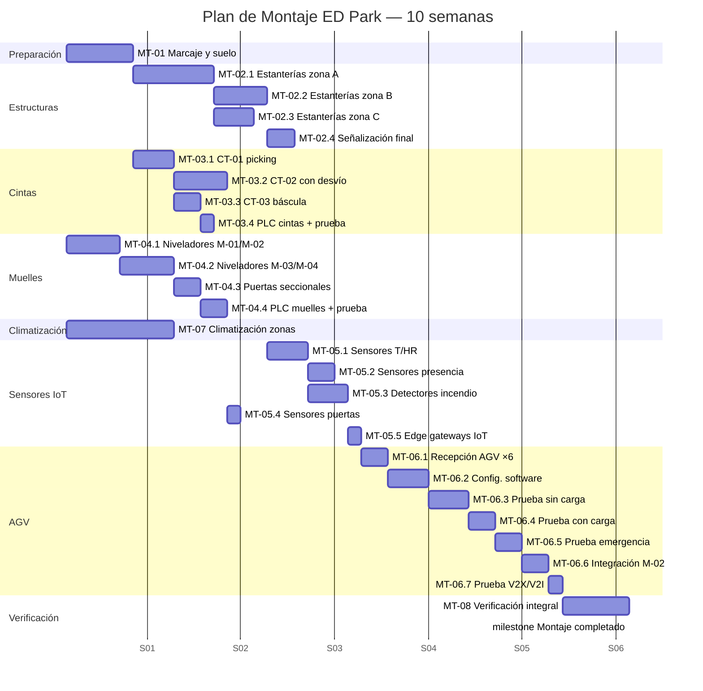
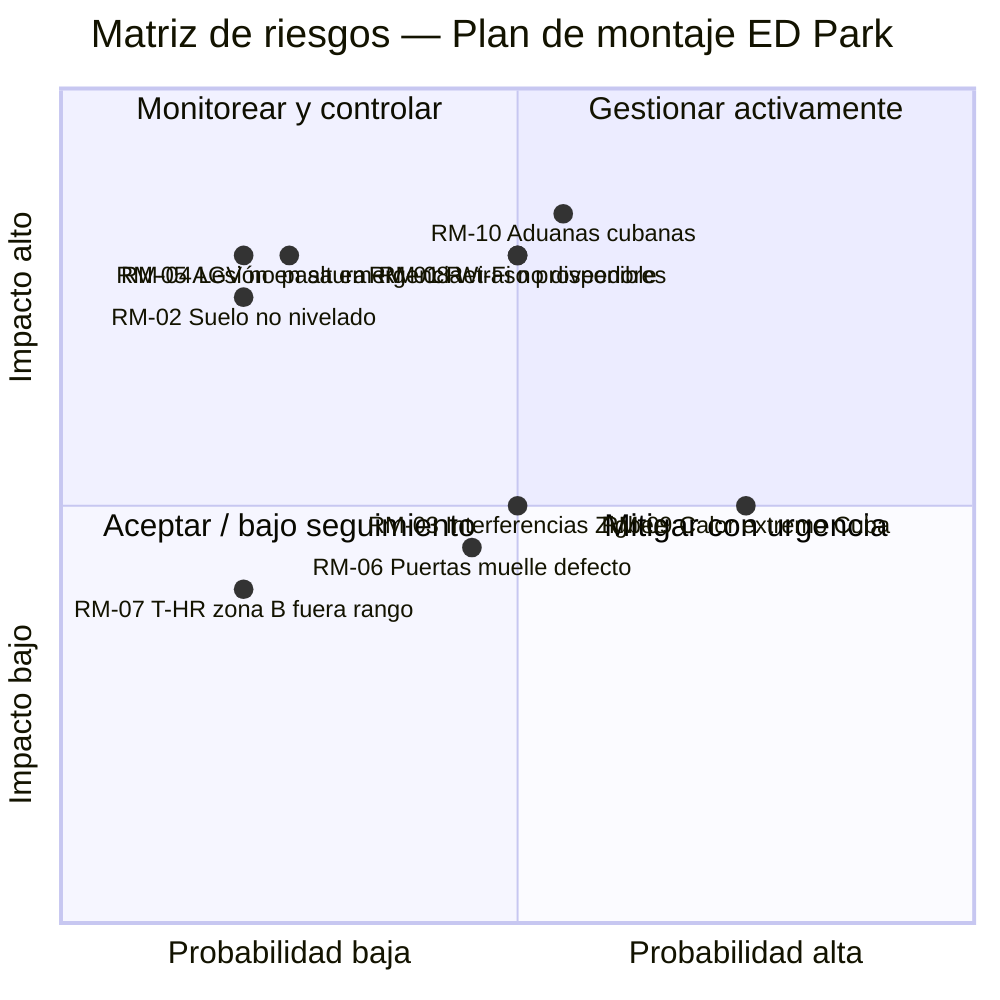

# Plan de Montaje del ED Park

## Objetivo de la sección

El objetivo de esta sección es planificar en detalle las tareas de montaje físico de los equipos del ED Park: estanterías, cintas transportadoras, muelles de carga, sensores IoT y puesta en servicio de los AGV/AMR. Para cada tarea se define la descripción, la duración estimada, los recursos humanos y materiales necesarios, las dependencias con otras tareas y el estándar GOST aplicable. La sección cierra con el cronograma de montaje en formato Gantt, la matriz de riesgos de montaje y el checklist de la fase.

> ⚠️ **Aclaración: planificación virtual.** Este plan de montaje corresponde a un proyecto académico. No se ejecuta ningún trabajo físico real. Las duraciones, recursos y costos son estimaciones técnicas para fines de gestión de proyectos.

---

## 1. Condiciones previas al inicio del montaje

Antes de iniciar cualquier tarea de montaje deben cumplirse las siguientes condiciones:

| Condición previa | Responsable | Estado esperado |
|-----------------|------------|----------------|
| Nave principal y nave recepción entregadas por obra civil | Contratista civil | Suelo nivelado, paredes terminadas, cubierta sellada |
| Instalación eléctrica básica completada (tomas de fuerza, iluminación) | Electricista | Certificado de instalación eléctrica |
| Sistema contra incendios básico instalado | Contratista FAS | Rociadores y detectores de humo operativos |
| Planos de planta aprobados con ubicaciones definitivas | Jefe de proyecto | Versión 1.0 firmada |
| Equipos recibidos en almacén temporal | Logística | Inventario verificado al 100 % |
| Acceso al parque con vehículos de carga y elevación | Coordinador de obra | Caminos de acceso despejados |

---

## 2. Estructura de desglose de tareas de montaje

El montaje del ED Park se organiza en cinco grupos de tareas (MT = Montaje Task):

```
MT-01 Preparación del suelo y marcaje
MT-02 Montaje de estanterías
MT-03 Montaje de cintas transportadoras
MT-04 Instalación de muelles de carga
MT-05 Montaje de sensores IoT y sistemas de seguridad
MT-06 Puesta en servicio de AGV/AMR
MT-07 Montaje de equipos de climatización
MT-08 Verificación y pruebas de montaje
```

---

## 3. Tareas de montaje — Descripción detallada

### MT-01 — Preparación del suelo y marcaje de zonas

| Atributo | Detalle |
|----------|---------|
| **Descripción** | Marcaje en suelo de todas las zonas funcionales del parque: pasillos de AGV (franjas amarillas 100 mm), zonas de almacenamiento A/B/C, zona de picking, muelles, estaciones de carga de AGV y señalización de seguridad perimetral. Instalación de cinta magnética guía en el suelo para el sistema de navegación de los AGV. |
| **Duración estimada** | 5 días hábiles |
| **Recursos humanos** | 2 técnicos de suelo, 1 supervisor de montaje |
| **Recursos materiales** | Pintura epoxi industrial amarilla/blanca, cinta magnética para AGV (180 m), señalización GOST, plantillas de marcaje |
| **Dependencias** | Suelo de nave terminado y nivelado (condición previa); planos aprobados |
| **GOST aplicable** | — (señalización según normas de seguridad industrial cubanas + estándares de planta) |
| **Costo estimado** | 85,000 ₽ |

---

### MT-02 — Montaje de estanterías

| Atributo | Detalle |
|----------|---------|
| **Descripción** | Montaje e instalación de los tres sistemas de estanterías de la nave principal: Zona A (estanterías selectivas convencionales, 5 niveles, 50 m de longitud total), Zona B (estanterías de temperatura controlada, 4 niveles, 25 m), Zona C (estanterías de flujo por gravedad, 3 niveles, 30 m). Incluye anclaje al suelo con tacos químicos, nivelación, apriete de uniones y señalización de capacidad. |
| **Duración estimada** | 15 días hábiles |
| **Recursos humanos** | 4 técnicos de montaje de estructuras metálicas, 1 supervisor, 1 técnico de calidad |
| **Recursos materiales** | Estanterías selectivas (lote), estanterías flujo por gravedad (lote), tacos químicos ×200, nivel láser, llaves de impacto, andamio móvil |
| **Dependencias** | MT-01 (marcaje de zonas completado); suelo nivelado certificado |
| **GOST aplicable** | **ГОСТ Р ИСО 15745-4-2010** — integración de las estanterías con el sistema de ubicaciones del WMS; **ГОСТ Р МЭК 61131-1** — si se incorporan sensores de ocupación controlados por PLC |
| **Costo estimado** | 320,000 ₽ (mano de obra; equipos incluidos en presupuesto hardware) |

#### MT-02 Subtareas

| ID | Subtarea | Días | Recursos |
|----|---------|:----:|---------|
| MT-02.1 | Montaje bastidores y largueros zona A (700 m²) | 6 | 4 técnicos |
| MT-02.2 | Montaje estanterías zona B (temperatura controlada, 250 m²) | 4 | 3 técnicos + técnico climatización |
| MT-02.3 | Montaje estanterías flujo zona C (300 m²) | 3 | 3 técnicos |
| MT-02.4 | Señalización de capacidad y nivelación final | 2 | 2 técnicos + supervisor |

---

### MT-03 — Montaje de cintas transportadoras

| Atributo | Detalle |
|----------|---------|
| **Descripción** | Instalación de las tres cintas transportadoras del parque: CT-01 (cinta recta 10 m, zona picking → consolidación), CT-02 (cinta con desvío 15 m + 1 desvío, nave recepción) y CT-03 (cinta de pesaje integrado 5 m, antes de expedición). Incluye ensamblaje mecánico, alineación de la banda, conexión eléctrica a cuadros de control, configuración de velocidad de los variadores y prueba de marcha en vacío. |
| **Duración estimada** | 10 días hábiles |
| **Recursos humanos** | 3 técnicos mecánicos, 1 electricista industrial, 1 técnico de automatización (PLC), 1 supervisor |
| **Recursos materiales** | Soportes de suelo, tornillería de fijación, cable de fuerza (16 mm²), cuadro eléctrico de cintas, variadores de frecuencia |
| **Dependencias** | MT-01 (marcaje); instalación eléctrica básica completada; PLC de cintas disponible |
| **GOST aplicable** | **ГОСТ Р МЭК 61131-1** — programación del PLC de control de cintas; **ГОСТ Р ИСО 15745-4-2010** — integración de cintas con WMS vía Industrial Ethernet |
| **Costo estimado** | 180,000 ₽ (mano de obra e instalación eléctrica) |

#### MT-03 Subtareas

| ID | Subtarea | Días | Recursos |
|----|---------|:----:|---------|
| MT-03.1 | Ensamblaje mecánico CT-01 (zona picking) | 3 | 3 técnicos |
| MT-03.2 | Ensamblaje CT-02 con desvío (nave recepción) | 4 | 3 técnicos + electricista |
| MT-03.3 | Instalación CT-03 con báscula integrada | 2 | 2 técnicos + técnico pesaje |
| MT-03.4 | Conexión PLC y prueba de marcha en vacío | 1 | técnico automatización + supervisor |

---

### MT-04 — Instalación de muelles de carga

| Atributo | Detalle |
|----------|---------|
| **Descripción** | Instalación y puesta en servicio de los cuatro muelles de carga del ED Park (M-01 a M-04): montaje de los niveladores hidráulicos abatibles, instalación de las puertas seccionales con motor eléctrico, instalación del sellado perimetral de goma, cableado de los actuadores a los PLC de muelles, prueba de apertura/cierre eléctrico y ajuste de recorrido. Incluye también la instalación de los sensores de posición de puerta (abierta/cerrada) conectados al SCADA. |
| **Duración estimada** | 12 días hábiles |
| **Recursos humanos** | 3 técnicos de instalación industrial, 1 electricista industrial, 1 técnico de automatización, 1 supervisor |
| **Recursos materiales** | Niveladores hidráulicos ×4, puertas seccionales ×4 (motorizadas), sellado de goma ×4, cable de mando 24 V, sensores de posición ×6 |
| **Dependencias** | Estructura de los muelles terminada por obra civil; instalación eléctrica básica completada; PLC de muelles disponible |
| **GOST aplicable** | **ГОСТ Р МЭК 61131-1** — PLC de control de puertas seccionales; **ГОСТ Р МЭК 60870-5-104** — si la supervisión de muelles se integra con el SCADA remoto; **ГОСТ Р ИСО 15745-4-2010** — integración con WMS para coordinación de muelles |
| **Costo estimado** | 240,000 ₽ (mano de obra; equipos en presupuesto hardware) |

#### MT-04 Subtareas

| ID | Subtarea | Días | Recursos |
|----|---------|:----:|---------|
| MT-04.1 | Instalación niveladores hidráulicos M-01 y M-02 | 4 | 3 técnicos |
| MT-04.2 | Instalación niveladores hidráulicos M-03 y M-04 | 4 | 3 técnicos |
| MT-04.3 | Instalación puertas seccionales motorizadas ×4 | 2 | 2 técnicos + electricista |
| MT-04.4 | Cableado PLC + sensores posición + prueba ciclo completo | 2 | técnico automatización + supervisor |

---

### MT-05 — Montaje de sensores IoT y sistemas de seguridad

| Atributo | Detalle |
|----------|---------|
| **Descripción** | Instalación de los 76 sensores IoT del ED Park distribuidos en cuatro categorías: (a) 30 sensores de temperatura y humedad Zigbee en zona B y nave principal (montaje en perfil metálico cada 10 m²), (b) 20 sensores de presencia en pasillos y zona AGV (montaje en columnas a 1.5 m de altura), (c) 20 detectores de humo e incendio distribuidos en toda la superficie cubierta (montaje en techo según normativa FAS), (d) 6 sensores de apertura de puertas en muelles. Incluye también la instalación de los 4 edge gateways IoT en sus ubicaciones definitivas y la verificación del enlace Zigbee de cada sensor. |
| **Duración estimada** | 10 días hábiles |
| **Recursos humanos** | 3 técnicos de sistemas IoT, 1 técnico de seguridad (FAS), 1 técnico de red, 1 supervisor |
| **Recursos materiales** | Soportes de montaje para sensores, cable de alimentación 24 V DC, conectores IP67, taladro con broca para hormigón, gateway Zigbee ×4 |
| **Dependencias** | MT-01 (marcaje de zonas); cableado eléctrico de baja tensión completado; red Ethernet de campo parcialmente operativa (para configuración de gateways) |
| **GOST aplicable** | **ГОСТ IEC 62026-3-2015** — integración de sensores Zigbee con buses de campo industriales; **ГОСТ Р МЭК 62443-3-3-2016** — seguridad de dispositivos IoT conectados; **ГОСТ Р МЭК 61131-1** — sensores de presencia conectados como entradas digitales al PLC de zona AGV |
| **Costo estimado** | 95,000 ₽ (mano de obra; sensores en presupuesto hardware) |

#### MT-05 Subtareas

| ID | Subtarea | Días | Recursos |
|----|---------|:----:|---------|
| MT-05.1 | Instalación sensores T°/HR zona B (20 uds.) + zona A (10 uds.) | 3 | 2 técnicos IoT |
| MT-05.2 | Instalación sensores presencia pasillos + zona AGV (20 uds.) | 2 | 2 técnicos IoT |
| MT-05.3 | Instalación detectores humo/incendio (20 uds.) | 3 | técnico FAS + técnico IoT |
| MT-05.4 | Instalación sensores puertas muelles (6 uds.) + cableado | 1 | técnico IoT + electricista |
| MT-05.5 | Instalación y configuración edge gateways IoT ×4 | 1 | técnico de red + supervisor |

---

### MT-06 — Puesta en servicio de AGV/AMR

| Atributo | Detalle |
|----------|---------|
| **Descripción** | Puesta en servicio de los 6 AGV/AMR del ED Park. El proceso incluye: (a) descarga y posicionamiento inicial de cada AGV en la zona de carga, (b) verificación del estado mecánico y electrónico del vehículo, (c) instalación y ajuste de la cinta magnética guía en el suelo (realizado en MT-01), (d) configuración del software de control embarcado con los parámetros de la instalación (velocidades, zonas de reducción, puntos de parada), (e) carga inicial de baterías (ciclo completo 4 horas), (f) pruebas de navegación en rutas predefinidas sin carga, (g) pruebas de navegación con carga nominal, (h) pruebas de parada de emergencia ante obstáculo, (i) integración con el servidor de control de flota (M-02) y verificación de comunicaciones Wi-Fi 6E. |
| **Duración estimada** | 15 días hábiles |
| **Recursos humanos** | 2 técnicos especialistas AGV (del fabricante o certificados), 1 técnico de redes, 1 técnico de automatización, 1 supervisor de puesta en marcha |
| **Recursos materiales** | Laptop de configuración, cable USB de diagnóstico, carrito de herramientas del fabricante, conos de señalización, dinamómetro de tracción |
| **Dependencias** | MT-01 (cinta magnética instalada); red Wi-Fi 6E operativa en naves (ver `04_02_Plan_Instalacion.md`); servidor M-02 instalado; zona AGV libre de obstáculos |
| **GOST aplicable** | **ГОСТ Р 70982-2023** — V2X/V2I, comunicaciones del AGV con la infraestructura; **ГОСТ Р МЭК 62443-3-3-2016** — configuración segura del OBU V2X embarcado; **ГОСТ Р МЭК 61131-1** — controladores lógicos embarcados del AGV; **IEEE 802.11ax** — configuración de la radio Wi-Fi 6E del AGV |
| **Costo estimado** | 280,000 ₽ (técnicos especialistas del fabricante + viáticos) |

#### MT-06 Subtareas

| ID | Subtarea | Días | Recursos |
|----|---------|:----:|---------|
| MT-06.1 | Recepción, inspección física y carga inicial (6 AGV) | 2 | 2 técnicos AGV |
| MT-06.2 | Configuración software embarcado: parámetros de planta | 3 | 2 técnicos AGV + técnico automatización |
| MT-06.3 | Pruebas de navegación sin carga (rutas básicas) | 3 | 2 técnicos AGV + supervisor |
| MT-06.4 | Pruebas de navegación con carga nominal (1,000 kg) | 2 | 2 técnicos AGV + supervisor |
| MT-06.5 | Pruebas de parada de emergencia (< 500 ms) | 2 | 2 técnicos AGV + técnico seguridad |
| MT-06.6 | Integración con servidor M-02 y prueba de comunicaciones | 2 | técnico redes + técnico automatización |
| MT-06.7 | Prueba de V2X/V2I con RSU instaladas | 1 | técnico redes + técnico AGV |

---

### MT-07 — Montaje de equipos de climatización

| Atributo | Detalle |
|----------|---------|
| **Descripción** | Instalación de las 6 unidades de climatización del parque: 2 unidades de precisión para zona B (Stulz CyberAir equiv.), 2 climatizadores industriales para naves principal y recepción (Daikin equiv.), 1 climatizador para sala de control y 1 para oficinas. Incluye anclaje de unidades exteriores, instalación de tuberías de refrigerante, conexión eléctrica, carga de gas refrigerante y configuración de los controladores PLC de las unidades de precisión. |
| **Duración estimada** | 8 días hábiles |
| **Recursos humanos** | 2 técnicos de climatización (certificados F-Gas), 1 electricista industrial, 1 técnico de automatización |
| **Recursos materiales** | Soporte de pared/techo para unidades interiores, soportes antivibratorios para unidades exteriores, tuberías de cobre, gas refrigerante R410A/R32, cable de alimentación trifásico |
| **Dependencias** | Instalación eléctrica trifásica completada en zonas correspondientes; cerramiento de zona B completado (para garantizar estanqueidad) |
| **GOST aplicable** | **ГОСТ Р МЭК 61131-1** — PLC de control de las unidades de precisión zona B; **ГОСТ Р МЭК 62443-3-3-2016** — sensores IoT de T°/HR integrados con SCADA |
| **Costo estimado** | 120,000 ₽ (mano de obra e instalación) |

---

### MT-08 — Verificación y pruebas de montaje

| Atributo | Detalle |
|----------|---------|
| **Descripción** | Verificación integral de todo el montaje físico antes de la fase de instalación de red y software. Incluye: revisión de anclajes de estanterías (par de apriete), prueba de carga de estanterías (10 % de carga nominal), prueba de ciclo completo de los 4 muelles, prueba de marcha de las 3 cintas en vacío y con carga, verificación de todos los sensores IoT (señal Zigbee recibida por gateway), prueba de climatización de zona B (24 h en condiciones de diseño T° 20 °C / HR 50 %) y prueba de recorrido completo de los AGV por todas las rutas definidas. |
| **Duración estimada** | 5 días hábiles |
| **Recursos humanos** | 1 supervisor de montaje, 1 técnico de calidad, 1 técnico de sistemas, 1 representante del cliente |
| **Recursos materiales** | Llave dinamométrica, medidor de vibración, psicrómetro digital, scanner RFID portátil, laptop de diagnóstico |
| **Dependencias** | MT-02 a MT-07 completadas |
| **GOST aplicable** | **ГОСТ Р ИСО 15745-4-2010** — verificación de integración de todos los equipos montados; **ГОСТ Р МЭК 62443-3-3-2016** — verificación de la configuración de seguridad de dispositivos IoT y AGV |
| **Costo estimado** | 60,000 ₽ (personal de calidad y pruebas) |

---

## 4. Tabla resumen de tareas de montaje

| ID | Tarea | Duración (días) | Inicio relativo | Recursos principales | Costo (₽) | Dependencias |
|----|-------|:---------------:|:---------------:|---------------------|:---------:|-------------|
| MT-01 | Preparación del suelo y marcaje | 5 | Día 1 | 2 téc. suelo + supervisor | 85,000 | Condiciones previas |
| MT-02 | Montaje de estanterías | 15 | Día 6 | 4 téc. metálicas + supervisor | 320,000 | MT-01 |
| MT-03 | Montaje de cintas transportadoras | 10 | Día 11 | 3 téc. + electricista + automatización | 180,000 | MT-01 |
| MT-04 | Instalación de muelles de carga | 12 | Día 6 | 3 téc. + electricista + automatización | 240,000 | Obra civil muelles |
| MT-05 | Montaje de sensores IoT | 10 | Día 16 | 3 téc. IoT + técnico FAS + red | 95,000 | MT-01, eléctrico |
| MT-06 | Puesta en servicio AGV/AMR | 15 | Día 31 | 2 esp. AGV + redes + automatización | 280,000 | MT-01, Wi-Fi operativa |
| MT-07 | Montaje climatización | 8 | Día 6 | 2 téc. F-Gas + electricista | 120,000 | Eléctrico trifásico |
| MT-08 | Verificación y pruebas de montaje | 5 | Día 46 | Supervisor + calidad + cliente | 60,000 | MT-02 a MT-07 |
| **TOTAL** | | **~50 días hábiles** | | | **1,380,000** | |

---

## 5. Cronograma de montaje — Gantt simplificado



**Duración total del montaje**: ~10 semanas (50 días hábiles), con algunas tareas en paralelo (MT-03, MT-04 y MT-07 se inician simultáneamente con MT-02).

---

## 6. Recursos humanos del equipo de montaje

| Rol | Cantidad | Especialización | Fase de mayor actividad |
|-----|:--------:|----------------|------------------------|
| Supervisor de montaje | 1 | Dirección técnica de obra, gestión de calidad | MT-01 a MT-08 (transversal) |
| Técnico de estructuras metálicas | 4 | Montaje de estanterías industriales | MT-02 (semanas 1–3) |
| Técnico mecánico industrial | 3 | Cintas transportadoras, muelles | MT-03, MT-04 (semanas 1–3) |
| Electricista industrial | 1 | Cuadros eléctricos, cintas, muelles | MT-03, MT-04, MT-07 |
| Técnico de automatización (PLC) | 1 | Programación y prueba de PLC | MT-03, MT-04, MT-06 |
| Técnico de climatización (F-Gas) | 2 | Instalación y carga de gas | MT-07 (semana 1–2) |
| Técnico IoT / sensores | 3 | Instalación y configuración Zigbee | MT-05 (semanas 3–5) |
| Técnico de sistemas FAS | 1 | Detectores de humo e incendio | MT-05 (semana 3–4) |
| Técnico de red | 1 | Configuración edge gateways, Wi-Fi | MT-05, MT-06 |
| Especialista AGV (certificado fabricante) | 2 | Puesta en servicio AGV | MT-06 (semanas 6–9) |
| Técnico de calidad | 1 | Verificación y documentación | MT-08 (semana 10) |
| **TOTAL equipo de montaje** | **20** | | |

---

## 7. Riesgos del montaje

| ID | Riesgo | Categoría | Probabilidad | Impacto | Nivel | Estrategia de mitigación | Plan de contingencia |
|----|--------|-----------|:------------:|:-------:|:-----:|--------------------------|---------------------|
| RM-01 | Retraso en entrega de equipos (estanterías, AGV) desde proveedor | Proveedor | Media | Alto | **Alto** | Contrato con penalizaciones por retraso; pedido con 6 semanas de antelación | Replanificar Gantt; iniciar con equipos disponibles |
| RM-02 | Suelo de nave no nivelado (tolerancia > 3 mm/m) | Técnico | Baja | Alto | **Medio** | Verificación de nivelación certificada antes del inicio | Rectificado de suelo por contratista civil (3 días adicionales) |
| RM-03 | Interferencias electromagnéticas en sensores Zigbee por equipos eléctricos | Técnico | Media | Medio | **Medio** | Planificación de canales Zigbee (ch 11–26); separación mínima 0.5 m de fuentes EMI | Cambio de canal Zigbee; reubicación del sensor afectado |
| RM-04 | Lesión de operario durante montaje de estanterías en altura | Seguridad | Baja | Alto | **Medio** | Formación en trabajos en altura, arnés obligatorio, andamio certificado | Protocolo de primeros auxilios; paralización de tarea hasta investigación |
| RM-05 | AGV no supera prueba de parada de emergencia (< 500 ms) | Técnico | Baja | Alto | **Medio** | Pruebas en planta del fabricante previas al envío | Ajuste de parámetros del firmware del AGV; soporte remoto del fabricante |
| RM-06 | Puertas seccionales de muelle con recorrido incorrecto o sellado deficiente | Técnico | Media | Medio | **Medio** | Supervisión de instalación por técnico del proveedor | Reajuste mecánico del recorrido; reposición del sellado (1–2 días) |
| RM-07 | Temperatura y humedad fuera de rango en zona B durante prueba 24 h | Técnico | Baja | Medio | **Bajo** | Verificación del diseño de la instalación de climatización antes de montaje | Ajuste de parámetros del PLC de climatización; revisión de estanqueidad de zona B |
| RM-08 | Disponibilidad de la red Wi-Fi 6E no garantizada cuando se inicia MT-06 | Dependencia | Media | Alto | **Alto** | Sincronizar plan de montaje con plan de instalación de red (`04_02`); Wi-Fi debe estar operativo antes del día 31 | Usar LTE privado como canal temporal de control durante las pruebas de AGV |
| RM-09 | Clima tropical de Cuba (calor extremo > 40 °C) afecta al personal de montaje | Ambiental | Alta | Medio | **Alto** | Turnos de trabajo temprano (7:00–13:00), ventilación forzada en naves durante obras | Reducir jornada en semanas más calurosas; hidratación y descanso programados |
| RM-10 | Aduanas cubanas retrasan importación de equipos | Regulatorio | Media | Alto | **Alto** | Gestión documental anticipada; agente de aduanas local | Agilización de despacho; almacenamiento temporal en zona franca |

### 7.1 Matriz de riesgos de montaje



---

## 8. Indicadores de progreso del montaje (KPIs)

| KPI | Descripción | Meta | Frecuencia |
|-----|------------|:----:|:----------:|
| % tareas de montaje completadas | Tareas MT completadas / total × 100 | 100 % en semana 10 | Semanal |
| Desviación de cronograma (SV) | Días de retraso acumulado respecto al plan | ≤ 2 días | Semanal |
| Incidentes de seguridad | Número de accidentes o cuasi-accidentes | 0 | Diario |
| Equipos recibidos y verificados | Equipos aceptados / equipos pedidos × 100 | 100 % antes semana 5 | Al recibirlos |
| Sensores IoT operativos | Sensores con señal confirmada / total instalados | ≥ 95 % en MT-08 | Al finalizar MT-05 |
| AGV superan todas las pruebas | AGV aprobados / total × 100 | 100 % (6/6) | Al finalizar MT-06 |

---

## 9. Referencias normativas de la sección

- **ГОСТ Р МЭК 61131-1**. Программируемые контроллеры. Часть 1. Общие сведения и основные принципы. — М.: Стандартинформ, 2011. — Aplicable a PLC de cintas, muelles, climatización y controladores embarcados de AGV.
- **ГОСТ Р ИСО 15745-4-2010**. Системы автоматизации производства и их интеграция. Профили. Часть 4. — М.: Стандартинформ, 2010. — Aplicable a la integración de estanterías, cintas y muelles con el WMS.
- **ГОСТ Р 70982-2023**. Безопасность дорожного движения. Системы связи и управления транспортными средствами. — М.: Стандартинформ, 2023. — Aplicable a la puesta en servicio V2X/V2I de los AGV.
- **ГОСТ Р МЭК 62443-3-3-2016**. Системы и меры по обеспечению кибербезопасности. Часть 3-3. — М.: Стандартинформ, 2016. — Aplicable a la configuración segura de sensores IoT, AGV y edge gateways.
- **ГОСТ IEC 62026-3-2015**. Технологии связи для промышленных систем управления. — М.: Стандартинформ, 2015. — Aplicable a la instalación y verificación de sensores Zigbee.
- **ГОСТ Р МЭК 60870-5-104**. Системы дистанционного управления. Часть 5-104. — М.: Стандартинформ. — Aplicable a la integración de PLC de muelles con SCADA.
- **IEEE 802.11ax**. Wi-Fi 6/6E. — IEEE, 2019. — Aplicable a la configuración de la radio Wi-Fi 6E de los AGV en MT-06.
- **ГОСТ 7.32-2017**. Отчет о научно-исследовательской работе. Структура и правила оформления. — М.: Стандартинформ, 2017.

---

## 10. Checklist de la sección

- [x] 3.1 Definir condiciones previas al inicio del montaje (6 condiciones)
- [x] 3.2 MT-01 Preparación del suelo y marcaje (5 días, cinta magnética AGV, señalización)
- [x] 3.3 MT-02 Montaje de estanterías (15 días, zonas A/B/C, 4 subtareas, GOST)
- [x] 3.4 MT-03 Montaje de cintas transportadoras (10 días, CT-01/02/03, PLC, GOST)
- [x] 3.5 MT-04 Instalación de muelles de carga (12 días, 4 muelles, niveladores hidráulicos, GOST)
- [x] 3.6 MT-05 Montaje de sensores IoT (10 días, 76 sensores, 5 subtareas, GOST)
- [x] 3.7 MT-06 Puesta en servicio AGV/AMR (15 días, 6 AGV, 7 subtareas, V2X, GOST)
- [x] 3.8 MT-07 Montaje climatización (8 días, 6 unidades, F-Gas, PLC)
- [x] 3.9 MT-08 Verificación y pruebas de montaje (5 días, checklist técnico)
- [x] 3.10 Tabla resumen de 8 tareas con duración, recursos y costo (~1,380,000 ₽)
- [x] 3.11 Tabla de equipo de montaje (20 personas, 11 roles)
- [x] 3.12 Cronograma Gantt simplificado (Mermaid, 10 semanas, ~50 días hábiles)
- [x] 3.13 Tabla de 10 riesgos de montaje con probabilidad, impacto y estrategia
- [x] 3.14 Matriz de riesgos cuadrante (Mermaid quadrantChart)
- [x] 3.15 KPIs de progreso del montaje (6 indicadores)
- [x] 3.16 Referencias normativas (8 GOST + IEEE)
- [x] 3.17 Coherencia con equipos definidos en `03_05_Equipos_Hardware.md`

---

## 11. Conclusión

El plan de montaje del ED Park contempla 8 grupos de tareas distribuidas en ~10 semanas (50 días hábiles), con un costo de mano de obra de instalación estimado en **1,380,000 ₽** y un equipo de 20 personas especializadas. Las tareas críticas son la puesta en servicio de los AGV (MT-06, 15 días) y el montaje de estanterías (MT-02, 15 días), que determinan la ruta crítica del cronograma de montaje. Los riesgos más elevados son los retrasos de proveedores (RM-01), la disponibilidad de red Wi-Fi antes del inicio de MT-06 (RM-08), las aduanas cubanas (RM-10) y el calor extremo del clima de Matanzas (RM-09), para los cuales se han definido estrategias de mitigación y planes de contingencia específicos. El montaje concluye con la verificación integral MT-08, que certifica que todos los equipos físicos están operativos y listos para la fase de instalación de red y software (`04_02_Plan_Instalacion.md`).
