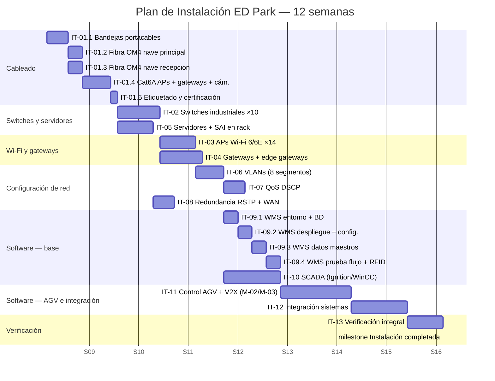

# Plan de Instalación del ED Park — Red y Software

## Objetivo de la sección

El objetivo de esta sección es planificar en detalle las tareas de instalación de la infraestructura de red (cableado, switches, puntos de acceso Wi-Fi, gateways, servidores, VLAN, QoS y redundancia) y la instalación del software de gestión (WMS, SCADA, sistema de control de AGV e integración de sistemas) del ED Park. Para cada tarea se define la descripción, la duración estimada, los recursos necesarios, las dependencias y el GOST aplicable. La sección cierra con el cronograma en formato Gantt, la matriz de riesgos de instalación y el checklist de la fase.

> ⚠️ **Aclaración: planificación virtual.** Este plan corresponde a un proyecto académico. No se ejecuta ninguna instalación real. Las duraciones, recursos y costos son estimaciones técnicas para fines de gestión de proyectos.

> **Dependencia clave**: La instalación de red comienza en paralelo con el montaje físico (Fase `04_01`), pero la instalación de software requiere que la red esté operativa. La puesta en servicio de los AGV (MT-06) requiere que Wi-Fi 6E esté activo antes del día 31 del plan de montaje.

---

## 1. Condiciones previas al inicio de la instalación

| Condición previa | Responsable | Estado esperado |
|-----------------|------------|----------------|
| Sala de control disponible con rack 42U instalado | Supervisor de montaje | Rack anclado, PDU instalada, climatización activa |
| Cableado eléctrico de fuerza completado en naves | Electricista | Tomas de fuerza PoE++ en techo certificadas |
| Planos de red aprobados (diagrama `03_06`) | Jefe de proyecto | Versión 1.0 firmada |
| Servidores SRV-01/02/03 recibidos y verificados | Logística | Inventario hardware verificado |
| Switches industriales recibidos en almacén | Logística | Embalaje íntegro, sin golpes |
| Licencias de software adquiridas (WMS, SCADA, VPN) | Administración | Claves de licencia disponibles |

---

## 2. Estructura de desglose — Tareas de instalación

```
IT-01  Cableado estructurado (fibra OM4 + Cat6A S/FTP)
IT-02  Instalación de switches industriales
IT-03  Instalación de puntos de acceso Wi-Fi 6/6E
IT-04  Instalación de gateways y edge gateways
IT-05  Instalación de servidores físicos y SAI
IT-06  Configuración de VLANs y segmentación
IT-07  Configuración de QoS y políticas de tráfico
IT-08  Configuración de redundancia (RSTP + WAN dual)
IT-09  Instalación de WMS
IT-10  Instalación de SCADA
IT-11  Instalación del sistema de control de AGV
IT-12  Integración de sistemas (WMS ↔ SCADA ↔ AGV ↔ ERP)
IT-13  Verificación integral de instalación
```

---

## 3. Tareas de instalación de red

### IT-01 — Cableado estructurado

| Atributo | Detalle |
|----------|---------|
| **Descripción** | Tendido e instalación del cableado estructurado completo del ED Park: (a) fibra óptica multimodo OM4 LC-LC entre sala de control y los cuatro switches de distribución de las naves (~180 m total en bandejas metálicas), (b) cable Cat6A S/FTP apantallado para los enlaces de acceso entre switches de distribución y APs, gateways, cámaras y equipos de campo (~850 m total), (c) instalación de bandejas portacables metálicas en techo a lo largo de los pasillos de naves, (d) etiquetado de todos los cables según esquema de identificación del proyecto, (e) certificación de cada enlace con tester Fluke DSX-8000 (Cat6A y fibra OM4). |
| **Duración estimada** | 12 días hábiles |
| **Recursos humanos** | 3 técnicos de cableado estructurado, 1 técnico de fibra óptica (fusionador), 1 técnico de calidad |
| **Recursos materiales** | Fibra OM4 LC-LC duplex 180 m, Cat6A S/FTP 850 m, bandejas metálicas 150 mm (lote), patch panels Cat6A ×4, patch panels fibra ×2, fusionadora de fibra, tester Fluke DSX-8000 |
| **Dependencias** | Bandejas portacables instaladas (obra civil); sala de control con rack disponible; planos de red aprobados |
| **GOST aplicable** | **IEEE 802.3** — especificaciones físicas de Ethernet (1000BASE-T Cat6A, 10GBASE-SR fibra OM4); **ГОСТ Р ИСО 15745-4-2010** — cableado del backbone Industrial Ethernet |
| **Costo estimado** | 220,000 ₽ |

#### IT-01 Subtareas

| ID | Subtarea | Días |
|----|---------|:----:|
| IT-01.1 | Instalación de bandejas portacables en techo nave principal y nave recepción | 3 |
| IT-01.2 | Tendido fibra OM4 sala control → SW-D1/D2 (nave principal) | 2 |
| IT-01.3 | Tendido fibra OM4 sala control → SW-D3/D4 (nave recepción) + SW-F1/F2 (campo) | 2 |
| IT-01.4 | Tendido Cat6A para APs (14 tiradas), gateways (4), cámaras (12) | 4 |
| IT-01.5 | Etiquetado, peinado de racks y certificación con tester | 1 |

---

### IT-02 — Instalación de switches industriales

| Atributo | Detalle |
|----------|---------|
| **Descripción** | Instalación física y puesta en servicio de los 10 switches industriales del ED Park en sus ubicaciones definitivas: SW-C1 y SW-C2 (rack sala control), SW-D1/D2 (armario nave principal), SW-D3/D4 (armario nave recepción), SW-F1 (zona AGV) y SW-F2 (muelles). Incluye: montaje en rack/carril DIN, conexión de fibra OM4 y Cat6A según el esquema, configuración básica de gestión (hostname, IP de gestión VLAN 99, contraseñas, NTP apuntando al servidor PTP), y configuración del protocolo RSTP (spanning-tree) para redundancia en anillo. |
| **Duración estimada** | 6 días hábiles |
| **Recursos humanos** | 2 técnicos de redes, 1 técnico senior de redes (líder) |
| **Recursos materiales** | Switches industriales ×10 (recibidos), kit de montaje en rack, herramienta de inserción, laptop de configuración, cables de consola RS-232/USB |
| **Dependencias** | IT-01 (cableado completado y certificado); rack de sala control instalado; alimentación eléctrica en armarios de distribución |
| **GOST aplicable** | **ГОСТ Р ИСО 15745-4-2010** — perfiles de switches en red Industrial Ethernet; **ГОСТ Р МЭК 61850-3** — requisitos de entorno y disponibilidad de switches industriales; **IEEE 802.3** — configuración de interfaces Ethernet |
| **Costo estimado** | 85,000 ₽ (mano de obra; equipos en presupuesto hardware) |

---

### IT-03 — Instalación de puntos de acceso Wi-Fi 6/6E

| Atributo | Detalle |
|----------|---------|
| **Descripción** | Instalación de los 14 puntos de acceso Wi-Fi 6/6E en sus posiciones definitivas según el plan de cobertura RF (diagrama D-06 de `03_06`): 10 APs industriales interiores en techo de nave principal (6) y nave recepción (4) a h=7 m y h=6 m respectivamente, 4 APs exteriores en mástiles de 4 m en patio y zona AGV. Incluye: fijación mecánica en techo/mástil, conexión PoE++ desde switch de distribución, montaje de antenas, adopción por el controlador WLC, configuración de SSIDs (operarios, AGV-6GHz, gestión), asignación de VLANs por SSID y ajuste de potencia TX según el plan RF. |
| **Duración estimada** | 5 días hábiles |
| **Recursos humanos** | 2 técnicos de redes Wi-Fi (certificación CWNA o equivalente), 1 técnico de campo (trabajo en altura) |
| **Recursos materiales** | APs Wi-Fi 6/6E ×14, mástiles exteriores ×4, arnés anticaída, escalera de aluminio 8 m, laptop con software WLC |
| **Dependencias** | IT-01 (cableado Cat6A a posiciones de APs); IT-02 (switches de distribución operativos y con PoE++ activo) |
| **GOST aplicable** | **IEEE 802.11ax** — configuración de APs Wi-Fi 6/6E (canales, potencia, OFDMA, MU-MIMO); **ГОСТ Р МЭК 62443-3-3-2016** — WPA3-Enterprise + 802.1X en cada SSID |
| **Costo estimado** | 65,000 ₽ |

---

### IT-04 — Instalación de gateways y edge gateways

| Atributo | Detalle |
|----------|---------|
| **Descripción** | Instalación y configuración de los 4 gateways de protocolo y 4 edge gateways en sus ubicaciones definitivas: Edge-GW-01 (zona B — IoT), Edge-GW-02 (zona AGV), Edge-GW-03 (sala control — seguridad OT/IT), Edge-GW-04 (muelles). Configuración de cada gateway: interfaces de red (IP estática en VLAN correspondiente), protocolos de campo (Zigbee, Modbus RTU, OPC-UA), broker MQTT interno para GW-01/02, reglas de firewall OT/IT para GW-03, y forwarding de datos de PLC de muelles hacia SCADA para GW-04. Instalación del servidor GPS-PTP Grandmaster en rack de sala control. |
| **Duración estimada** | 6 días hábiles |
| **Recursos humanos** | 2 técnicos de redes / automatización, 1 especialista en ciberseguridad industrial |
| **Recursos materiales** | Edge gateways ×4 (recibidos), servidor PTP Grandmaster (recibido), antena GPS exterior (cable 15 m), carril DIN para montaje |
| **Dependencias** | IT-02 (switches operativos); IT-01 (cableado a posiciones de gateways) |
| **GOST aplicable** | **ГОСТ Р МЭК 62443-3-3-2016** — configuración de firewall OT/IT en Edge-GW-03 (SR 5.1, SR 5.2); **ГОСТ IEC 62026-3-2015** — configuración de interfaces Zigbee/DeviceNet en GW-01; **IEEE 1588-2019** — configuración del servidor PTP Grandmaster |
| **Costo estimado** | 75,000 ₽ |

---

### IT-05 — Instalación de servidores físicos y SAI

| Atributo | Detalle |
|----------|---------|
| **Descripción** | Instalación física de los tres servidores (SRV-01, SRV-02, SRV-03) y dos SAI en el rack 42U de la sala de control. Incluye: montaje en rack con rieles deslizantes, conexión de interfaces 10GbE a los switches núcleo SW-C1/C2, conexión de gestión iDRAC/iLO a VLAN 99, conexión a PDU del SAI, instalación del sistema operativo base (Linux RHEL/Ubuntu Server — diseño virtual), configuración de RAID (RAID-1 para SRV-01/02, RAID-5 para SRV-03), verificación de temperaturas y velocidades de ventiladores, y prueba de failover del SAI. |
| **Duración estimada** | 5 días hábiles |
| **Recursos humanos** | 2 técnicos de sistemas (administradores de servidor), 1 electricista industrial |
| **Recursos materiales** | Servidores ×3 (recibidos), SAI ×2 (recibidos), rieles rack, cables patch 10GbE SFP+, cables de gestión |
| **Dependencias** | IT-01 (cableado rack), IT-02 (switches núcleo operativos), climatización sala control activa |
| **GOST aplicable** | **ГОСТ Р МЭК 62443-3-3-2016** — configuración de seguridad base del SO (SR 1.1, SR 7.1, SR 7.3); **ГОСТ Р МЭК 61850-3** — disponibilidad de servidores en infraestructura industrial |
| **Costo estimado** | 90,000 ₽ |

---

### IT-06 — Configuración de VLANs y segmentación

| Atributo | Detalle |
|----------|---------|
| **Descripción** | Configuración de las 8 VLANs del ED Park en todos los switches (trunks entre switches, access ports hacia dispositivos finales): VLAN 10 AGV-CONTROL, VLAN 20 INDUSTRIAL-CTRL, VLAN 30 WMS-SERVERS, VLAN 40 IOT-SENSORS, VLAN 50 WIFI-OPERARIOS, VLAN 60 CAMERAS-CCTV, VLAN 70 ADMIN-OFICINAS, VLAN 99 MGMT. Configuración de ACLs entre VLANs según la política de segmentación OT/IT definida en `03_03` y `03_06` (Diagrama D-03). Asignación de VLANs a los SSIDs Wi-Fi. Verificación de conectividad entre VLANs permitidas y aislamiento de VLANs restringidas. |
| **Duración estimada** | 4 días hábiles |
| **Recursos humanos** | 1 técnico senior de redes, 1 especialista en ciberseguridad |
| **Recursos materiales** | Laptop de configuración, acceso de consola a switches, documentación de VLANs aprobada |
| **Dependencias** | IT-02 (switches instalados), IT-03 (APs instalados y adoptados por WLC) |
| **GOST aplicable** | **ГОСТ Р МЭК 62443-3-3-2016** — segmentación de zonas OT/IT (SR 5.1, SR 5.2); **ГОСТ Р ИСО 15745-4-2010** — separación de perfiles de red de control e IT |
| **Costo estimado** | 40,000 ₽ |

---

### IT-07 — Configuración de QoS y políticas de tráfico

| Atributo | Detalle |
|----------|---------|
| **Descripción** | Configuración de las políticas de Calidad de Servicio (QoS) en todos los switches y en el controlador WLC, según la tabla de DSCP definida en `03_03` (sección VLAN/QoS): DSCP EF para VLAN 10 (AGV), DSCP AF41 para VLAN 20 (control industrial), DSCP AF31 para VLAN 30 (WMS), DSCP AF21 para VLAN 40 (IoT), DSCP AF11 para VLAN 50 (operarios), DSCP CS0 para VLANs 60/70. Configuración de colas de prioridad (WRR/CBWFQ) en switches de núcleo y distribución. Verificación con iperf3 de que el tráfico AGV (VLAN 10) mantiene latencia < 5 ms bajo carga máxima. |
| **Duración estimada** | 3 días hábiles |
| **Recursos humanos** | 1 técnico senior de redes, 1 técnico de QoS/rendimiento |
| **Recursos materiales** | Laptop con iperf3, acceso de gestión a switches y WLC |
| **Dependencias** | IT-06 (VLANs configuradas) |
| **GOST aplicable** | **ГОСТ Р МЭК 61850-3** — requisitos de QoS en redes industriales (latencia determinista); **ГОСТ Р ИСО 15745-4-2010** — calidad de servicio en perfiles Industrial Ethernet |
| **Costo estimado** | 30,000 ₽ |

---

### IT-08 — Configuración de redundancia (RSTP + WAN dual)

| Atributo | Detalle |
|----------|---------|
| **Descripción** | Configuración y verificación de los mecanismos de redundancia de red a tres niveles: (a) RSTP (802.1w) en todos los switches con el núcleo como root bridge — verificación de tiempo de convergencia < 50 ms mediante simulación de corte de enlace, (b) failover WAN: configuración del router perimetral para conmutar automáticamente de fibra ISP a LTE backup en < 30 s, (c) redundancia de alimentación: verificación del SAI con simulación de corte eléctrico (tiempo de conmutación < 20 ms, autonomía verificada 15 min). Documentación del resultado de cada prueba de failover. |
| **Duración estimada** | 3 días hábiles |
| **Recursos humanos** | 1 técnico senior de redes, 1 técnico de sistemas |
| **Recursos materiales** | Laptop con Wireshark, analizador de red, acceso a router perimetral y switches |
| **Dependencias** | IT-02 (switches y anillo de fibra instalados), IT-05 (SAI instalados) |
| **GOST aplicable** | **ГОСТ Р МЭК 61850-3** — requisitos de redundancia y tiempo de recuperación en redes industriales; **IEEE 802.3** — LACP (802.3ad) si se usa bonding de enlaces |
| **Costo estimado** | 25,000 ₽ |

---

## 4. Tareas de instalación de software

### IT-09 — Instalación de WMS

| Atributo | Detalle |
|----------|---------|
| **Descripción** | Instalación y configuración del módulo M-01 WMS en SRV-01. Incluye: (a) instalación del entorno de ejecución Java/Spring Boot en SRV-01, (b) instalación y configuración de PostgreSQL 15 con esquema de base de datos del WMS, (c) despliegue del servicio WMS (archivo JAR o contenedor Docker), (d) configuración de las conexiones a la base de datos, el broker MQTT (SRV-02) y el API Gateway (M-05), (e) carga inicial de datos maestros: SKUs, ubicaciones de almacén (zonas A/B/C), usuarios y roles RBAC, configuración de muelles M-01 a M-04, (f) prueba de flujo básico de recepción → almacenamiento → picking → expedición con datos de prueba, (g) verificación de la integración con los lectores RFID vía Edge-GW. |
| **Duración estimada** | 8 días hábiles |
| **Recursos humanos** | 2 desarrolladores backend (equipo software del proyecto), 1 administrador de bases de datos, 1 técnico de sistemas |
| **Recursos materiales** | SRV-01 operativo, licencias PostgreSQL/software, repositorio de código fuente, datos maestros del cliente |
| **Dependencias** | IT-05 (SRV-01 instalado y con SO base), IT-06 (VLAN 30 WMS-SERVERS activa), IT-04 (edge gateways RFID configurados) |
| **GOST aplicable** | **ГОСТ Р МЭК 62443-3-3-2016** — configuración de RBAC, cifrado de BD, auditoría (SR 1.1, SR 4.1, SR 7.3); **ГОСТ Р ИСО 15745-4-2010** — integración del WMS con los perfiles de automatización |
| **Costo estimado** | 120,000 ₽ (horas de técnicos de instalación y configuración) |

#### IT-09 Subtareas

| ID | Subtarea | Días |
|----|---------|:----:|
| IT-09.1 | Instalación entorno Java, PostgreSQL y servicios base | 2 |
| IT-09.2 | Despliegue del servicio WMS y configuración de conexiones | 2 |
| IT-09.3 | Carga de datos maestros (SKUs, ubicaciones, usuarios) | 2 |
| IT-09.4 | Prueba de flujo completo y verificación integración RFID | 2 |

---

### IT-10 — Instalación de SCADA

| Atributo | Detalle |
|----------|---------|
| **Descripción** | Instalación y configuración del módulo M-04 SCADA en SRV-02. Incluye: (a) instalación de la plataforma SCADA (Ignition o WinCC OA — diseño virtual), (b) configuración del servidor OPC-UA para comunicación con los edge gateways de campo (Edge-GW-04 muelles, Edge-GW-01 IoT), (c) configuración de la base de datos de proceso InfluxDB en SRV-02 para almacenamiento de series temporales, (d) creación de las pantallas del dashboard SCADA: temperatura/humedad zona B (30 tags), estado de muelles M-01 a M-04 (8 tags), consumo eléctrico (6 tags), sistema de alarmas, (e) configuración de las alarmas con umbrales: T° > 26 °C (crítica), T° > 25 °C (mayor), HR > 62 % (mayor), puerta muelle sin respuesta (mayor), (f) prueba de 24 h en condiciones de operación con validación de todos los tags. |
| **Duración estimada** | 8 días hábiles |
| **Recursos humanos** | 1 ingeniero SCADA (especialista), 1 técnico de automatización, 1 administrador de sistemas |
| **Recursos materiales** | SRV-02 operativo, licencia SCADA, credenciales de acceso a edge gateways, datos de configuración de PLC |
| **Dependencias** | IT-05 (SRV-02 operativo), IT-04 (edge gateways configurados), MT-05 (sensores IoT instalados), MT-04 (PLC de muelles instalado) |
| **GOST aplicable** | **ГОСТ Р МЭК 60870-5-104** — protocolo de telecontrol para comunicación SCADA ↔ PLC de muelles; **ГОСТ Р МЭК 62443-3-3-2016** — seguridad de la zona SCADA (SR 5.2); **ГОСТ Р МЭК 61850-3** — disponibilidad del sistema SCADA |
| **Costo estimado** | 130,000 ₽ |

---

### IT-11 — Instalación del sistema de control de AGV

| Atributo | Detalle |
|----------|---------|
| **Descripción** | Instalación y configuración del módulo M-02 (Control AGV) en SRV-02. Incluye: (a) instalación del stack ROS 2 (Robot Operating System 2) o equivalente en SRV-02, (b) instalación del broker MQTT Mosquitto v5 en SRV-02, (c) carga del mapa digital de las naves y rutas predefinidas de AGV (generado a partir de los planos del parque), (d) configuración del sistema de asignación de misiones conectado al WMS (M-01) vía MQTT, (e) configuración del módulo V2X/V2I (M-03) con los parámetros de las RSU instaladas, (f) vinculación de cada AGV (OBU) al servidor de control con sus parámetros de identificación, velocidad máxima y zonas operativas, (g) prueba de misión completa: WMS genera orden → servidor asigna AGV → AGV ejecuta ruta → V2X coordina intersecciones → WMS confirma entrega. |
| **Duración estimada** | 10 días hábiles |
| **Recursos humanos** | 1 desarrollador de sistemas (ROS 2), 1 técnico de redes, 2 especialistas AGV del fabricante |
| **Recursos materiales** | SRV-02 operativo, OBU V2X configuradas en AGV (MT-06), RSU instaladas (MT-05), mapa digital de planta |
| **Dependencias** | IT-05 (SRV-02 operativo), IT-09 (WMS operativo), MT-06 (AGV con Wi-Fi y OBU configurados), IT-03 (Wi-Fi 6E activo) |
| **GOST aplicable** | **ГОСТ Р 70982-2023** — configuración del sistema V2X/V2I (mensajes BSM, SPaT, ICA); **ГОСТ Р МЭК 62443-3-3-2016** — cifrado ECDSA de mensajes V2X (SR 3.1, SR 3.3); **ГОСТ Р МЭК 61131-1** — integración con controladores PLC de AGV |
| **Costo estimado** | 160,000 ₽ |

---

### IT-12 — Integración de sistemas

| Atributo | Detalle |
|----------|---------|
| **Descripción** | Integración de todos los módulos de software entre sí y con los sistemas externos del cliente. Incluye: (a) despliegue del API Gateway (M-05) en SRV-01 con configuración de rutas, políticas OAuth 2.0 y TLS 1.3 para acceso externo, (b) integración WMS (M-01) ↔ SCADA (M-04) vía REST API para alertas de temperatura de zona B y control de muelles, (c) integración WMS (M-01) ↔ Control AGV (M-02) vía MQTT para emisión y confirmación de misiones de transporte, (d) despliegue del frontend React 18 (M-06) en SRV-01 con acceso a APIs de todos los módulos, (e) configuración de webhooks hacia el ERP del cliente para notificaciones de recepción y despacho, (f) prueba de escenario end-to-end: orden de cliente → WMS → AGV → V2X → picking → expedición → notificación ERP. |
| **Duración estimada** | 8 días hábiles |
| **Recursos humanos** | 1 ingeniero de integración, 1 desarrollador frontend, 1 especialista en ciberseguridad, 1 técnico de sistemas |
| **Recursos materiales** | SRV-01 operativo con todos los módulos instalados, credenciales de prueba del ERP del cliente, laptop de pruebas |
| **Dependencias** | IT-09 (WMS), IT-10 (SCADA), IT-11 (Control AGV) completados |
| **GOST aplicable** | **ГОСТ Р МЭК 62443-3-3-2016** — seguridad del API Gateway (SR 1.1, SR 4.1, SR 5.2); **ГОСТ Р ИСО 15745-4-2010** — integración de sistemas de automatización con sistemas IT externos |
| **Costo estimado** | 100,000 ₽ |

---

### IT-13 — Verificación integral de instalación

| Atributo | Detalle |
|----------|---------|
| **Descripción** | Verificación técnica completa de toda la instalación de red y software antes de la fase de puesta en marcha y pruebas (`04_03`). Incluye: (a) verificación de cobertura Wi-Fi en todos los puntos del parque con medidor RF (RSSI > -65 dBm en toda la superficie), (b) prueba de latencia de red en VLAN 10 (AGV) con < 5 ms confirmado, (c) verificación de failover RSTP (< 50 ms), (d) verificación de failover WAN fibra → LTE (< 30 s), (e) verificación de todos los tags SCADA (100 % activos), (f) verificación de autenticación WPA3 en todos los SSIDs, (g) escaneo de vulnerabilidades básico en la interfaz API externa (OWASP ZAP), (h) generación del informe de verificación firmado por el supervisor y el representante del cliente. |
| **Duración estimada** | 5 días hábiles |
| **Recursos humanos** | 1 supervisor de instalación, 1 técnico de redes, 1 técnico de sistemas, 1 especialista en ciberseguridad, 1 representante del cliente |
| **Recursos materiales** | Medidor RF Wi-Fi (Ekahau o equiv.), laptop con Wireshark + iperf3 + OWASP ZAP |
| **Dependencias** | IT-01 a IT-12 completadas |
| **GOST aplicable** | **ГОСТ Р МЭК 62443-3-3-2016** — verificación del nivel SL 2 (SR 1.1 a SR 7.3); **ГОСТ Р ИСО 15745-4-2010** — verificación de integración de todos los sistemas |
| **Costo estimado** | 55,000 ₽ |

---

## 5. Tabla resumen de tareas de instalación

| ID | Tarea | Tipo | Días | Inicio relativo | Recursos | Costo (₽) | Dependencias |
|----|-------|:----:|:----:|:---------------:|---------|:---------:|-------------|
| IT-01 | Cableado estructurado | Red | 12 | Día 1 | 4 téc. cableado | 220,000 | Obra civil |
| IT-02 | Switches industriales | Red | 6 | Día 8 | 3 téc. redes | 85,000 | IT-01 |
| IT-03 | Puntos de acceso Wi-Fi | Red | 5 | Día 14 | 3 téc. Wi-Fi | 65,000 | IT-01, IT-02 |
| IT-04 | Gateways y edge gateways | Red | 6 | Día 14 | 3 téc. redes/seguridad | 75,000 | IT-01, IT-02 |
| IT-05 | Servidores y SAI | Sistema | 5 | Día 8 | 3 téc. sistemas | 90,000 | IT-01, IT-02 |
| IT-06 | Configuración VLANs | Red | 4 | Día 20 | 2 téc. redes | 40,000 | IT-02, IT-03 |
| IT-07 | Configuración QoS | Red | 3 | Día 24 | 2 téc. redes | 30,000 | IT-06 |
| IT-08 | Configuración redundancia | Red | 3 | Día 24 | 2 téc. redes | 25,000 | IT-02, IT-05 |
| IT-09 | Instalación WMS | Software | 8 | Día 27 | 4 personas | 120,000 | IT-05, IT-06, IT-04 |
| IT-10 | Instalación SCADA | Software | 8 | Día 27 | 3 personas | 130,000 | IT-05, IT-04, MT-05 |
| IT-11 | Control AGV (M-02+M-03) | Software | 10 | Día 35 | 4 personas | 160,000 | IT-09, MT-06, IT-03 |
| IT-12 | Integración de sistemas | Software | 8 | Día 45 | 4 personas | 100,000 | IT-09, IT-10, IT-11 |
| IT-13 | Verificación integral | Validación | 5 | Día 53 | 5 personas | 55,000 | IT-01..IT-12 |
| **TOTAL** | | | **~58 días** | | | **1,195,000** | |

---

## 6. Cronograma de instalación — Gantt simplificado



**Duración total**: ~12 semanas (58 días hábiles). IT-09 e IT-10 se ejecutan en paralelo desde el día 27.

---

## 7. Equipo de instalación

| Rol | Cantidad | Especialización | Fase activa |
|-----|:--------:|----------------|-------------|
| Técnico senior de redes (líder) | 1 | Switching, routing, VLAN, QoS, RSTP | IT-02 a IT-08 |
| Técnico de cableado estructurado | 3 | Cat6A, fibra OM4, certificación | IT-01 |
| Técnico de fibra óptica (fusionador) | 1 | Fusión de fibra, OTDR | IT-01 |
| Técnico de redes Wi-Fi | 2 | Wi-Fi 6/6E, controlador WLC, RF planning | IT-03 |
| Especialista en ciberseguridad OT | 1 | Firewall OT/IT, ACLs, WPA3, OAuth | IT-04, IT-06, IT-13 |
| Administrador de sistemas | 2 | Linux, RAID, SO, servicios base | IT-05 |
| Desarrollador backend (WMS) | 2 | Java/Spring Boot, PostgreSQL, MQTT | IT-09 |
| Ingeniero SCADA | 1 | Ignition/WinCC, OPC-UA, InfluxDB | IT-10 |
| Desarrollador de sistemas AGV | 1 | ROS 2, MQTT, mapa digital | IT-11 |
| Ingeniero de integración | 1 | API Gateway, OAuth, EDI, webhooks | IT-12 |
| Técnico de QA / pruebas | 1 | iperf3, Wireshark, OWASP ZAP | IT-07, IT-13 |
| **TOTAL** | **17** | | |

---

## 8. Riesgos de instalación

| ID | Riesgo | Categoría | Prob. | Impacto | Nivel | Mitigación | Contingencia |
|----|--------|-----------|:-----:|:-------:|:-----:|-----------|-------------|
| RI-01 | Interferencias RF en naves metálicas degradan cobertura Wi-Fi | Técnico | Media | Alto | **Alto** | Encuesta RF previa con medidor antes de instalar APs; ajuste de posición según resultados | Añadir 1–2 APs adicionales en zonas de sombra detectadas |
| RI-02 | Fallo de certificación de cableado Cat6A (atenuación fuera de norma) | Técnico | Baja | Alto | **Medio** | Certificación con Fluke DSX-8000 al finalizar cada tramo; instalar cable de calidad certificada | Reemplazar el tramo fallido (1–2 días adicionales) |
| RI-03 | Conflicto de VLANs o loops en el backbone al activar RSTP | Técnico | Media | Alto | **Alto** | Activar RSTP en entorno de prueba antes de producción; prueba enlace por enlace | Restaurar configuración anterior desde backup; reconfigurar árbol RSTP |
| RI-04 | Retraso en entrega de licencias de software (WMS, SCADA) | Administrativo | Media | Alto | **Alto** | Solicitar licencias con 4 semanas de antelación; usar versión de evaluación temporalmente | Ampliar período de prueba; negociar activación anticipada con proveedor |
| RI-05 | Incompatibilidad de versiones entre broker MQTT y módulos WMS/AGV | Técnico | Baja | Medio | **Bajo** | Especificar versiones exactas (MQTT v5, Mosquitto 2.x) en el diseño; prueba en entorno de desarrollo | Actualizar el módulo afectado; consultar soporte del proveedor |
| RI-06 | Latencia de red en VLAN 10 (AGV) supera 5 ms bajo carga máxima | Técnico | Baja | Alto | **Medio** | Configurar QoS DSCP EF + colas strict priority para VLAN 10; verificar con iperf3 | Ajustar parámetros QoS; separar físicamente el tráfico AGV en SSID exclusivo 6 GHz |
| RI-07 | Integración con ERP del cliente falla por cambio de API del proveedor | Externo | Media | Medio | **Medio** | Validar especificación de API del ERP antes de comenzar IT-12; usar versión estable de la API | Implementar adaptador de protocolo; contactar al equipo técnico del cliente |
| RI-08 | Vulnerabilidad de seguridad detectada en escaneo OWASP ZAP (IT-13) | Ciberseguridad | Media | Alto | **Alto** | Seguir OWASP Top 10 en el diseño del API; revisión de código antes del despliegue | Parchar la vulnerabilidad antes de la puesta en marcha; no poner en producción hasta corrección |
| RI-09 | El sistema SCADA no recibe datos de PLC de muelles (fallo OPC-UA) | Técnico | Baja | Medio | **Bajo** | Verificar compatibilidad de versión OPC-UA entre SCADA y Edge-GW-04; prueba con cliente OPC-UA antes de IT-13 | Usar Modbus TCP como protocolo alternativo si OPC-UA falla |
| RI-10 | Personal de instalación sin experiencia en entorno cubano (voltaje, normativa local) | Operativo | Media | Medio | **Medio** | Briefing de normativa eléctrica cubana antes del inicio; verificar tensión de red (110 V / 220 V) | Usar transformadores de seguridad; soporte de electricista local certificado |

---

## 9. Indicadores de progreso de la instalación (KPIs)

| KPI | Meta | Frecuencia |
|-----|:----:|:----------:|
| % tareas de instalación completadas | 100 % en semana 12 | Semanal |
| Desviación de cronograma (SV) | ≤ 3 días | Semanal |
| Cobertura Wi-Fi (RSSI > -65 dBm) | 100 % de superficie | Al finalizar IT-03 |
| Latencia VLAN 10 AGV | < 5 ms bajo carga | Al finalizar IT-07 |
| Tags SCADA activos | ≥ 98 % | Al finalizar IT-10 |
| Vulnerabilidades críticas en API | 0 | Al finalizar IT-13 |
| Tiempo de failover RSTP verificado | < 50 ms | Al finalizar IT-08 |

---

## 10. Referencias normativas de la sección

- **IEEE 802.3**. Ethernet Standard. — IEEE, edición vigente. — Cableado Cat6A, fibra OM4, switches 10G.
- **IEEE 802.11ax**. High Efficiency WLAN (Wi-Fi 6/6E). — IEEE, 2019. — Instalación y configuración de APs.
- **IEEE 1588-2019 (PTP v2.1)**. Precision Time Protocol. — IEEE, 2019. — Instalación del Grandmaster PTP.
- **ГОСТ Р ИСО 15745-4-2010**. Системы автоматизации производства и их интеграция. Профили. Часть 4. — М.: Стандартинформ, 2010. — Integración Industrial Ethernet, VLANs de control.
- **ГОСТ Р МЭК 61850-3**. Коммуникационные системы и сети в электроэнергетике. Часть 3. — М.: Стандартинформ. — QoS, redundancia RSTP, disponibilidad de red.
- **ГОСТ Р МЭК 62443-3-3-2016**. Системы и меры по обеспечению кибербезопасности. Часть 3-3. — М.: Стандартинформ, 2016. — Segmentación VLAN, WPA3, OAuth, verificación SL 2.
- **ГОСТ Р 70982-2023**. Безопасность дорожного движения. Взаимодействие транспортных средств и инфраструктуры. — М.: Стандартинформ, 2023. — Configuración V2X/V2I en sistema de control AGV.
- **ГОСТ Р МЭК 60870-5-104**. Системы дистанционного управления. Часть 5-104. — М.: Стандартинформ. — Protocolo SCADA ↔ PLC muelles.
- **ГОСТ IEC 62026-3-2015**. Технологии связи для промышленных систем управления. — М.: Стандартинформ, 2015. — Configuración de interfaces Zigbee en edge gateways.
- **ГОСТ 7.32-2017**. Отчет о научно-исследовательской работе. Структура и правила оформления. — М.: Стандартинформ, 2017.

---

## 11. Checklist de la sección

- [x] 3.2.1 IT-01 Cableado estructurado (12 días, fibra OM4 + Cat6A S/FTP, certificación Fluke)
- [x] 3.2.2 IT-02 Switches industriales ×10 (6 días, RSTP, VLAN 99 gestión, NTP→PTP)
- [x] 3.2.3 IT-03 Puntos de acceso Wi-Fi 6/6E ×14 (5 días, WPA3-Enterprise, 3 SSIDs)
- [x] 3.2.4 IT-04 Gateways y edge gateways ×8 (6 días, Zigbee, OPC-UA, firewall OT/IT, PTP GM)
- [x] 3.2.5 IT-05 Servidores SRV-01/02/03 + SAI ×2 (5 días, RAID, SO base, 10GbE)
- [x] 3.2.6 IT-06 Configuración VLANs (4 días, 8 VLANs, ACLs OT/IT, asignación a SSIDs)
- [x] 3.2.7 IT-07 Configuración QoS (3 días, DSCP EF/AF/CS, colas WRR, latencia VLAN 10 < 5 ms)
- [x] 3.2.8 IT-08 Configuración redundancia (3 días, RSTP < 50 ms, WAN failover < 30 s, SAI verificado)
- [x] 3.2.9 IT-09 Instalación WMS (8 días, Spring Boot + PostgreSQL, datos maestros, flujo completo)
- [x] 3.2.10 IT-10 Instalación SCADA (8 días, Ignition/WinCC, OPC-UA, InfluxDB, 100+ tags, 24 h prueba)
- [x] 3.2.11 IT-11 Instalación Control AGV + V2X (10 días, ROS 2, MQTT, mapa digital, prueba misión)
- [x] 3.2.12 IT-12 Integración de sistemas (8 días, API Gateway, OAuth, webhook ERP, prueba end-to-end)
- [x] 3.2.13 IT-13 Verificación integral (5 días, RF survey, latencia, failover, OWASP ZAP, informe firmado)
- [x] 3.2.14 Tabla resumen 13 tareas: ~58 días, 17 personas, costo mano de obra ~1,195,000 ₽
- [x] 3.2.15 Cronograma Gantt (Mermaid, 12 semanas, IT-09 e IT-10 en paralelo)
- [x] 3.2.16 Tabla de 10 riesgos de instalación (probabilidad, impacto, mitigación, contingencia)
- [x] 3.2.17 KPIs de instalación (7 indicadores con metas)
- [x] 3.2.18 Referencias normativas (10 GOST + IEEE)
- [x] 3.2.19 Coherencia con plan de montaje (`04_01`) y diseño técnico (`03_03`, `03_04`, `03_06`)

---

## 12. Conclusión

El plan de instalación del ED Park comprende 13 tareas distribuidas en ~12 semanas (58 días hábiles), con un equipo de 17 personas y un costo de mano de obra estimado en **1,195,000 ₽**. Las tareas críticas son el cableado estructurado (IT-01, punto de partida de toda la instalación), la configuración de VLANs y QoS (IT-06/IT-07, que habilita el tráfico de red para el software) y la instalación del control AGV (IT-11, que depende de Wi-Fi, WMS y los AGV físicamente puestos en servicio). Los riesgos más elevados son las interferencias RF (RI-01), los conflictos RSTP (RI-03), los retrasos en licencias de software (RI-04) y las vulnerabilidades detectadas en el escaneo de seguridad (RI-08). La instalación concluye con la verificación integral IT-13, que certifica que toda la infraestructura de red y software está operativa y lista para la fase de puesta en marcha y pruebas de aceptación (`04_03_Puesta_Marcha_Pruebas.md`).
