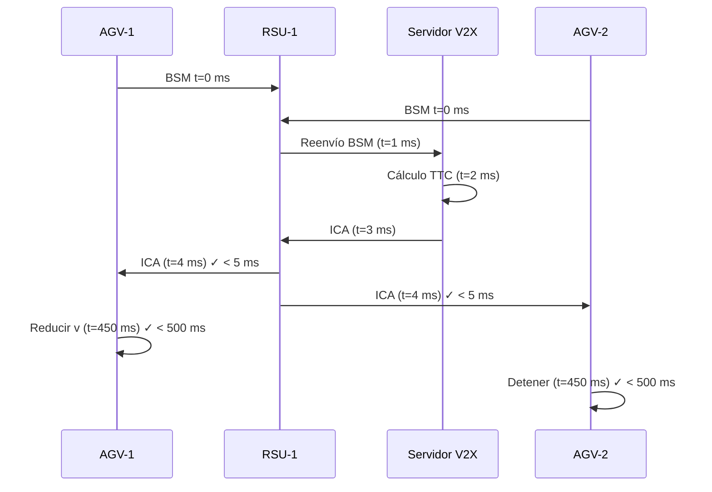
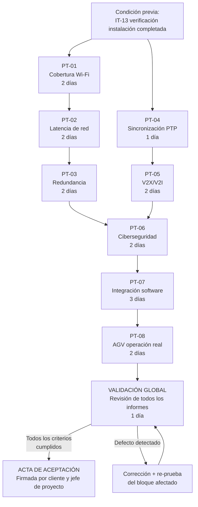
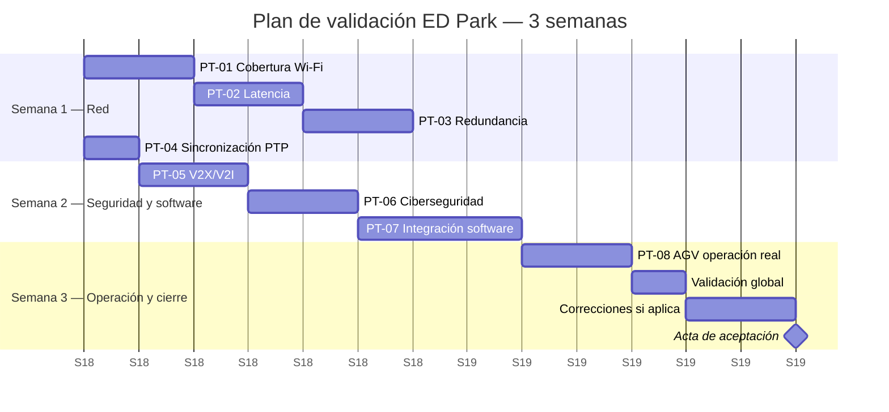

# Puesta en Marcha y Pruebas de Aceptación del ED Park

## Objetivo de la sección

El objetivo de esta sección es definir el plan completo de puesta en marcha y pruebas de aceptación técnica del ED Park. Las pruebas verifican que cada componente del sistema (red, AGV, V2X/V2I, sincronización temporal, ciberseguridad, software integrado) cumple los criterios de aceptación establecidos en el diseño técnico (`03_03`, `03_04`) antes de la entrega formal al cliente. La sección incluye además el plan de validación global del sistema y el plan de capacitación del personal operativo y técnico del parque.

> ⚠️ **Aclaración: planificación virtual.** Esta sección forma parte de un proyecto académico. No se ejecutan pruebas reales. Las métricas, criterios y procedimientos se definen con fines de gestión de proyectos y demostración de coherencia técnica.

> **Secuencia**: Las pruebas de puesta en marcha se ejecutan después de completar la verificación integral de instalación (IT-13 de `04_02`). Se organizan en dos semanas de pruebas funcionales seguidas de una semana de prueba de operación continua.

---

## 1. Estructura de pruebas de puesta en marcha

Las pruebas se organizan en ocho bloques (PT = Puesta en marcha Test), ejecutados en secuencia lógica de menor a mayor dependencia:

```
PT-01  Pruebas de cobertura Wi-Fi
PT-02  Pruebas de latencia de red
PT-03  Pruebas de redundancia
PT-04  Pruebas de sincronización PTP
PT-05  Pruebas de V2X/V2I
PT-06  Pruebas de ciberseguridad
PT-07  Pruebas de integración de software
PT-08  Pruebas de AGV en operación real
```

---

## 2. PT-01 — Pruebas de cobertura Wi-Fi

### 2.1 Descripción

Medición sistemática de la cobertura Wi-Fi en toda la superficie operativa del ED Park (naves principal, recepción/expedición, patio y zona AGV) mediante un survey RF activo con medidor calibrado. Se registra el nivel de señal recibida (RSSI), la relación señal/ruido (SNR) y el throughput efectivo en cada punto de medición. Las mediciones se realizan en una cuadrícula de 5 × 5 m en el interior de las naves y 10 × 10 m en el exterior.

### 2.2 Criterios de aceptación

| Criterio | Valor requerido | Norma de referencia |
|---------|:--------------:|:-------------------:|
| RSSI mínimo en todo el parque | ≥ −65 dBm | IEEE 802.11ax §17 |
| SNR mínimo | ≥ 20 dB | IEEE 802.11ax §17 |
| Solapamiento entre celdas adyacentes | ≥ 20 % | Plan RF `03_03` |
| Throughput mínimo (VLAN 50 operarios) | ≥ 50 Mbps | Diseño `03_03` |
| Throughput VLAN 10 AGV (banda 6 GHz) | ≥ 200 Mbps | IEEE 802.11ax §27 |
| Zonas con cobertura < −65 dBm | 0 % de la superficie | — |
| Tiempo de handover entre APs (AGV en movimiento) | < 50 ms | Diseño `03_03` |

### 2.3 Métricas

- RSSI promedio por zona (nave A, nave B, patio, zona AGV)
- Número y porcentaje de puntos de medición que superan −65 dBm
- Mapa de calor de cobertura (generado por software de survey)
- Throughput medido con iperf3 desde 5 puntos representativos
- Tiempo de handover medido con terminal móvil simulando AGV

### 2.4 Duración estimada

**2 días hábiles** — 1 día de mediciones de campo + 1 día de análisis y documentación

### 2.5 Herramientas

Medidor RF Ekahau Site Survey (o equiv.), iperf3, terminal Android con app Wi-Fi Analyzer

---

## 3. PT-02 — Pruebas de latencia de red

### 3.1 Descripción

Medición de la latencia extremo a extremo en los segmentos de red más críticos del ED Park: tráfico de control AGV (VLAN 10), tráfico WMS (VLAN 30), tráfico SCADA (VLAN 20) y tráfico IoT (VLAN 40). Las pruebas se realizan con el sistema bajo carga máxima simulada (todos los AGV en movimiento, 30 terminales Wi-Fi activos, 50 sensores IoT transmitiendo) para verificar que QoS mantiene los criterios en condiciones reales.

### 3.2 Criterios de aceptación

| Segmento | Latencia máxima requerida | Protocolo |
|---------|:------------------------:|-----------|
| VLAN 10 — AGV (Wi-Fi 6E → SRV-02) | < 5 ms | MQTT / UDP |
| VLAN 10 — AGV (5G privado → SRV-02) | < 1 ms | MQTT / UDP |
| VLAN 20 — Control industrial (OPC-UA) | < 20 ms | OPC-UA / TCP |
| VLAN 30 — WMS (REST API) | < 200 ms | HTTP/REST |
| VLAN 40 — IoT (MQTT telemetría) | < 500 ms | MQTT |
| PTP (timestamp precisión) | < 1 µs | IEEE 1588 |

### 3.3 Métricas

- Latencia media, P95 y P99 en cada VLAN bajo carga
- Jitter (variación de latencia) en VLAN 10 (< 1 ms)
- Pérdida de paquetes en VLAN 10 (< 0.01 %)
- Degradación de latencia bajo carga máxima vs. carga mínima

### 3.4 Duración estimada

**2 días hábiles** — mediciones con carga progresiva (25 %, 50 %, 75 %, 100 %)

### 3.5 Herramientas

iperf3, Wireshark con filtro por VLAN, ping con timestamp, ptpd (cliente PTP)

---

## 4. PT-03 — Pruebas de redundancia

### 4.1 Descripción

Verificación de todos los mecanismos de redundancia del ED Park mediante simulación controlada de fallos: corte de enlace de backbone (fibra OM4 entre SW-C1 y SW-C2), corte de enlace WAN principal (fibra ISP), corte de alimentación eléctrica (simulación con bypass del SAI) y pérdida de cobertura Wi-Fi en una zona (apagado de AP). Para cada escenario se mide el tiempo hasta recuperación del servicio y se verifica que no hay pérdida de datos en los sistemas críticos.

### 4.2 Criterios de aceptación

| Escenario de fallo | Tiempo de recuperación requerido | Pérdida de datos |
|-------------------|:--------------------------------:|:----------------:|
| Corte enlace backbone (RSTP) | < 50 ms | Ninguna |
| Corte WAN principal → conmutación LTE | < 30 s | Ninguna (MQTT QoS 1) |
| Corte eléctrico total → SAI | < 20 ms (conmutación SAI) | Ninguna |
| Caída de AP Wi-Fi → handover a AP vecino | < 50 ms | Ninguna |
| Caída de SRV-01 → hot standby SRV-03 | < 60 s | Ninguna (transacciones abiertas) |
| Pérdida de canal Wi-Fi AGV → 5G backup | < 100 ms | Ninguna (MQTT QoS 1) |

### 4.3 Métricas

- Tiempo de convergencia RSTP (medido con Wireshark timestamp)
- Tiempo de failover WAN (medido desde corte hasta primera respuesta DNS por LTE)
- Tiempo de conmutación SAI (medido con osciloscopio digital)
- Número de paquetes MQTT perdidos durante cada failover (debe ser 0 en QoS 1)
- Tiempo de recuperación del WMS tras failover de SRV-01 → SRV-03

### 4.4 Duración estimada

**2 días hábiles** — 1 día de pruebas de red + 1 día de pruebas de alimentación y servidores

### 4.5 Herramientas

Wireshark, iperf3 en modo continuo durante el failover, osciloscopio digital, cliente MQTT con contador de mensajes

---

## 5. PT-04 — Pruebas de sincronización PTP

### 5.1 Descripción

Verificación de la jerarquía de sincronización PTP (IEEE 1588) del ED Park desde el Grandmaster GPS hasta los nodos finales (AGV, servidores, PLC, RSU). Las pruebas miden la precisión de sincronización en cada nivel jerárquico y verifican que el sistema selecciona correctamente un nuevo Grandmaster (algoritmo BMCA) si el principal falla.

### 5.2 Criterios de aceptación

| Nodo | Precisión requerida | Norma |
|------|:------------------:|-------|
| Grandmaster GPS | ±50 ns vs. UTC | IEEE 1588-2019 §9 |
| Boundary Clock (SW-C1/C2) | ±100 ns | IEEE 1588-2019 §8.2 |
| Transparent Clock (SW-D1..D4, SW-F1) | ±500 ns (residual) | IEEE 1588-2019 §8.3 |
| Ordinary Clock (servidores, AGV, PLC, RSU) | ±1 µs | IEEE 1588-2019 §7 |
| Selección BMCA tras fallo de GM | < 10 s | IEEE 1588-2019 §9.3 |
| Resincronización tras fallo de GM | < 30 s hasta ±1 µs | IEEE 1588-2019 |

### 5.3 Métricas

- Offset relativo al Master en cada nodo (ns)
- Mean Path Delay entre cada par Master-Slave
- Tiempo de convergencia BMCA tras desconexión del Grandmaster
- Estabilidad del offset a lo largo de 1 hora de medición continua

### 5.4 Duración estimada

**1 día hábil** — configuración de medición + 2 horas de medición continua + prueba de failover BMCA

### 5.5 Herramientas

ptpd monitor, ptp4l con modo de análisis, Wireshark (filtro PTP), analizador de time deviation

---

## 6. PT-05 — Pruebas de V2X/V2I

### 6.1 Descripción

Verificación del sistema V2X/V2I del ED Park: transmisión de mensajes BSM (posición de AGV a 10 Hz), recepción y procesamiento de mensajes ICA (alerta de colisión), generación de mensajes SPaT (estado de puertas de muelle), distribución del mapa MAP y latencia del ciclo completo desde detección de riesgo hasta recepción de alerta por el AGV. Las pruebas se realizan con 2 AGV en movimiento simultáneo en zona de intersección con RSU activa.

### 6.2 Criterios de aceptación

| Prueba | Criterio | Norma |
|--------|---------|-------|
| Frecuencia de mensajes BSM | 10 Hz ±0.5 Hz por AGV | ГОСТ Р 70982-2023 §6 |
| Latencia BSM → ICA → AGV | < 5 ms extremo a extremo | ГОСТ Р 70982-2023 §6 |
| Cobertura de RSU en zona | 100 % de pasillos y muelles | Diseño `03_03` |
| Firma ECDSA de mensajes BSM | Verificada en 100 % de mensajes | ГОСТ Р МЭК 62443 SR 3.1 |
| Reacción AGV ante ICA (reducción v) | < 500 ms desde recepción | ГОСТ Р 70982-2023 §5 |
| SPaT: actualización estado muelle | < 100 ms desde cambio de estado | Diseño `03_03` |
| Mensaje MAP distribuido correctamente | Recibido por todos los AGV | ГОСТ Р 70982-2023 §8 |

### 6.3 Métricas

- Frecuencia real de mensajes BSM por AGV (Hz)
- Latencia de ciclo ICA medida con timestamp PTP (µs)
- Porcentaje de mensajes BSM con firma ECDSA válida
- Tiempo de reacción del AGV ante ICA (ms)
- Tasa de pérdida de mensajes V2X (debe ser < 0.1 %)

### 6.4 Prueba de escenario de colisión



### 6.5 Duración estimada

**2 días hábiles** — 1 día de pruebas de mensajería V2X + 1 día de prueba de escenario de intersección con 2 AGV

---

## 7. PT-06 — Pruebas de ciberseguridad

### 7.1 Descripción

Verificación del nivel de seguridad SL 2 (ГОСТ Р МЭК 62443-3-3-2016) de la infraestructura del ED Park mediante pruebas funcionales de los controles de seguridad implementados. Las pruebas cubren: autenticación de usuarios y dispositivos, segmentación de red, cifrado de comunicaciones, auditoría de accesos y resistencia básica ante intentos de intrusión (no se realiza penetration testing completo en este proyecto académico).

### 7.2 Criterios de aceptación

| Control de seguridad | Prueba | Criterio de aceptación | GOST SR |
|---------------------|--------|----------------------|---------|
| Autenticación WPA3-Enterprise | Intento de conexión sin certificado | Rechazado en 100 % de intentos | SR 1.1 |
| RBAC — control de acceso por rol | Operario intenta acceso a panel admin | Acceso denegado | SR 2.1 |
| Cifrado TLS 1.3 en API externa | Captura de tráfico con Wireshark | No se distingue contenido | SR 4.1 |
| Firma ECDSA en mensajes V2X | Mensaje BSM sin firma enviado al RSU | Rechazado por servidor V2X | SR 3.1 |
| Segmentación VLAN OT/IT | Ping desde VLAN 50 a VLAN 10 | Sin respuesta (ACL bloquea) | SR 5.1 |
| Log de auditoría | Acceso de operario a WMS | Evento registrado con timestamp PTP | SR 6.1 |
| Gestión de sesión WMS | Sesión inactiva > 15 min | Cierre automático de sesión | SR 1.1 |
| Escaneo de vulnerabilidades API | OWASP ZAP scan en API Gateway | 0 vulnerabilidades críticas/altas | SR 7.1 |

### 7.3 Métricas

- Número de intentos de autenticación no autorizados rechazados (debe ser 100 %)
- Número de vulnerabilidades OWASP por severidad (crítica: 0, alta: 0, media: ≤ 2)
- Porcentaje de mensajes V2X firmados correctamente (100 %)
- Cobertura de logs de auditoría: todos los accesos a WMS registrados
- Tiempo de respuesta del sistema de detección IDS en Edge-GW-03 (< 5 s ante anomalía)

### 7.4 Duración estimada

**2 días hábiles** — 1 día de pruebas funcionales de seguridad + 1 día de análisis OWASP ZAP y documentación

### 7.5 Herramientas

OWASP ZAP, Wireshark (análisis de cifrado), nmap (verificación de puertos abiertos), cliente MQTT de prueba (sin firma)

---

## 8. PT-07 — Pruebas de integración de software

### 8.1 Descripción

Verificación del funcionamiento integrado de todos los módulos de software del ED Park (M-01 a M-06) mediante la ejecución de escenarios operativos completos de extremo a extremo. Las pruebas cubren los cinco flujos operativos principales del parque: recepción de mercancía, almacenamiento, picking, expedición y devolución.

### 8.2 Escenarios de prueba

| ID | Escenario | Módulos involucrados | Criterio de aceptación |
|----|-----------|---------------------|----------------------|
| E-01 | Recepción de pallet vía muelle M-01 | M-04 (muelle) + M-01 (WMS) + M-02 (AGV) | Pallet registrado en WMS en < 30 s desde descarga |
| E-02 | Almacenamiento automático en zona A | M-01 (WMS) + M-02 (AGV) + M-03 (V2X) | AGV deposita en ubicación correcta; WMS actualiza stock |
| E-03 | Picking de 5 SKUs para un pedido | M-01 (WMS) + M-06 (UI operario) + M-02 (AGV) | Pedido completado sin errores; peso verificado |
| E-04 | Expedición vía muelle M-03 | M-01 (WMS) + M-04 (muelle) + M-05 (webhook) | Webhook enviado al ERP del cliente en < 5 s tras despacho |
| E-05 | Alerta de temperatura zona B (T° > 26 °C) | M-04 (SCADA) + Edge-GW-01 + M-06 (UI supervisor) | Alerta visible en dashboard en < 1 s; email enviado |
| E-06 | Devolución de mercancía | M-01 (WMS) + M-06 (UI operario) | Devolución registrada en WMS; stock de cuarentena actualizado |
| E-07 | Fallo de AGV-3 en misión | M-02 (AGV) + M-06 (UI supervisor) | Alerta en dashboard; misión reasignada a AGV-4 en < 30 s |
| E-08 | Consulta de inventario por cliente externo | M-05 (API) + M-01 (WMS) | Respuesta en < 500 ms; datos correctos |

### 8.3 Criterios de aceptación globales

- Todos los escenarios E-01 a E-08 ejecutados sin errores críticos
- Tiempo de respuesta de la UI (M-06): < 2 s para cualquier operación
- Sincronización de estado entre WMS y SCADA: desfase < 1 s
- Trazabilidad completa: cada movimiento de pallet registrado con timestamp PTP

### 8.4 Métricas

- Porcentaje de escenarios superados (objetivo: 100 %)
- Tiempo de ejecución de cada escenario vs. tiempo esperado
- Número de errores por módulo y severidad
- Latencia de integración WMS ↔ AGV ↔ SCADA (debe ser < 100 ms)

### 8.5 Duración estimada

**3 días hábiles** — 2 días de ejecución de escenarios + 1 día de corrección de defectos menores y re-prueba

---

## 9. PT-08 — Pruebas de AGV en operación real

### 9.1 Descripción

Prueba operativa completa de los 6 AGV del ED Park durante 8 horas de operación continua simulando la carga de trabajo de un turno real. Los AGV ejecutan misiones reales asignadas por el WMS con pallets de prueba (peso < 200 kg para la prueba inicial). Se verifican: navegación sin colisiones, gestión de batería y carga automática, coordinación V2X en intersecciones, reasignación de misiones ante fallo de AGV y precisión de posicionamiento.

### 9.2 Criterios de aceptación

| Criterio | Valor requerido |
|---------|:--------------:|
| Número de colisiones en 8 h | 0 |
| Misiones completadas correctamente | ≥ 95 % |
| Tiempo medio de ciclo de misión | ≤ valor de diseño ±10 % |
| Parada de emergencia ante obstáculo | < 500 ms en 100 % de pruebas |
| Carga automática iniciada con batería < 20 % | 100 % de los casos |
| Precisión de posicionamiento (vs. ubicación WMS) | ±5 cm |
| Disponibilidad de AGV durante 8 h | ≥ 95 % (máx. 1 AGV en mantenimiento/carga simultáneamente) |
| Comunicación V2X continua (sin pérdida > 200 ms) | 100 % del tiempo |

### 9.3 Métricas

- Número de misiones completadas / total asignadas
- Tiempo medio, mínimo y máximo de misión
- Número de paradas de emergencia activadas y causa
- Número de ciclos de carga por AGV en 8 h
- Desviación de posición media vs. coordenadas WMS
- Uptime de cada AGV durante la prueba
- Tráfico V2X: mensajes BSM transmitidos vs. recibidos por RSU

### 9.4 Perfil de carga de la prueba

```mermaid
gantt
    title PT-08 — Prueba de operación AGV 8 horas
    dateFormat HH:mm
    axisFormat %H:%M

    section Arranque
    Inicialización y verificación  :done, 08:00, 30m
    Carga inicial de baterías      :done, 08:00, 1h

    section Operación incremental
    Fase 1 — 2 AGV en operación   :active, 09:00, 1h
    Fase 2 — 4 AGV en operación   :active, 10:00, 1h
    Fase 3 — 6 AGV en operación   :active, 11:00, 2h

    section Carga máxima
    Operación plena 6 AGV         :crit, 13:00, 2h

    section Pruebas de fallo
    Simulación fallo AGV-3         :14:00, 30m
    Paradas de emergencia ×5       :14:30, 30m

    section Cierre
    Reducción gradual y análisis   :15:00, 1h
```



### 9.5 Duración estimada

**2 días hábiles** — 1 día de prueba operativa + 1 día de análisis de datos y documentación

---

## 10. Plan de validación global

### 10.1 Secuencia de validación



### 10.2 Cronograma de validación



**Duración total de pruebas**: ~3 semanas (15 días hábiles)

### 10.3 Resumen de criterios de aceptación del sistema

| Bloque | Criterio clave | Resultado requerido |
|--------|---------------|:-------------------:|
| PT-01 Wi-Fi | RSSI ≥ −65 dBm en toda la superficie | APROBADO |
| PT-02 Latencia | VLAN 10 AGV < 5 ms bajo carga máxima | APROBADO |
| PT-03 Redundancia | RSTP < 50 ms; WAN failover < 30 s | APROBADO |
| PT-04 PTP | Precisión ±1 µs en todos los nodos finales | APROBADO |
| PT-05 V2X/V2I | Latencia ICA < 5 ms; 0 colisiones en prueba | APROBADO |
| PT-06 Ciberseguridad | 0 vulnerabilidades críticas/altas; 100 % RBAC | APROBADO |
| PT-07 Software | 100 % escenarios E-01..E-08 sin error crítico | APROBADO |
| PT-08 AGV | 0 colisiones; ≥ 95 % misiones completadas | APROBADO |
| **GLOBAL** | **Todos los bloques APROBADO** | **→ Acta de aceptación** |

### 10.4 Documentación de validación

Para cada bloque de prueba se genera un informe que incluye:

- Fecha y hora de la prueba
- Personal presente (técnicos + representante del cliente)
- Resultados medidos por criterio (tabla de resultados)
- Observaciones y defectos detectados
- Resultado global: APROBADO / RECHAZADO / CONDICIONADO
- Firma del responsable técnico y del representante del cliente

---

## 11. Plan de capacitación del personal

### 11.1 Perfiles y necesidades de capacitación

| Perfil | Número | Módulos a capacitar | Duración | Modalidad |
|--------|:------:|---------------------|:--------:|-----------|
| Supervisor de turno | 2 | WMS completo, SCADA, gestión AGV, alertas | 3 días | Presencial en sala control |
| Operario de recepción | 4 | WMS recepción, terminal RFID, muelles, básculas | 1 día | Presencial en nave recepción |
| Operario de picking | 6 | WMS picking, terminal mano, confirmación RFID, embalaje | 1 día | Presencial en nave principal |
| Operario de expedición | 4 | WMS expedición, muelle, etiquetado | 1 día | Presencial en nave recepción |
| Técnico de sistemas | 2 | Administración de red, switches, APs, WLC, edge gateways, PTP, ciberseguridad | 3 días | Laboratorio + sala control |
| Técnico de mantenimiento AGV | 2 | Sistema de control AGV, rutas, diagnóstico, mantenimiento básico | 2 días | Presencial zona AGV |
| Administrador del sistema | 1 | Administración WMS, SCADA, backup, usuarios, API Gateway | 2 días | Presencial sala control |

### 11.2 Plan de capacitación por módulo

#### Módulo C-01 — Capacitación supervisores (3 días)

| Día | Contenido | Duración |
|-----|-----------|:--------:|
| 1 | Dashboard de operaciones WMS: KPIs, alertas, gestión de misiones AGV | 8 h |
| 2 | SCADA: monitoreo T°/HR zona B, control de muelles, gestión de alarmas | 8 h |
| 3 | Escenarios de contingencia: fallo de AGV, alerta de temperatura, fallo de red | 8 h |

#### Módulo C-02 — Capacitación operarios (1 día por grupo)

| Hora | Contenido |
|------|-----------|
| 08:00–10:00 | Uso del terminal de mano: login RFID, navegación WMS |
| 10:00–12:00 | Proceso de recepción / picking / expedición en el sistema |
| 13:00–15:00 | Práctica guiada: 5 recepciones + 5 pickings reales |
| 15:00–17:00 | Manejo de incidencias: devoluciones, discrepancias de stock |

#### Módulo C-03 — Capacitación técnicos de sistemas (3 días)

| Día | Contenido |
|-----|-----------|
| 1 | Infraestructura de red: switches, VLANs, QoS, APs, WLC, resolución de problemas |
| 2 | Edge gateways, PTP, sensores IoT, SCADA, diagnóstico de campo |
| 3 | Ciberseguridad: gestión de usuarios, logs, respuesta a incidentes, backup/restore |

#### Módulo C-04 — Capacitación técnicos AGV (2 días)

| Día | Contenido |
|-----|-----------|
| 1 | Sistema de control AGV: asignación de misiones, mapas de rutas, parámetros de velocidad |
| 2 | Diagnóstico de AGV: indicadores de error, mantenimiento preventivo básico, comunicaciones V2X |

### 11.3 Materiales de capacitación

| Material | Formato | Destinatario |
|---------|---------|-------------|
| Manual rápido de operación WMS | PDF 20 páginas | Operarios |
| Guía del supervisor — dashboard completo | PDF 40 páginas | Supervisores |
| Manual técnico de red y SCADA | PDF 80 páginas | Técnicos de sistemas |
| Manual de mantenimiento AGV | PDF 60 páginas | Técnicos AGV |
| Guía de administración del sistema | PDF 50 páginas | Administrador |
| Videos tutoriales (5 min c/u) | MP4 | Todos |
| Tarjetas de referencia rápida (plastificadas) | A5 plastificado | Operarios en campo |

### 11.4 Evaluación de la capacitación

Al final de cada módulo se realiza una evaluación práctica:

| Perfil | Tipo de evaluación | Criterio de aprobación |
|--------|-------------------|----------------------|
| Supervisores | Simulación de turno completo con incidencias | ≥ 80 % de decisiones correctas |
| Operarios | Ejecución de 10 operaciones sin asistencia | ≤ 1 error en 10 operaciones |
| Técnicos sistemas | Diagnóstico y resolución de 3 averías simuladas | Resolución en < 30 min c/u |
| Técnicos AGV | Diagnóstico de AGV con error simulado | Identificación correcta de la causa |

### 11.5 Duración total de la capacitación

**5 días hábiles** (en paralelo con correcciones post-validación si aplica):
- Días 1–3: supervisores + técnicos sistemas
- Días 2–4: operarios (en 3 grupos de 4–5 personas)
- Días 4–5: técnicos AGV + administrador

---

## 12. Resumen de la fase de puesta en marcha

| Bloque | Tipo | Días | Costo estimado (₽) |
|--------|:----:|:----:|:-----------------:|
| PT-01 a PT-04 (red y sincronización) | Pruebas técnicas | 7 | 80,000 |
| PT-05 a PT-06 (V2X y seguridad) | Pruebas técnicas | 4 | 60,000 |
| PT-07 (integración software) | Pruebas funcionales | 3 | 50,000 |
| PT-08 (AGV operación real) | Prueba operativa | 2 | 40,000 |
| Validación global + correcciones | Gestión | 3 | 30,000 |
| Capacitación del personal | Formación | 5 | 120,000 |
| Documentación y acta de aceptación | Documentación | 2 | 20,000 |
| **TOTAL** | | **~26 días** | **400,000** |

---

## 13. Referencias normativas de la sección

- **ГОСТ Р 70982-2023**. Безопасность дорожного движения. Взаимодействие транспортных средств и инфраструктуры. — М.: Стандартинформ, 2023. — PT-05 V2X/V2I.
- **ГОСТ Р МЭК 62443-3-3-2016**. Системы и меры по обеспечению кибербезопасности. Часть 3-3. — М.: Стандартинформ, 2016. — PT-06 ciberseguridad SL 2.
- **ГОСТ Р МЭК 61850-3**. Коммуникационные системы и сети в электроэнергетике. Часть 3. — М.: Стандартинформ. — PT-03 redundancia, PT-02 QoS.
- **ГОСТ Р ИСО 15745-4-2010**. Системы автоматизации производства. Профили. Часть 4. — М.: Стандартинформ, 2010. — PT-07 integración de sistemas.
- **ГОСТ Р МЭК 60870-5-104**. Системы дистанционного управления. Часть 5-104. — М.: Стандартинформ. — PT-07 protocolo SCADA.
- **ГОСТ Р МЭК 61131-1**. Программируемые контроллеры. Часть 1. — М.: Стандартинформ, 2011. — PT-08 AGV controladores.
- **IEEE 802.11ax**. High Efficiency WLAN (Wi-Fi 6/6E). — IEEE, 2019. — PT-01 cobertura Wi-Fi.
- **IEEE 1588-2019 (PTP v2.1)**. Precision Time Protocol. — IEEE, 2019. — PT-04 sincronización.
- **IEEE 802.3**. Ethernet Standard. — IEEE, edición vigente. — PT-02 latencia backbone.
- **ГОСТ 7.32-2017**. Отчет о научно-исследовательской работе. Структура и правила оформления. — М.: Стандартинформ, 2017.

---

## 14. Checklist de la sección

- [x] 3.3.1 PT-01 Prueba de cobertura Wi-Fi (RSSI ≥ −65 dBm, SNR ≥ 20 dB, handover < 50 ms)
- [x] 3.3.2 PT-02 Prueba de latencia de red (VLAN 10 < 5 ms, P99, jitter < 1 ms)
- [x] 3.3.3 PT-03 Prueba de redundancia (RSTP < 50 ms, WAN failover < 30 s, SAI < 20 ms)
- [x] 3.3.4 PT-04 Prueba de sincronización PTP (±1 µs en nodos finales, BMCA < 10 s)
- [x] 3.3.5 PT-05 Prueba V2X/V2I (BSM 10 Hz, latencia ICA < 5 ms, reacción AGV < 500 ms)
- [x] 3.3.6 PT-06 Prueba de ciberseguridad (RBAC, TLS 1.3, ECDSA, OWASP ZAP, 0 vulnerabilidades críticas)
- [x] 3.3.7 PT-07 Prueba integración software (8 escenarios E-01..E-08 end-to-end)
- [x] 3.3.8 PT-08 Prueba AGV operación real (8 h, 6 AGV, 0 colisiones, ≥ 95 % misiones)
- [x] 3.3.9 Diagrama de secuencia V2X — prueba de colisión (Mermaid sequenceDiagram)
- [x] 3.3.10 Diagrama de validación global (Mermaid flowchart con lógica APROBADO/RECHAZADO)
- [x] 3.3.11 Cronograma de validación Gantt (Mermaid, 3 semanas)
- [x] 3.3.12 Diagrama Gantt de prueba AGV 8 horas (Mermaid, fases de carga)
- [x] 3.3.13 Tabla de criterios de aceptación global del sistema
- [x] 3.3.14 Plan de capacitación (7 perfiles, 4 módulos, materiales, evaluación)
- [x] 3.3.15 Resumen de fase puesta en marcha: ~26 días, ~400,000 ₽
- [x] 3.3.16 Referencias normativas (10 GOST + IEEE)
- [x] 3.3.17 Coherencia con diseño técnico (`03_03`, `03_04`) y planes `04_01` / `04_02`

---

## 15. Conclusión

La fase de puesta en marcha y pruebas de aceptación del ED Park comprende 8 bloques de prueba ejecutados en ~3 semanas, con un equipo de 5 personas técnicas especializadas y un costo estimado de **400,000 ₽** (incluyendo capacitación). El sistema se considera aceptado cuando los 8 bloques de prueba obtienen resultado APROBADO, condición que habilita la firma del acta de aceptación por el cliente y el inicio del período de garantía. Los dos criterios más exigentes — latencia AGV < 5 ms (PT-02) y cero colisiones en 8 h de operación real (PT-08) — son los indicadores de calidad más relevantes para el cliente, ya que definen directamente la productividad y la seguridad del parque. La capacitación del personal, ejecutada en paralelo con las correcciones post-validación, garantiza que el equipo operativo está preparado para asumir la operación autónoma del ED Park desde el primer día de producción.
