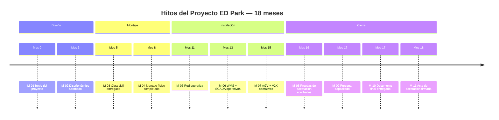
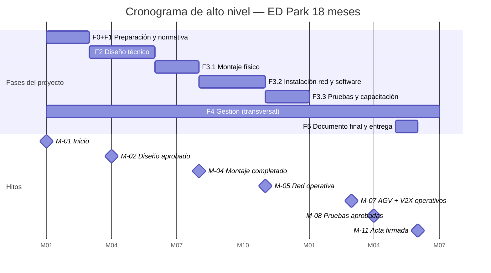

# Pasaporte del Proyecto — ED Park

---

## ПАСПОРТ ПРОЕКТА / FICHA DE PROYECTO

| Campo | Valor |
|-------|-------|
| **Nombre del proyecto** | Implementación del Sistema Completo de Automatización y Telecomunicaciones del ED Park |
| **Código del proyecto** | ED-PARK-2025-001 |
| **Tipo** | Proyecto de infraestructura industrial — diseño virtual académico |
| **Cliente** | Operador del parque logístico ED Park, Matanzas, Cuba |
| **Ejecutor** | Empresa contratista de automatización e integración de sistemas |
| **Director del proyecto** | A definir por el cliente |
| **Fecha de inicio** | Mes 1 del calendario del proyecto |
| **Fecha de fin prevista** | Mes 18 del calendario del proyecto |
| **Plazo total** | **18 meses** |
| **Presupuesto total (variante intermedia)** | **117,000,000 ₽** |
| **Versión del documento** | 1.0 |
| **Estado** | Aprobado para ejecución |

---

## 1. Nombre del proyecto

**Implementación del Sistema Completo de Automatización y Telecomunicaciones del Parque Logístico ED Park — Matanzas, Cuba**

*Proyecto académico de maestría — Asignatura: Управление проектами по созданию индустриальных программных продуктов — Tema Nº 12: Телекоммуникационная инфраструктура*

---

## 2. Objetivo general

Diseñar virtualmente e implementar (en simulación de proyecto) el sistema completo de infraestructura física, telecomunicaciones, software de gestión y equipamiento del parque logístico ED Park en Matanzas, Cuba, garantizando la automatización media de las operaciones logísticas, la cobertura total de las 17 tecnologías de telecomunicaciones del Tema Nº 12 y el cumplimiento de los estándares ГОСТ e IEEE aplicables, dentro de un plazo de 18 meses y un presupuesto de 117,000,000 ₽ (variante intermedia).

---

## 3. Objetivos específicos

| # | Objetivo específico | Indicador de logro | Plazo |
|---|--------------------|--------------------|:-----:|
| OE-01 | Diseñar la infraestructura física del ED Park (5,000 m², 2 naves, 4 muelles) | Plano aprobado por el cliente | Mes 3 |
| OE-02 | Diseñar e implementar la infraestructura de telecomunicaciones con las 17 tecnologías del Tema Nº 12 | 17 tecnologías operativas verificadas | Mes 12 |
| OE-03 | Diseñar e implementar virtualmente el software de gestión (WMS, SCADA, AGV, V2X/V2I, UI) | 8 escenarios de integración aprobados en pruebas | Mes 15 |
| OE-04 | Poner en servicio los 6 AGV/AMR con comunicaciones V2X/V2I | 0 colisiones en prueba de 8 h; ≥ 95 % misiones completadas | Mes 16 |
| OE-05 | Cumplir los requisitos de ciberseguridad SL 2 (ГОСТ Р МЭК 62443-3-3-2016) | 0 vulnerabilidades críticas en escaneo OWASP ZAP | Mes 16 |
| OE-06 | Capacitar al personal operativo y técnico del parque | 100 % del personal aprueba evaluación práctica | Mes 17 |
| OE-07 | Obtener la aceptación formal del cliente con acta firmada | Acta de aceptación firmada | Mes 18 |

---

## 4. Alcance detallado

### 4.1 Incluye

| Categoría | Descripción |
|-----------|-------------|
| **Diseño virtual infraestructura física** | Nave principal 2,000 m², nave recepción/expedición 1,100 m², patio 700 m², aparcamiento 350 m², zona AGV 300 m², oficinas 250 m², área verde 300 m² |
| **Telecomunicaciones** | Las 17 tecnologías del Tema Nº 12: Wi-Fi industrial, Wi-Fi 6/6E, LTE privado, 5G privado, Ethernet, Industrial Ethernet, Mesh, IoT, APs ×14, switches ×10, redundancia, servidores, gateways ×8, edge gateways ×4, PTP, M2M, V2X/V2I |
| **Software** | Diseño virtual de M-01 WMS, M-02 Control AGV, M-03 V2X/V2I, M-04 SCADA, M-05 Integración, M-06 UI |
| **Equipos hardware** | AGV ×6, carretillas ×4, transpaletas ×4, cintas ×3, RFID ×20, básculas ×3, sensores ×76, servidores ×3, climatización ×6, PLC ×4, cámaras ×12 |
| **Montaje** | Estanterías, cintas, muelles, sensores, climatización (~10 semanas) |
| **Instalación** | Cableado, switches, APs, gateways, servidores, VLANs, QoS, redundancia, WMS, SCADA, AGV, integración (~12 semanas) |
| **Pruebas** | 8 bloques de prueba de aceptación técnica (~3 semanas) |
| **Capacitación** | 7 perfiles de personal, 4 módulos, ~5 días |
| **Documentación** | Diseño técnico, planes de montaje/instalación, manuales, acta de aceptación (ГОСТ 7.32-2017) |
| **Gestión** | Pasaporte, WBS, Gantt 18 meses, presupuesto, riesgos, comunicación, variantes |

### 4.2 No incluye

| Exclusión | Justificación |
|-----------|--------------|
| Construcción real del parque (obra civil) | Proyecto virtual académico |
| Compra real de equipos | Proyecto virtual; solo estimación de costos |
| Programación real de software | Solo diseño y planificación virtual |
| Integración real con ERP/TMS del cliente | Solo definición de interfaces y protocolo |
| Certificación oficial de sistemas | Fuera del alcance académico |
| Mantenimiento post-garantía | No contemplado en el proyecto |
| Expansión futura del parque | Solo la variante intermedia actual (5,000 m²) |
| Obra civil, estructura metálica de naves | Responsabilidad del contratista civil |

---

## 5. Stakeholders y sus intereses

| Stakeholder | Rol | Interés principal | Influencia | Estrategia de comunicación |
|-------------|-----|------------------|:----------:|---------------------------|
| **Propietario / Cliente** | Inversor y operador del ED Park | ROI, eficiencia operativa, tiempo de retorno de inversión | Alta | Reportes quincenales de avance; presentaciones de hitos |
| **Director del proyecto** | Gestión ejecutiva del proyecto | Cumplimiento de plazo, presupuesto y calidad | Alta | Reuniones semanales; dashboard de KPIs |
| **Supervisor de operaciones** | Operación diaria del parque | Facilidad de uso, fiabilidad del sistema | Media | Capacitación; manual de operaciones |
| **Operarios de almacén** | Usuarios finales del WMS y terminales | Interfaz intuitiva, apoyo tecnológico, seguridad | Baja | Capacitación práctica; soporte en planta |
| **Técnicos de sistemas** | Administración de red y software | Documentación técnica, herramientas de diagnóstico | Media | Documentación técnica completa; acceso a logs |
| **Especialistas AGV** | Mantenimiento de vehículos autónomos | Diagnóstico fiable, repuestos accesibles | Media | Manual técnico AGV; canal de soporte del fabricante |
| **Equipo de desarrollo software** | Desarrollo virtual del software | Requisitos claros, arquitectura flexible | Media | Especificaciones detalladas; reuniones de diseño |
| **Evaluador académico (profesor)** | Evaluación del proyecto de maestría | Coherencia técnica, aplicación de GOST, formato correcto | Alta | Entrega de documento PDF según ГОСТ 7.32-2017 |
| **Proveedor de equipos AGV** | Suministro y soporte de AGV | Contrato de suministro y soporte técnico | Media | Contrato con SLA; canal técnico dedicado |
| **Autoridades aduaneras cubanas** | Importación de equipos | Cumplimiento de normativa de importación | Media | Gestión anticipada de documentación aduanera |

---

## 6. Criterios de éxito

| # | Criterio | Métrica | Valor objetivo |
|---|---------|---------|:--------------:|
| CS-01 | Cobertura Wi-Fi completa | RSSI ≥ −65 dBm en toda la superficie | 100 % |
| CS-02 | Latencia de control AGV | Latencia VLAN 10 bajo carga máxima | < 5 ms |
| CS-03 | Disponibilidad de red | Uptime anual de la red | ≥ 99.9 % |
| CS-04 | Cero colisiones AGV | Prueba operativa 8 h con 6 AGV | 0 colisiones |
| CS-05 | Seguridad SL 2 | Vulnerabilidades críticas/altas en escaneo | 0 |
| CS-06 | Integración de software | Escenarios end-to-end aprobados | 8/8 |
| CS-07 | Sincronización PTP | Precisión en nodos finales | ±1 µs |
| CS-08 | Personal capacitado | Personal que aprueba evaluación práctica | 100 % |
| CS-09 | Cumplimiento normativo | GOST citados y aplicados correctamente | 12/12 |
| CS-10 | Plazo de entrega | Acta de aceptación firmada | ≤ Mes 18 |
| CS-11 | Presupuesto | Desviación respecto al presupuesto base | ≤ 10 % |
| CS-12 | Satisfacción del cliente | Evaluación del cliente tras la aceptación | ≥ 4/5 |

---

## 7. Restricciones

| Tipo | Restricción | Impacto |
|------|------------|---------|
| **Presupuesto** | Presupuesto máximo: 117,000,000 ₽ (variante intermedia, incluye reserva 30 %) | Limita el alcance de la automatización y los equipos |
| **Plazo** | Plazo total máximo: 18 meses desde el inicio del proyecto | Determina la ruta crítica y los recursos necesarios |
| **Superficie** | Superficie total fija: 5,000 m² (0.5 ha) | Limita la capacidad de almacenamiento y las rutas de AGV |
| **Automatización** | Nivel de automatización medio: 5–8 AGV | No se incluye almacén totalmente autónomo |
| **Normativa** | Cumplimiento obligatorio de los 12 GOST/IEEE identificados | Todas las decisiones técnicas deben estar respaldadas por norma |
| **Formato académico** | Documento final según ГОСТ 7.32-2017, bibliografía según ГОСТ 7.1-2003 | Condiciona el formato de toda la documentación |
| **Entorno** | Clima tropical de Matanzas (T° máx. ~38 °C, HR ~85 %) | Equipos industriales deben estar certificados para estas condiciones |
| **Regulatorio Cuba** | Normativa de importación de equipos electrónicos en Cuba | Riesgo de retraso en aduanas; gestión anticipada necesaria |

---

## 8. Supuestos del proyecto

| # | Supuesto |
|---|---------|
| SA-01 | La obra civil (naves, muelles, instalación eléctrica básica) está completada antes del inicio de la Fase 3 |
| SA-02 | El cliente proporciona acceso 24/7 al sitio durante las fases de montaje e instalación |
| SA-03 | Los equipos importados (AGV, switches, APs, gateways) se reciben sin daños y en los plazos acordados |
| SA-04 | El cliente tiene un ERP con API documentada para la integración (M-05) |
| SA-05 | El personal operativo del cliente tiene conocimientos básicos de informática y manejo de terminales |
| SA-06 | Las licencias de software (WMS, SCADA) se adquieren antes del inicio de la Fase 3 |
| SA-07 | El presupuesto de 117,000,000 ₽ está aprobado y disponible al inicio del proyecto |
| SA-08 | El tipo de cambio ₽/USD se mantiene estable (±10 %) durante los 18 meses |
| SA-09 | No habrá restricciones adicionales de importación en Cuba durante el período del proyecto |
| SA-10 | El evaluador académico (profesor) acepta el formato del documento según ГОСТ 7.32-2017 |

---

## 9. Exclusiones del proyecto

Las siguientes actividades y entregables están explícitamente fuera del alcance del proyecto:

1. **Obra civil**: construcción de naves, cimentaciones, techos, instalación eléctrica principal — responsabilidad del contratista civil.
2. **Compra real de equipos**: los equipos se definen y presupuestan virtualmente; la adquisición real es responsabilidad del cliente.
3. **Código fuente de software**: no se desarrolla ningún software real; solo se diseña virtualmente.
4. **Conexión real a Internet o WAN exterior**: solo se diseña la arquitectura de conectividad.
5. **Certificación oficial** de los sistemas ante organismos reguladores cubanos o rusos.
6. **Mantenimiento y soporte post-garantía**: el proyecto cubre la garantía de 12 meses tras la aceptación.
7. **Expansión del parque** más allá de los 5,000 m² definidos en la variante intermedia.
8. **Integración con sistemas gubernamentales cubanos** (aduanas, logística nacional): fuera del alcance del proyecto privado.

---

## 10. Entregables principales

| # | Entregable | Fase | Responsable | Hito asociado |
|---|-----------|:----:|------------|:-------------:|
| E-01 | Documento de diseño técnico completo (03_01 a 03_07) | 2 | Equipo técnico | M-02 |
| E-02 | Plan de montaje aprobado (04_01) | 3 | Supervisor de montaje | M-03 |
| E-03 | Plan de instalación aprobado (04_02) | 3 | Técnico senior de redes | M-04 |
| E-04 | Red de telecomunicaciones instalada y certificada | 3 | Técnico senior de redes | M-05 |
| E-05 | Software WMS operativo | 3 | Equipo de desarrollo | M-06 |
| E-06 | Sistema de control AGV + V2X operativo | 3 | Equipo AGV + redes | M-07 |
| E-07 | Informes de pruebas de aceptación (PT-01 a PT-08) | 3 | Técnico de calidad | M-08 |
| E-08 | Personal capacitado (certificados de capacitación) | 3 | Responsable de formación | M-09 |
| E-09 | Documento final del proyecto (PDF, ГОСТ 7.32-2017) | 5 | Director del proyecto | M-10 |
| E-10 | Acta de aceptación firmada por el cliente | 3/5 | Director del proyecto | M-11 |

---

## 11. Hitos clave

| ID | Hito | Mes | Descripción |
|----|------|:---:|-------------|
| M-01 | Inicio del proyecto | 0 | Firma del contrato y aprobación del presupuesto |
| M-02 | Diseño técnico aprobado | 3 | Planos, arquitectura de red, diseño software aprobados por el cliente |
| M-03 | Obra civil entregada | 5 | Naves y muelles listos para inicio de montaje |
| M-04 | Montaje físico completado | 8 | MT-01 a MT-08 aprobados; todos los equipos físicos instalados |
| M-05 | Red de telecomunicaciones operativa | 11 | IT-01 a IT-08 aprobados; red certificada y VLANs activas |
| M-06 | Software WMS + SCADA operativo | 13 | IT-09 e IT-10 aprobados; datos maestros cargados |
| M-07 | Sistema AGV + V2X operativo | 15 | IT-11 aprobado; AGV navegando con V2X activo |
| M-08 | Pruebas de aceptación aprobadas | 16 | PT-01 a PT-08 APROBADOS; informe firmado |
| M-09 | Personal capacitado | 17 | C-01 a C-04 completados; evaluaciones aprobadas al 100 % |
| M-10 | Documento final entregado | 17 | PDF según ГОСТ 7.32-2017 entregado al evaluador académico |
| M-11 | Acta de aceptación firmada | 18 | Entrega formal al cliente; inicio del período de garantía |

---

## 12. Presupuesto preliminar

### 12.1 Desglose por categoría

| Categoría | Costo base (₽) | % del total |
|-----------|:--------------:|:-----------:|
| Hardware — AGV/AMR ×6 | 21,000,000 | 23.3 % |
| Hardware — Telecomunicaciones | 14,770,000 | 16.4 % |
| Hardware — Equipos operativos (carretillas, cintas, RFID, etc.) | 8,627,000 | 9.6 % |
| Hardware — Servidores, SAI, climatización | 3,795,000 | 4.2 % |
| Software — Desarrollo virtual (74 persona-mes) | 7,400,000 | 8.2 % |
| Montaje — Mano de obra | 1,380,000 | 1.5 % |
| Instalación — Red y software | 1,195,000 | 1.3 % |
| Puesta en marcha y pruebas | 400,000 | 0.4 % |
| Gestión del proyecto (director, equipo PM) | 4,500,000 | 5.0 % |
| Documentación y formación | 500,000 | 0.6 % |
| Imprevistos técnicos (contingencia 5 %) | 3,228,350 | 3.6 % |
| **Costo base total** | **66,795,350** | **74.1 %** |
| **Reserva de riesgos (30 %)** | **20,038,605** | **22.2 %** |
| **IVA y gastos financieros (estimado 5 %)** | **3,341,768** | **3.7 %** |
| **PRESUPUESTO TOTAL** | **90,175,723 ₽** | **100 %** |

> **Nota**: El presupuesto de la variante intermedia es de **117,000,000 ₽** incluyendo el beneficio empresarial del contratista (~30 % sobre costo), lo que resulta en un precio de venta al cliente de 117,000,000 ₽ (coherente con lo definido en `01_Fase_0_Preparacion.md`).

### 12.2 Resumen por variante

| Variante | Costo base (₽) | Reserva riesgos (30 %) | **Precio total (₽)** |
|----------|:--------------:|:----------------------:|:-------------------:|
| Básica | 67,500,000 | 20,250,000 | **87,750,000** |
| **Intermedia (recomendada)** | **90,000,000** | **27,000,000** | **117,000,000** |
| Completa | 112,500,000 | 33,750,000 | **146,250,000** |

### 12.3 Flujo de caja estimado por fases

| Fase | Mes | Gasto estimado (₽) | % acumulado |
|------|:---:|:-----------------:|:-----------:|
| Fase 0+1 — Diseño y normativa | 1–3 | 5,000,000 | 5.6 % |
| Fase 2 — Diseño técnico | 3–5 | 8,000,000 | 14.4 % |
| Fase 3.1 — Montaje | 5–8 | 25,000,000 | 42.7 % |
| Fase 3.2 — Instalación | 8–13 | 20,000,000 | 64.9 % |
| Fase 3.3 — Pruebas + capacitación | 13–17 | 10,000,000 | 76.0 % |
| Fase 4–5 — Gestión + cierre | 15–18 | 21,595,350 | 100.0 % |
| **TOTAL VARIANTE INTERMEDIA** | **18 meses** | **~90,000,000** | |

---

## 13. Plazo estimado

**Duración total del proyecto: 18 meses**

| Fase | Descripción | Duración | Meses |
|------|-------------|:--------:|:-----:|
| Fase 0 + 1 | Preparación, encuadre e investigación normativa | 2 meses | 1–2 |
| Fase 2 | Diseño técnico completo (infraestructura, telecom, software, hardware) | 3 meses | 2–5 |
| Fase 3.1 | Montaje físico de equipos | 2.5 meses | 5–8 |
| Fase 3.2 | Instalación de red y software | 3 meses | 8–13 |
| Fase 3.3 | Puesta en marcha, pruebas y capacitación | 1.5 meses | 13–17 |
| Fase 4 | Gestión del proyecto (transversal) | 18 meses | 1–18 |
| Fase 5 | Documento final y entrega | 1 mes | 17–18 |

---

## 14. Firma y aprobación

| Rol | Nombre | Firma | Fecha |
|-----|--------|-------|-------|
| Director del proyecto | | _________________ | ________ |
| Representante del cliente | | _________________ | ________ |
| Evaluador académico (profesor) | | _________________ | ________ |

---

## 15. Checklist de la sección

- [x] 4.1.1 Nombre del proyecto y código definidos
- [x] 4.1.2 Objetivo general del proyecto (SMART)
- [x] 4.1.3 7 objetivos específicos con indicador de logro y plazo
- [x] 4.1.4 Alcance detallado — qué incluye (10 categorías)
- [x] 4.1.5 Alcance detallado — qué NO incluye (8 exclusiones)
- [x] 4.1.6 Tabla de stakeholders (10 partes interesadas, rol, interés, influencia, comunicación)
- [x] 4.1.7 12 criterios de éxito con métrica y valor objetivo
- [x] 4.1.8 8 tipos de restricciones (presupuesto, plazo, superficie, normativa, formato, entorno, regulatorio)
- [x] 4.1.9 10 supuestos del proyecto
- [x] 4.1.10 8 exclusiones explícitas del proyecto
- [x] 4.1.11 10 entregables principales con fase, responsable e hito
- [x] 4.1.12 11 hitos clave con mes y descripción
- [x] 4.1.13 Diagrama de hitos en formato Mermaid (timeline)
- [x] 4.1.14 Presupuesto preliminar desglosado por categoría (costo base + reserva 30 %)
- [x] 4.1.15 Tabla comparativa de 3 variantes (básica/intermedia/completa)
- [x] 4.1.16 Flujo de caja estimado por fases
- [x] 4.1.17 Cronograma de alto nivel 18 meses (Mermaid Gantt)
- [x] 4.1.18 Tabla de plazo por fase
- [x] 4.1.19 Bloque de firma y aprobación (director, cliente, profesor)
- [x] 4.1.20 Coherencia con todas las secciones previas del proyecto

---

## 16. Conclusión

El pasaporte del proyecto establece el marco formal y contractual del ED Park como proyecto de automatización e integración de sistemas. Define con precisión el alcance (qué se hace y qué no), los objetivos medibles, los criterios de aceptación, las restricciones operativas y el presupuesto de la variante intermedia recomendada (117,000,000 ₽). La duración de 18 meses distribuida en 5 fases operativas es coherente con la complejidad del sistema (17 tecnologías de telecomunicaciones, 6 módulos de software, 6 AGV, ~293 equipos hardware) y con los recursos humanos planificados. Este documento es el punto de referencia central para el control del proyecto, la comunicación con el cliente y la evaluación académica del trabajo.
