# 05_03 - Cronograma Gantt - Proyecto ED Park

## Objetivo de la sección

Definir el cronograma maestro del proyecto ED Park mediante un diagrama de Gantt que visualice la secuencia temporal de todas las tareas, sus duraciones, dependencias, hitos y la ruta crítica. Establece un plazo total de 18 meses como referencia de planificación y control del proyecto. Coherente con el WBS (05_02) y el Pasaporte del Proyecto (05_01).

---

## 1. Fases del proyecto (18 meses)

| Fase | Código | Duración | Periodo estimado | Objetivo |
|------|--------|----------|------------------|----------|
| Análisis | 1.1 | ~3 meses | Nov 2026 – Ene 2027 | Requisitos, normativa, suelo y viabilidad |
| Diseño | 1.2 | ~6 meses | Ene 2027 – Jul 2027 | Arquitectura, ingeniería, licencias |
| Desarrollo | 1.3 | ~7 meses | Mar 2027 – Sep 2027 | Adquisiciones, WMS, sistemas |
| Montaje | 1.4 | ~9 meses | Jul 2027 – Feb 2028 | Construcción e instalación de naves |
| Pruebas | 1.5 | ~3 meses | Ene 2028 – Mar 2028 | Validación técnica y operativa |
| Despliegue | 1.6 | ~2 meses | Feb 2028 – Abr 2028 | Formación, producción y cierre |

> **Plazo total planificado:** 18 meses (nov 2026 – abr/maj 2028), incluyendo margen de contingencia.

---

## 2. Diagrama de Gantt (Mermaid)

```mermaid
timeline
    title Proyecto ED Park - Cronograma (18 meses)
    section Análisis
        Estudio de normativa aplicable : 2026-11-02 : 2026-11-30
        Selección y adquisición de suelo : 2026-11-02 : 2027-01-09 : M1: Terreno adquirido
        Estudio de viabilidad técnica y económica : 2026-12-02 : 2027-01-13
        Definición de requisitos funcionales : 2026-12-02 : 2026-12-30
        Estudio de impacto ambiental : 2026-12-02 : 2027-01-27
    section Diseño
        Diseño arquitectónico de naves : 2027-01-04 : 2027-02-14
        Diseño estructural : 2027-02-15 : 2027-03-22
        Diseño de instalaciones : 2027-02-15 : 2027-03-22
        Diseño de muelles y patio : 2027-02-15 : 2027-03-08
        Diseño de estanterías y almacenamiento : 2027-02-15 : 2027-03-08
        Diseño de oficinas y sala de control : 2027-02-15 : 2027-03-08
        Memoria de seguridad y salud : 2027-03-22 : 2027-04-12
        Tramitación de licencias y permisos : 2027-03-22 : 2027-07-11 : M2: Licencia concedida
    section Desarrollo
        Adquisición de estanterías y equipos : 2027-03-22 : 2027-05-17
        Adquisición de carretillas y AGV : 2027-03-22 : 2027-05-31
        Desarrollo e implementación de WMS : 2027-04-12 : 2027-07-04
        Instalación de red y comunicaciones : 2027-07-05 : 2027-08-16
        Instalación de videovigilancia y accesos : 2027-07-05 : 2027-08-16
        Compra de mobiliario y equipamiento : 2027-07-05 : 2027-08-16
    section Montaje
        Obras de cimentación y estructura : 2027-07-11 : 2027-11-28 : M3: Estructura terminada
        Instalación de pavimentos y muelles : 2027-11-01 : 2027-12-26
        Montaje de instalaciones técnicas : 2027-11-01 : 2028-01-09
        Montaje de estanterías y almacenamiento : 2027-11-29 : 2028-01-09
        Montaje de oficinas y sala de control : 2027-11-29 : 2028-01-09
        Montaje de zona de carga AGV : 2028-01-10 : 2028-02-06
    section Pruebas
        Pruebas de instalaciones técnicas : 2028-01-10 : 2028-02-06
        Pruebas de estanterías y capacidad : 2028-01-10 : 2028-01-23
        Pruebas de WMS y comunicaciones : 2028-01-10 : 2028-02-06
        Pruebas de AGV y zona de carga : 2028-02-07 : 2028-02-20
        Pruebas de seguridad y evacuación : 2028-02-07 : 2028-02-20
        Puesta en marcha en vacío : 2028-02-21 : 2028-03-06
    section Despliegue
        Formación de personal operativo : 2028-02-21 : 2028-03-19
        Carga inicial de mercancía : 2028-03-06 : 2028-03-19
        Puesta en producción : 2028-03-20 : 2028-03-26 : M4: Producción iniciada
        Entrega y cierre del proyecto : 2028-03-20 : 2028-04-16 : M5: Proyecto cerrado
```



---

## 3. Lista de tareas con detalle

| ID | Nombre | Duración | Inicio | Fin | Predecesoras | Recursos | Hito |
|----|--------|----------|--------|-----|--------------|----------|------|
| 1.1.1 | Estudio de normativa aplicable | 4 semanas | 2026-11-02 | 2026-11-30 | — | Arquitecto, Ingeniero legal | |
| 1.1.2 | Selección y adquisición de suelo | 10 semanas | 2026-11-02 | 2027-01-09 | — | Gestor inmobiliario, Abogado | M1: Terreno adquirido |
| 1.1.3 | Estudio de viabilidad técnica y económica | 6 semanas | 2026-12-02 | 2027-01-13 | 1.1.1 | Consultor financiero, Ingeniero | |
| 1.1.4 | Definición de requisitos funcionales | 4 semanas | 2026-12-02 | 2026-12-30 | 1.1.1 | Analista funcional, Cliente | |
| 1.1.5 | Estudio de impacto ambiental | 8 semanas | 2026-12-02 | 2027-01-27 | 1.1.1 | Consultor ambiental | |
| 1.2.1 | Diseño arquitectónico de naves | 6 semanas | 2027-01-04 | 2027-02-14 | 1.1.4, 1.1.5 | Arquitecto | |
| 1.2.2 | Diseño estructural | 5 semanas | 2027-02-15 | 2027-03-22 | 1.2.1 | Ingeniero estructural | |
| 1.2.3 | Diseño de instalaciones | 5 semanas | 2027-02-15 | 2027-03-22 | 1.2.1 | Ingeniero de instalaciones | |
| 1.2.4 | Diseño de muelles y patio | 3 semanas | 2027-02-15 | 2027-03-08 | 1.2.1 | Ingeniero civil | |
| 1.2.5 | Diseño de estanterías y almacenamiento | 3 semanas | 2027-02-15 | 2027-03-08 | 1.2.1 | Ingeniero logístico | |
| 1.2.6 | Diseño de oficinas y sala de control | 3 semanas | 2027-02-15 | 2027-03-08 | 1.2.1 | Arquitecto | |
| 1.2.7 | Memoria de seguridad y salud | 3 semanas | 2027-03-22 | 2027-04-12 | 1.2.2, 1.2.3 | Coordinador de seguridad | |
| 1.2.8 | Tramitación de licencias y permisos | 16 semanas | 2027-03-22 | 2027-07-11 | 1.2.1, 1.2.7 | Gestor administrativo | M2: Licencia concedida |
| 1.3.1 | Adquisición de estanterías y equipos | 8 semanas | 2027-03-22 | 2027-05-17 | 1.2.5 | Compras, Ingeniero logístico | |
| 1.3.2 | Adquisición de carretillas y AGV | 10 semanas | 2027-03-22 | 2027-05-31 | 1.2.5 | Compras, Ingeniero logístico | |
| 1.3.3 | Desarrollo e implementación de WMS | 12 semanas | 2027-04-12 | 2027-07-04 | 1.1.4 | Desarrollador software, Consultor WMS | |
| 1.3.4 | Instalación de red y comunicaciones | 6 semanas | 2027-07-05 | 2027-08-16 | 1.2.3 | Ingeniero de sistemas | |
| 1.3.5 | Instalación de videovigilancia y accesos | 6 semanas | 2027-07-05 | 2027-08-16 | 1.2.3 | Proveedor seguridad | |
| 1.3.6 | Compra de mobiliario y equipamiento oficinas | 6 semanas | 2027-07-05 | 2027-08-16 | 1.2.6 | Compras, RRHH | |
| 1.4.1 | Obras de cimentación y estructura | 20 semanas | 2027-07-11 | 2027-11-28 | 1.2.8 | Constructor, Ingeniero estructural | M3: Estructura terminada |
| 1.4.2 | Instalación de pavimentos y muelles | 8 semanas | 2027-11-01 | 2027-12-26 | 1.4.1 | Constructor, Ingeniero civil | |
| 1.4.3 | Montaje de instalaciones técnicas | 10 semanas | 2027-11-01 | 2028-01-09 | 1.4.1 | Instalador autorizado | |
| 1.4.4 | Montaje de estanterías y zonas de almacenamiento | 6 semanas | 2027-11-29 | 2028-01-09 | 1.4.1, 1.3.1 | Montador de estanterías | |
| 1.4.5 | Montaje de oficinas y sala de control | 6 semanas | 2027-11-29 | 2028-01-09 | 1.4.1, 1.3.6 | Constructor | |
| 1.4.6 | Montaje de zona de carga AGV | 4 semanas | 2028-01-10 | 2028-02-06 | 1.4.3, 1.3.2 | Ingeniero logístico, Electricista | |
| 1.5.1 | Pruebas de instalaciones técnicas | 4 semanas | 2028-01-10 | 2028-02-06 | 1.4.3 | Ingeniero de instalaciones | |
| 1.5.2 | Pruebas de estanterías y capacidad de carga | 2 semanas | 2028-01-10 | 2028-01-23 | 1.4.4 | Ingeniero estructural | |
| 1.5.3 | Pruebas de WMS y comunicaciones | 4 semanas | 2028-01-10 | 2028-02-06 | 1.4.3, 1.3.3 | Consultor WMS | |
| 1.5.4 | Pruebas de AGV y zona de carga | 2 semanas | 2028-02-07 | 2028-02-20 | 1.4.6, 1.5.3 | Proveedor AGV | |
| 1.5.5 | Pruebas de seguridad y evacuación | 2 semanas | 2028-02-07 | 2028-02-20 | 1.4.5, 1.2.7 | Coordinador de seguridad | |
| 1.5.6 | Puesta en marcha en vacío | 2 semanas | 2028-02-21 | 2028-03-06 | 1.5.1, 1.5.3, 1.5.4 | Equipo operativo | |
| 1.6.1 | Formación de personal operativo | 4 semanas | 2028-02-21 | 2028-03-19 | 1.5.6 | Formador, RRHH | |
| 1.6.2 | Carga inicial de mercancía | 2 semanas | 2028-03-06 | 2028-03-19 | 1.5.6 | Equipo operativo | |
| 1.6.3 | Puesta en producción | 1 semana | 2028-03-20 | 2028-03-26 | 1.6.1, 1.6.2 | Director de operaciones | M4: Producción iniciada |
| 1.6.4 | Entrega y cierre del proyecto | 4 semanas | 2028-03-20 | 2028-04-16 | 1.6.3 | Project Manager | M5: Proyecto cerrado |

---

## 4. Hitos principales

| Hito | ID asociado | Fecha estimada | Descripción |
|------|-------------|----------------|-------------|
| M1 | 1.1.2 | 2027-01-09 | Terreno adquirido y disponible para obra |
| M2 | 1.2.8 | 2027-07-11 | Licencia de obras concedida por el ayuntamiento |
| M3 | 1.4.1 | 2027-11-28 | Estructura de ambas naves terminada |
| M4 | 1.6.3 | 2028-03-26 | Puesta en producción: inicio de operaciones reales |
| M5 | 1.6.4 | 2028-04-16 | Proyecto entregado y cerrado administrativamente |

---

## 5. Ruta crítica identificada

La ruta crítica es la secuencia de tareas que determina la duración mínima del proyecto (sin holgura). Cualquier retraso en estas tareas retrasa directamente la fecha de entrega final.

**Ruta crítica:**
```
1.1.1 Estudio normativa → 1.1.4 Requisitos funcionales → 
1.2.1 Diseño arquitectónico → 1.2.8 Licencias y permisos →
1.4.1 Cimentación y estructura → 1.4.3 Instalaciones técnicas →
1.4.4 Montaje estanterías → 1.5.1 Pruebas instalaciones →
1.5.6 Puesta en marcha en vacío → 1.6.1 Formación personal →
1.6.4 Entrega y cierre
```

**Duración de la ruta crítica:** aproximadamente 17 meses.  
**Margen de contingencia:** ~1 mes dentro de los 18 meses planificados.

Tareas en ruta crítica (marcadas con `crit` en el diagrama): 1.1.2, 1.1.4, 1.2.1, 1.2.8, 1.4.1, 1.4.3, 1.4.4, 1.5.1, 1.5.6, 1.6.1, 1.6.3, 1.6.4.

---

## 6. Checklist de la sección

- [x] Objetivo de la sección definido y alineado con el WBS (05_02)
- [x] Diagrama de Gantt completo en Mermaid con las 6 fases
- [x] Lista de tareas con ID, nombre, duración, inicio, fin, predecesoras, recursos y hito
- [x] Todas las tareas del WBS (1.1.x a 1.6.x) reflejadas en el cronograma
- [x] Ruta crítica identificada y señalada en el diagrama y en el texto
- [x] Hitos principales definidos (M1 a M5) con fechas estimadas
- [x] Plazo total de 18 meses respetado con margen de contingencia
- [x] Dependencias entre tareas coherentes con el WBS
- [x] Recursos asignados a cada tarea
- [x] Medidas coherentes con el ED Park (5,000 m², 4 muelles, 6 AGV)
- [x] Documento revisado por el Project Manager

---
*Documento generado como parte del expediente de gestión de proyecto del proyecto ED Park - Fase 5: Gestión de Proyecto*